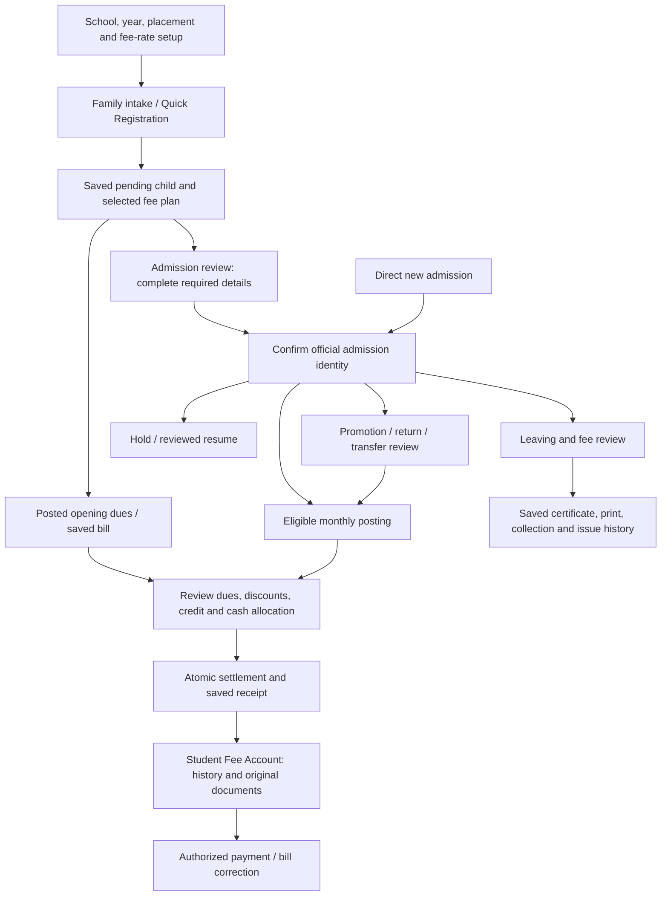

# Consolidated audit history

These are dated records, not current release certification. All original narrative, finding IDs,
reviewed revisions, test results and caveats are retained below. Only heading levels and local
links have been adjusted for consolidation. [Master audit](FMSC_MASTER_AUDIT.md) remains the status
register; [business rules](../Docs/BUSINESS_DECISIONS.md) and [C# policy record](../Core/BusinessDecisions.cs) distinguish current decisions from earlier proposals.

- [FMSC_SMS end-user flow audit — 14 October 2026](#fmsc-end-user-flow-audit-2026-10-14)
- [PDF and financial RDLC presentation review — 2 November 2026](#fmsc-pdf-finance-presentation-2026-11-02)
- [FMSC_SMS — Independent Post-Merge Project Audit](#fmsc-post-merge-project-audit-2026-10-14)
- [Student fee-posting hold and resume: owner discussion](#fmsc-student-hold-resume-discussion-2026-10-21)
- [FMSC — UI Wording, Guidance & Consistency Audit](#fmsc-ui-guidance-audit-2026-10-20)
- [UI improvement review](#ui-improvements-review)
- [Audit fix verification — 13 October 2026](#audit-fix-verification-2026-10-13)
- [Admission and fee-flow audit — 28 October 2026](#admission-fee-flow-audit-2026-10-28)
- [FMSC: comprehensive independent billing and system audit](#codex-cloud-billing-audit)
- [System redundancy review — 28 October 2026](#redundancy-audit-2026-10-28)
- [Help & FAQ source audit — 2026-10-16](#faq-audit-report)

<a id="fmsc-end-user-flow-audit-2026-10-14"></a>
<!-- BEGIN preserved-source: Audit/Reviews/FMSC_END_USER_FLOW_AUDIT_2026-10-14.md -->
Original source: `Audit/Reviews/FMSC_END_USER_FLOW_AUDIT_2026-10-14.md`. Original SHA-256: `2ab925843abdb7d0ec0bb476cb7871e4310265a819829d848855bb41e94f4525`.

<a id="fmsc-end-user-flow-audit-2026-10-14-fmsc_sms-end-user-flow-audit--14-october-2026"></a>
## FMSC_SMS end-user flow audit — 14 October 2026

Reviewed source: [`14aba80a8751322e04aa028f960e0a68efaf08f2`](https://github.com/farhan2166-creator/FMSC-Database/tree/14aba80a8751322e04aa028f960e0a68efaf08f2), the latest `main` checked both at the start and end of source review. Audit branch: `audit/end-user-flow`.

This is a **source-backed operator-flow review**, covering startup, the dashboard, each form/page/dialog, report workflows, retained compatibility screens, shared controls and all 20 RDLC templates. It is not an interactive Windows acceptance test. No application, installer, SQL, permission or financial behavior was changed.

<a id="fmsc-end-user-flow-audit-2026-10-14-result"></a>
### Result

**Nine confirmed source-level findings: two High, six Medium, one Low.** The most urgent are the certificate creation re-entry path and dialogs that can close during a database write. Another concrete reporting defect prevents daily closing summaries from printing when the day includes refunds or corrections.

The core workflows already have useful protections: explicit student/placement context, optional phone entry, pending registrations and family links, whole-rupee payment validation, transaction outcome recovery, prepared-photo retry, latest-read guards, report filter signatures, bounded logo/photo input, atomic export replacement and restore safety backups. Those should be preserved when fixing the gaps below.

“No additional finding” in the coverage tables means no further source-level flow gap was established in that review. It does not mean the screen passed live database, printer, DPI or accessibility acceptance.

<a id="fmsc-end-user-flow-audit-2026-10-14-confirmed-findings"></a>
### Confirmed findings

<a id="fmsc-end-user-flow-audit-2026-10-14-ufa-01--certificate-field-changes-can-re-enable-create-during-an-outstanding-write"></a>
#### UFA-01 — Certificate field changes can re-enable Create during an outstanding write

**High · Sports, Provisional and No Objection certificates.**

Operator sequence: select a student, complete a valid certificate, click Create, then change a still-enabled field before the database reply. For Sports, edit performance; for Provisional, edit a valid board/result field; for NOC, change the certificate date. Create can become enabled again and accept another click.

The click handlers disable only the student picker, records grid and Create button. Field-change handlers call `ApplyWorkflowState()`, which sets the picker and Create enabled without consulting `creatingCertificate`. The click handler checks the button's enabled state but does not refuse when `creatingCertificate` is already true. A second call also shares the same Boolean; completion of one call can release the shell busy guard while another call remains pending.

Evidence: [Sports handlers/state](../Pages/Students/Certificates/SportsCertificatePage.cs#L56), [Sports field events](../Pages/Students/Certificates/SportsCertificatePage.cs#L183), [Sports state](../Pages/Students/Certificates/SportsCertificatePage.cs#L342); [Provisional handlers](../Pages/Students/Certificates/ProvisionalCertificatePage.cs#L116), [events](../Pages/Students/Certificates/ProvisionalCertificatePage.cs#L432), [state](../Pages/Students/Certificates/ProvisionalCertificatePage.cs#L895); [NOC handlers](../Pages/Students/Certificates/NoObjectionCertificatePage.cs#L49), [events](../Pages/Students/Certificates/NoObjectionCertificatePage.cs#L171), [state](../Pages/Students/Certificates/NoObjectionCertificatePage.cs#L322).

The reviewed DACPAC definitions of `CreateSportsCertificate`, `CreateProvisionalCertificate` and `CreateNoObjectionCertificate` each insert a new certificate per successful invocation; they do not deduplicate the submitted request. The procedure transaction protects each individual write, but does not prevent this second submission. No duplicate was created in a real database during this audit.

Fix scope: use one operation guard at the submission boundary; make all enabled-state calculations respect it; hold inputs, record changes, Refresh and Next Student for the full operation; capture the submitted values once. Test with a deliberately delayed, injected write and field-change/second-click attempts. Do not change certificate business rules merely to mask the UI issue.

<a id="fmsc-end-user-flow-audit-2026-10-14-ufa-02--admission-closure-and-legacy-go-live-dialogs-can-close-while-sql-is-running"></a>
#### UFA-02 — Admission closure and legacy go-live dialogs can close while SQL is running

**High · Cancel Registration / Mark as Left and Finish Legacy Setup / Go Live.**

Operator sequence: click Apply or Confirm & Go Live, then use the title-bar close or Alt+F4 before the reply. The content is disabled, but there is no `FormClosing` busy guard. The custom window caption is outside that disabled content. The modal caller can resume with `Changed == false`, skip its refresh and dispose the dialog while the operation is still outstanding. SQL may complete even though the operator appears to have cancelled the window.

Evidence: [CloseAdmissionDialog](../Pages/Students/Admissions/AdmissionLifecycleDialogs.cs#L4), [LegacyGoLiveDialog](../Pages/Students/Admissions/AdmissionLifecycleDialogs.cs#L40), [admission caller](../Pages/Students/Admissions/StudentAdmissionPage.cs#L3789), [legacy caller](../Pages/Students/Maintenance/StudentDataReviewPage.cs#L65), [caption creation](../Core/ApplicationWindowForm.cs#L49).

Closure Review also leaves its date/reason/reversal inputs editable during the preview read, allowing an obsolete response to become the displayed plan. The reviewed `CloseStudentAdmission` SQL snapshot includes the date, reason and reversal choice, so Apply rejects a mismatched plan; **this is not evidence that SQL applies an unreviewed financial plan**. `FinishLegacyAdmissionSetup` likewise enforces its reviewed snapshot.

Fix scope: an explicit busy flag and close guard for both preview/write lifetimes; invalidate obsolete preview replies; keep the result attached to the submitted operation and distinguish a confirmed write from a failed refresh. Test title-bar close, Escape and Alt+F4 with delayed replies and failures. Preserve the SQL snapshot and transaction checks.

<a id="fmsc-end-user-flow-audit-2026-10-14-ufa-03--some-embedded-editors-do-not-forward-their-leave-protection"></a>
#### UFA-03 — Some embedded editors do not forward their leave protection

**Medium · Classes & Sections; the Bulk Fee Rate Changes tab.**

In Classes & Sections, type a class/section draft or start Save, then navigate Home, refresh the page or sign out. `ClassesAndSectionsWorkspacePage` implements neither `IUnsavedChanges` nor `IBusyPage`, despite its inner `MasterPage` editors implementing both. The shell examines only its current outer control.

For Bulk Fee Rate Changes, change the adjustment value in its embedded tab, then leave the fee-configuration workspace. Its `IsDirty()`/`FormClosing` guard protects the standalone modal form, but it does not implement `IUnsavedChanges`. Disposing an embedded form during navigation does not invoke its modal close guard. Merely switching a tab retains the editor and is not the loss being reported.

Evidence: [Classes & Sections host](../Pages/Setup/Academics/ClassesAndSectionsWorkspacePage.cs#L3), [Master contracts](../Core/MasterPage.cs#L6), [shell leave check](../MainDashboardForm.cs#L1637), [fee workspace](../Pages/Finance/Configuration/FeeConfigurationWorkspace.cs#L8), [Bulk close guard](../Pages/Finance/Configuration/BulkFeeRateChangesForm.cs#L161), [Bulk dirty state](../Pages/Finance/Configuration/BulkFeeRateChangesForm.cs#L590), [workspace aggregation](../Core/WorkspacePage.cs).

Fix scope: forward the child contracts in the composite workspace; expose the existing Bulk dirty state through the same contract. Preserve the owner's explicit Clear/New behavior. Test actual shell leave, refresh and sign-out against both an entered draft and a delayed class/section save.

<a id="fmsc-end-user-flow-audit-2026-10-14-ufa-04--new-sports-and-provisional-certificate-drafts-are-not-tracked"></a>
#### UFA-04 — New Sports and Provisional certificate drafts are not tracked

**Medium · Entered certificate content can disappear without a leave warning.**

Select a student and enter a sport/performance, or a board result with roll number, marks and subjects, without saving it. Navigate away or select another student. Both pages report dirty state only when a **saved certificate ID is greater than zero**. Their new business-content draft is therefore invisible to shell leave and student-change protection.

Evidence: [Sports dirty state](../Pages/Students/Certificates/SportsCertificatePage.cs#L6), [Sports selection guard](../Pages/Students/Certificates/SportsCertificatePage.cs#L100), [Provisional dirty state](../Pages/Students/Certificates/ProvisionalCertificatePage.cs#L6), [Provisional selection guard](../Pages/Students/Certificates/ProvisionalCertificatePage.cs#L160). Compare the established [Regular Student draft handling](../Pages/Students/Certificates/RegularStudentCertificatePage.cs#L10) and [Bank certificate baseline](../Pages/Staff/Certificates/BankAccountOpeningCertificatePage.cs#L16).

Fix scope: track substantive new content as well as saved-record edits, using a baseline after the selected student's defaults finish loading. Leave date-only untouched dialogs consistent with the owner's accepted policy; do not introduce a prompt simply because someone opened a certificate page.

<a id="fmsc-end-user-flow-audit-2026-10-14-ufa-05--admission-and-collection-fields-remain-editable-during-submission"></a>
#### UFA-05 — Admission and collection fields remain editable during submission

**Medium · Edits made while waiting can be silently overwritten.**

In Admission, click Save and type into a still-enabled name/contact/address/detail field while the SQL response is delayed. Save holds find/new/quick-selection and, for a new admission, numbering inputs; it does not hold the complete editor. The confirmed save subsequently reloads the student, replacing values typed after submission.

In Fee Collection, Process freezes student, enrollment and siblings, but leaves amount/discount/reference/remarks and allocation controls available. A change made during the outstanding collection is not part of its already-captured parameters; post-commit refresh/reset clears those entries. This can look as though the later entry was accepted when it was never submitted.

Evidence: [Admission Save lifetime](../Pages/Students/Admissions/StudentAdmissionPage.cs#L4230), [new numbering hold](../Pages/Students/Admissions/StudentAdmissionPage.cs#L4272), [existing save/reload](../Pages/Students/Admissions/StudentAdmissionPage.cs#L4588), [collection hold](../Pages/Finance/Collection/FeeCollectionPage.cs#L2611), [captured submission](../Pages/Finance/Collection/FeeCollectionPage.cs#L3011), [post-commit reset](../Pages/Finance/Collection/FeeCollectionPage.cs#L3190).

Fix scope: hold all inputs defining the submitted draft for the entire submission and refresh; preserve entered values on validation/failure; keep photo-only save/retry and confirmed receipt handling intact. This finding does **not** establish a wrong-student payment, partial family commit or database corruption.

<a id="fmsc-end-user-flow-audit-2026-10-14-ufa-06--quick-navigation-hides-destinations-in-collapsed-sidebar-groups"></a>
#### UFA-06 — Quick Navigation hides destinations in collapsed sidebar groups

**Medium · A permitted feature can appear to be missing.**

Collapse Students, or use the compact sidebar, then search for Quick Registration using Ctrl+K / Search features. Navigation passes the actual child buttons to the command palette, but the palette filters out `!button.Visible`. A child of a hidden/collapsed group reports `Visible == false`, although that page remains permitted. Selection also requires visibility and uses `PerformClick()` on the hidden sidebar control.

Evidence: [palette entry](../MainDashboardForm.cs#L347), [collapsed child container](../MainDashboardForm.cs#L900), [registered child destinations](../MainDashboardForm.cs#L944), [palette filtering and selection](../Core/CommandPaletteDialog.cs#L98).

Fix scope: build the palette from permitted navigation destinations independently of expansion state, and navigate through the destination callback. Do not expose forbidden destinations. Test all groups collapsed and compact sidebar, search by page name and keyboard selection.

<a id="fmsc-end-user-flow-audit-2026-10-14-ufa-07--daily-closing-cannot-print-when-adjustment-rows-have-blank-actual-amounts"></a>
#### UFA-07 — Daily closing cannot print when adjustment rows have blank actual amounts

**Medium · A correctly submitted refund/correction day can fail to produce its summary.**

Operator sequence: close a day with Cash plus a Refund or Correction, enter actual amounts only for ordinary methods as instructed, submit it, then Print Summary. The print path verifies that **non-adjustment** actual amounts are present, but calculates the total over **all rows** with `Convert.ToDecimal(r["Actual Amount"])`. An adjustment's legitimate `DBNull` produces `InvalidCastException` before preview opens.

Evidence: [instruction and adjustment input rules](../Pages/Finance/Collection/DailyCollectionClosingPage.cs#L43), [adjustment classification](../Pages/Finance/Collection/DailyCollectionClosingPage.cs#L87), [submission excludes adjustment actuals](../Pages/Finance/Collection/DailyCollectionClosingPage.cs#L152), [print total](../Pages/Finance/Collection/DailyCollectionClosingPage.cs#L207).

Verified against the reviewed DACPAC: `GetDailyCollectionClosing` outer-applies actual amounts by method, leaving missing entries null; `SaveDailyCollectionClosing` treats adjustment methods separately. This is a valid null, not an incomplete ordinary-method entry.

Fix scope: reuse the established closing reconciliation semantics for adjustment rows and total calculation. Do not invent an adjustment actual amount or change payment accounting. Test cash-only, cash/refund, cash/correction, adjustment-only and missing ordinary actuals.

<a id="fmsc-end-user-flow-audit-2026-10-14-ufa-08--daily-closing-accepts-fractions-but-prints-rounded-whole-amounts"></a>
#### UFA-08 — Daily closing accepts fractions but prints rounded whole amounts

**Medium · Screen, saved closing and printed summary can disagree.**

An ordinary actual amount such as Rs. 1.50 is permitted by the closing editor and `SubmitAsync()` (up to two decimal places). The reviewed SQL accepts `decimal(18,2)` inside its JSON actual amounts. The screen formats totals with `N2`; Print Summary passes `N0` to `GridPrintJob`, so that amount is shown rounded on the printed document.

Evidence: [editor amount guidance](../Pages/Finance/Collection/DailyCollectionClosingPage.cs#L59), [screen totals](../Pages/Finance/Collection/DailyCollectionClosingPage.cs#L120), [fraction acceptance](../Pages/Finance/Collection/DailyCollectionClosingPage.cs#L161), [printed format](../Pages/Finance/Collection/DailyCollectionClosingPage.cs#L220).

Fix scope: align closing inputs, stored invariants and print formatting with the owner's **whole-rupees-throughout** decision. If a database constraint is needed, first review existing synthetic/disposable closing data and put the reviewed SQL in a new migration. Do not silently round existing records or alter payment rules. No schema change was made during this audit.

<a id="fmsc-end-user-flow-audit-2026-10-14-ufa-09--some-shortcut-availability-differs-from-the-destinations-permissions"></a>
#### UFA-09 — Some shortcut availability differs from the destination's permissions

**Low · Unavailable actions remain inviting or lead to a permission failure.**

The dashboard's Student Reports quick action checks `Students.View`, while the reviewed `GetStudentRegister` requires `Reports.View` as well (and `Students.View` for detailed register modes). Editing Accountant permissions to retain student viewing but remove reporting leaves that quick action visible. Student Profile also creates its Manage Photo / family / maintenance shortcuts without destination permission gates; availability is based principally on selecting a student.

Evidence: [dashboard quick actions](../Pages/Dashboard/WelcomePage.cs#L310), [profile shortcuts](../Pages/Students/Profile/StudentProfilePage.cs#L245), [generic shortcut availability](../Pages/Students/Profile/StudentProfilePage.cs#L286), [sidebar permission filtering](../MainDashboardForm.cs#L863), [permission definitions](../Core/PermissionCatalog.json).

The default Accountant currently has the intended viewing/report access. SQL still enforces write/report permissions; **this finding is not an authorization bypass**. It matters when the existing editable permission set changes, or when a shortcut promises a maintenance action to a viewing-only account.

Fix scope: derive shortcut visibility/enabled state from the same destination requirements used elsewhere, with an understandable read-only explanation where appropriate. Keep Administrator's full authority and Accountant's current approved grants.

<a id="fmsc-end-user-flow-audit-2026-10-14-additional-improvements-and-manual-acceptance"></a>
### Additional improvements and manual acceptance

These are separate from the nine confirmed defects:

- **Responsiveness:** synchronous database paths remain in Possible Sibling Search, Promotion History, several certificate read/update/print paths, Copy/Bulk fee-rate tools and backup-file metadata reading. A slow engine or large result can block the UI thread. Convert measured bottlenecks to cancellable reads/guarded writes in small patches; do not assume splitting files or deleting themes improves speed. The synthetic timings below are not real-school SQL latency measurements.
- **Draft consistency in small dialogs:** Add Charge exposes `entry.HasDraft`, but its modal close guard currently checks only posting. Placement/date correction dialogs generally guard writes but vary in whether an entered reason is warned about on close. Decide meaningful typed-content leave behavior separately from date-only context and explicit Clear/New.
- **Receipt follow-through:** preserve the existing deliberate Print Receipt / Next Student flow, avoiding automatic print popups after payment. Confirm successful payment plus failed print remains clearly “recorded; reprint”, not “pay again”.
- **DPI, keyboard and low-end PC checks:** exercise 1366×768 at 100%, 125% and 150%; all standard/lightweight variants; long student/parent names; Tab/Enter/Escape/Ctrl shortcuts; blank/failed lookups; zero, one and many records. Source layout calculations alone cannot establish readability or acceptable RAM/CPU.
- **Printing:** render every template with synthetic data, especially same-name class sheets, multi-child/multi-placement receipts, long certificate wording and multipage financial reports. Check A4 portrait/landscape, thermal width, page selection, cancellation, unavailable printers and PDF overwrite denial.
- **Recovery:** on a disposable compatible database, test delayed replies, connection loss before/after commit, registration/payment/adjustment outcome checks, missing recovery-file access, backup disk-full and failed restore recovery. Test Database Connection Help / engine restart while a page is busy without touching real school data.
- **Separate existing database evidence:** the previously proposed migration-retirement review remains gated on database identity/type and independent supplied-database evidence. This UI audit's provenance check does not resolve that issue or approve installation against an unverified database pair. See the separate [verification PR #6](https://github.com/farhan2166-creator/FMSC-Database/pull/6).

<a id="fmsc-end-user-flow-audit-2026-10-14-scope-and-accepted-behavior"></a>
### Scope and accepted behavior

The owner-approved immediate **Clear/New** discard is explicitly documented in `MasterPage`; it is not reported as a defect. Academic Program's explicit New reset is likewise distinguished from unguarded navigation loss. Switching a workspace tab normally keeps its loaded editor; it is not equivalent to discarding a page. Date-only context on an otherwise untouched dialog may be intentionally abandoned. Photos retain their compact 80 KB maximum and aspect-preserving preparation; no separate photo-management page is proposed. Original themes and their lightweight variants are preserved. No notification system, new product feature or role redesign is proposed.

The static inventory found 124 directly recognizable UI inheritance declarations across 115 C# files. That number includes framework classes and auxiliary controls; **it is not a claim of 124 user screens or 124 executed tests**. Transfer Section/Class/Campus and Readmission are additional named modal variants in the same action-dialog source. The coverage catalogue below lists source units individually, including retained/unrouted code, with inline generic modal prompts and preview windows recorded separately.

<a id="fmsc-end-user-flow-audit-2026-10-14-screen-and-shared-flow-coverage"></a>
### Screen and shared-flow coverage

| Source unit / classes | Flow review and outcome |
|---|---|
| [AboutForm](../Core/AboutForm.cs) | Read-only application/schema/runtime identity and clipboard feedback. |
| [ApplicationWindowForm](../Core/ApplicationWindowForm.cs) | Shared modal caption, close/keyboard behavior and work-area fit; caption is outside page content (UFA-02). |
| [CommandPaletteDialog](../Core/CommandPaletteDialog.cs) | Permission-filtered source list, text search and keyboard selection; expansion visibility gap UFA-06. |
| [ContextPage](../Core/ContextPage.cs) | Campus/year/class/section lookup context and dependent selection flow; reviewed with admission callers. |
| [DatabaseConnectionForm](../Core/DatabaseConnectionForm.cs) | Startup/help connection attempts, incompatible-schema guidance, details, retry/engine repair and close-busy guard; live engine acceptance pending. |
| [DateSelectionPanel](../Core/DateSelectionPanel.cs) | Year/month/day selection, optional clear, min/max bounds and explicit use-date flow. |
| [HotKeysPage](../Core/HotKeysPage.cs) | Searchable read-only shortcut catalogue; no data writes. |
| [KeyBadge](../Core/KeyboardShortcutHints.cs) | Nonactivating shortcut hints, target visibility and badge disposal; keyboard/DPI acceptance pending. |
| [MasterPage](../Core/MasterPage.cs) | Shared entry/records/filter/reorder/delete/save behavior; dirty and saving contracts. Explicit Clear/New discard is owner-approved. |
| [ReportColumnDialog](../Core/ReportColumnDialog.cs) | Tick/reorder within categories, defaults, at-least-one-column validation; applies only on OK. |
| [ReportNameDialog](../Core/ReportNameDialog.cs) | Saved-view name prompt, trim/blank validation and cancel; persistence occurs in caller. |
| [StudentPhotoViewForm](../Core/StudentPhotoViewForm.cs) | Read-only zoom snapshot, aspect fit and independent image disposal; no photo/database write. |
| [StudentPickerPopupForm](../Core/StudentPickerPopupForm.cs) | Nonactivating picker popup; selection/clearing/guard behavior reviewed through StudentPicker callers. |
| [V2Page](../Core/V2Page.cs) | Shared actions, busy scope, status/validation, report loading/staleness/pager, column settings, preview and durable export. |
| [WorkspacePage](../Core/WorkspacePage.cs) | Lazy child tabs, retained editor state and child dirty/busy aggregation; embedded Bulk editor gap UFA-03. |
| [MainDashboardForm](../MainDashboardForm.cs) | Menu permissions, location/breadcrumb, page state/disposal, home/refresh/account/sign-out/close; UFA-03 and UFA-06. |
| [AccessEditorPage](../Pages/Administration/AccessEditorPage.cs) | User/role drafts, exact selected identity, stale access token, read-only protected Administrator, save/outcome-check/reload feedback. |
| [AuditLogsPage](../Pages/Administration/AuditLogsPage.cs) | User/table/date/text filters, newest run/filter checks, export and documented retention/pruning; no new finding established. |
| [BackupRestorePage](../Pages/Administration/BackupRestorePage.cs) | Folder persistence/relink, backup history/file selection, destructive restore review, busy guard and restart; safety-copy/compatibility/rollback service traced. |
| [MigrationBillingCleanupPage](../Pages/Administration/MigrationBillingCleanupPage.cs) | Retained historical billing-start page; no live construction/navigation caller found. Async result/disposal and one-time scope reviewed; not a fresh reachable-screen blocker. |
| [PasswordResetDialog](../Pages/Administration/PasswordResetDialog.cs) | Password-only validation and write, input hold, close/draft guards and uncertain-save handoff to Users editor. |
| [RolesPage](../Pages/Administration/RolesPage.cs) | Only Accountant description/grants editable; protected full Administrator; inherited draft/save/outcome flow. |
| [UsersPage](../Pages/Administration/UsersPage.cs) | Existing/new user mode, password confirmation, assigned Accountant access, reset of clean saved users; inherited recovery and leave guards. |
| [WelcomePage](../Pages/Dashboard/WelcomePage.cs) | Async/cancellable counts/year/readiness, location and permission-based quick actions; Student Reports shortcut mismatch UFA-09. |
| [AddAdditionalFeeDialog / AdditionalFeeEntry](../Pages/Finance/Billing/AddAdditionalFeeDialog.cs) | Current placement charge editor, request identity and posting close guard; typed-draft close consistency is an improvement item.<br>Same shared charge editor: fee/amount/discount/reason/date validation, held inputs, request ID, confirmed posted event. |
| [AdditionalFeePostingPage](../Pages/Finance/Billing/AdditionalFeePostingPage.cs) | Scope/read generation, explicit checked students, amount/reason review, captured request ID and posting hold. |
| [FeePostingPage](../Pages/Finance/Billing/FeePostingPage.cs) | Bounded billing months, eligible-row keys, explicit ticked selection, preview freshness, posting hold and server counts/partial-result feedback. |
| [FeePostingReversalPage](../Pages/Finance/Billing/FeePostingReversalPage.cs) | Scope/month preview, collected-money exclusions, reason/confirmation, held inputs and server reversal/blocked outcomes. |
| [ReverseChargeDialog](../Pages/Finance/Billing/ReverseChargeDialog.cs) | Single charge/reason confirmation, permission-backed write, save/close/draft guard and reversed result. |
| [StudentPurchasesPage](../Pages/Finance/Billing/StudentPurchasesPage.cs) | Student/placement context, one-off charge draft, selection discard, held posting, refreshed recent-charge list. |
| [DailyCollectionClosingPage](../Pages/Finance/Collection/DailyCollectionClosingPage.cs) | Load/submit/revision/approve/history/print, captured payment snapshot, entered actuals and draft/busy protection; UFA-07 and UFA-08. |
| [FeeCollectionPage](../Pages/Finance/Collection/FeeCollectionPage.cs) | Student/enrollment/family, allocation/discounts, confirmation, atomic family collection, durable uncertain outcome, result/receipt/reprint and next-student flow; UFA-05. |
| [ApplyFeeConfigurationPage](../Pages/Finance/Configuration/ApplyFeeConfigurationPage.cs) | Captured preview scope and month, conflicts, reviewed apply, per-group partial/interrupted outcome; live path is guarded matrix modal. |
| [BulkFeeRateChangesForm](../Pages/Finance/Configuration/BulkFeeRateChangesForm.cs) | Scope/value/frequency/rounding preview, checked plan, atomic apply and stale preview rejection; embedded leave gap UFA-03. |
| [CopyFeeRatesForm](../Pages/Finance/Configuration/CopyFeeRatesForm.cs) | Source/destination scope, skip/overwrite choices, explicit reviewed plan and atomic copy; successful embedded refresh. |
| [FeeRateDetailsDialog](../Pages/Finance/Configuration/FeeRateDetailsDialog.cs) | One matrix-cell amount/frequency/remark edit; no SQL until the matrix saves. |
| [FeeRateMatrixForm](../Pages/Finance/Configuration/FeeRateMatrixForm.cs) | Cell validation, own dirty/saving contract, campus-change guard, full-plan save, details/copy/bulk/apply tools; host contracts present. |
| [FeeTypesPage](../Pages/Finance/Configuration/FeeTypesPage.cs) | Shared Master editor with fee ordering, default frequency, dependency-safe delete and changed notifications. |
| [FeeAssignmentsDialog / AddFeeAssignmentForm / DiscontinueFeeAssignmentForm / ChangeFeeAssignmentAmountForm / ChangeFeeDiscountForm](../Pages/Finance/StudentAccounts/FeeAssignmentsDialog.cs) | Placement-scoped recurring fees/discount/transport panel; holds close during pending posting/review.<br>Available recurring fee or transport restart selection; configured options, explicit add and permission-backed save.<br>Transport-stop month and consequence, reason, saved outcome and close/draft guard.<br>Whole-rupee future rate, carried discount floor, effective-month consequence, reason and close/draft guard.<br>Whole-rupee discount or full period waiver, monthly boundaries, confirmed write and close/draft guard. |
| [FeeHistoryDialog](../Pages/Finance/StudentAccounts/FeeHistoryDialog.cs) | Read-only modal wrapper for student statement; cancellation/disposed-read behavior inherited from page. |
| [FutureFeesDialog](../Pages/Finance/StudentAccounts/FutureFeesDialog.cs) | Read-only projection horizon and refresh; failed read clears the stale list. |
| [PendingStudentFeesDialog](../Pages/Finance/StudentAccounts/PendingStudentFeesDialog.cs) | Current/historical month eligibility, individually checked fees, repost warning, reason, guarded posting and refreshed result. |
| [StudentFeeAdjustmentsPage](../Pages/Finance/StudentAccounts/StudentFeeAdjustmentsPage.cs) | Exact selected payment eligibility, refund/correction/reversal semantics, reason/default-No confirmation, held inputs and durable Check Save Outcome. |
| [StudentFeeAssignmentsPanel](../Pages/Finance/StudentAccounts/StudentFeeAssignmentsPanel.cs) | Exact recurring row identity, add/start/stop transport, amount/discount periods, pending-posting review and changed notifications. |
| [AnnualFeeReceiptsPage](../Pages/Reports/Finance/AnnualFeeReceiptsPage.cs) | Student/year readiness, held preparation, oldest-first receipts, actual student/placement grouping and current balance enrichment. |
| [BillingDiscountsReportPage](../Pages/Reports/Finance/BillingDiscountsReportPage.cs) | Canonical billing summary/detail/discount views, date/location grouping and captured totals/print/export. |
| [BillingStatusReportPage](../Pages/Reports/Finance/BillingStatusReportPage.cs) | Year/campus/as-of snapshot, cancellation/stale invalidation and explicit at-least-one-fee-posted wording. |
| [CanonicalFinanceReportPage](../Pages/Reports/Finance/CanonicalFinanceReportPage.cs) | Async captured report dataset/totals, optional dates, view/group/payment filters, saved scope and stale print/export protection. |
| [CollectionsReceiptsReportPage](../Pages/Reports/Finance/CollectionsReceiptsReportPage.cs) | Canonical receipts/transactions/summary, method/date/location and server reconciled totals. |
| [FeeReminderSelectionDialog](../Pages/Reports/Finance/FeeReminderSelectionDialog.cs) | Checked students versus shown filter, paper choice, optional pay-by/message and clear selection; balances refreshed in caller. |
| [OutstandingAgingReportPage](../Pages/Reports/Finance/OutstandingAgingReportPage.cs) | Student/charge/aging/family snapshots; separately captured class A4 and reminder scope, refreshed selected balances. |
| [StudentAccountStatementPage](../Pages/Reports/Finance/StudentAccountStatementPage.cs) | Individual/family selection, dates, opening balance, sequential reads, generation/freshness guard, print/CSV/PDF and failed-refresh export protection. |
| [UnpostedFeesReportPage](../Pages/Reports/Finance/UnpostedFeesReportPage.cs) | Year/campus/as-of missing-charge query, captured signature, cancellation, stale pager/export invalidation. |
| [ReportsHomePage](../Pages/Reports/ReportsHomePage.cs) | Searchable student/finance report destinations and read-access availability; native card fit acceptance pending. |
| [AdmissionsReportPage](../Pages/Reports/Students/AdmissionsReportPage.cs) | Retained preset wrapper around unified Student Reports; no separate active constructor caller found. |
| [ClassSheetsPage](../Pages/Reports/Students/ClassSheetsPage.cs) | Campus/year/class/section, checked roster and hidden checked students, captured exam/month metadata, scoped multi-class preview. |
| [CurrentStudentsReportPage](../Pages/Reports/Students/CurrentStudentsReportPage.cs) | Retained Student Reports list preset wrapper; no separate active constructor caller found. |
| [StudentMovementReportPage](../Pages/Reports/Students/StudentMovementReportPage.cs) | Retained Student Reports movement preset wrapper; no separate active constructor caller found. |
| [StudentReportsPage](../Pages/Reports/Students/StudentReportsPage.cs) | List/admission/strength/movement, independent admission-number lookup, grouping/sorting/comparison, columns and durable saved views/exports. |
| [StudentStrengthReportPage](../Pages/Reports/Students/StudentStrengthReportPage.cs) | Retained Student Reports strength preset wrapper; no separate active constructor caller found. |
| [ChangePasswordForm](../Pages/Security/ChangePasswordForm.cs) | Password policy/confirmation, own-password write and forced-change flow, saved outcome and busy/draft close guards. |
| [ChangePasswordHostPage](../Pages/Security/ChangePasswordHostPage.cs) | Dashboard account entry opens the established guarded password modal. |
| [ChangeUsernameForm](../Pages/Security/ChangeUsernameForm.cs) | Trim/required/unchanged validation, captured own username, rename feedback and busy/draft close guards. |
| [FirstRunSetupForm](../Pages/Security/FirstRunSetupForm.cs) | No-admin startup branch, required username/password confirmation, create response and explicit first-run discard guidance. |
| [LoginForm](../Pages/Security/LoginForm.cs) | Async captured sign-in, input/close hold, validation/connection-help retry and session/forced-password continuation. |
| [AcademicProgramManagerForm](../Pages/Setup/Academics/AcademicProgramManagerForm.cs) | Program type/code/name, selected-record/close discard guards, save and selected result; explicit New reset distinguished from leave loss. |
| [AcademicYearsPage](../Pages/Setup/Academics/AcademicYearsPage.cs) | Shared Master date range/current-year handling, meaningful date choices and server-backed save. |
| [CampusClassSectionAssignmentsPage](../Pages/Setup/Academics/CampusClassSectionAssignmentsPage.cs) | Campus scope, classes/sections matrix, dirty campus change, synchronous apply plan, result and baseline; no async save-lifetime gap claimed. |
| [ClassesAndSectionsWorkspacePage](../Pages/Setup/Academics/ClassesAndSectionsWorkspacePage.cs) | Combined editor host and class/section child context; missing shell contracts UFA-03. |
| [ClassesPage](../Pages/Setup/Academics/ClassesPage.cs) | Master class type/program/ordering fields, guarded record changes and dependency-aware delete; composite host affected by UFA-03. |
| [SectionsPage](../Pages/Setup/Academics/SectionsPage.cs) | Master section definition/ordering and dependency-aware delete; composite host affected by UFA-03. |
| [SubjectsPage](../Pages/Setup/Academics/SubjectsPage.cs) | Master subject name/code/order flow and saved baseline. |
| [CampusesPage](../Pages/Setup/CampusesPage.cs) | Master campus definition, records/filter and saved baseline. |
| [SchoolOfficialsPage](../Pages/Setup/SchoolOfficialsPage.cs) | Master school official fields, validation/save and saved baseline. |
| [SchoolProfilePage](../Pages/Setup/SchoolProfilePage.cs) | Loaded-profile precondition, fields/email, bounded logo selection/removal, save/reload and dirty baseline. |
| [SetupReadinessPage](../Pages/Setup/SetupReadinessPage.cs) | Async readiness checks and permission-aware route guidance to missing setup. |
| [BankAccountOpeningCertificatePage](../Pages/Staff/Certificates/BankAccountOpeningCertificatePage.cs) | Staff/bank/income/purpose, meaningful draft, full-operation hold, durable creation outcome, saved-ID print and new/next guards. |
| [RegularLecturerCertificatePage](../Pages/Staff/Certificates/RegularLecturerCertificatePage.cs) | Staff/role/subject, loaded/new baseline, selected certificate update/print and guarded reset/student change. |
| [StaffEmploymentDialog](../Pages/Staff/StaffEmploymentDialog.cs) | Captured staff identity, selected employment, dirty/busy close forwarding and saved event. |
| [StaffEmploymentOverview](../Pages/Staff/StaffEmploymentOverview.cs) | Generation-safe read-only active/history display and permission-gated add/edit modal. |
| [StaffEmploymentPage](../Pages/Staff/StaffEmploymentPage.cs) | Master job dates/type/status, parent staff context, selected exact saved job and chronology validation. |
| [StaffManagementPage](../Pages/Staff/StaffManagementPage.cs) | Staff editor and overview composition; forwards staff dirty/busy state before employment/navigation. |
| [StaffProfilePage](../Pages/Staff/StaffPage.cs) | Name/DOB/optional identity/contact fields, automatic staff number, save/view permissions and selected/saved events. |
| [CloseAdmissionDialog / CompleteAdmissionDialog / LegacyGoLiveDialog](../Pages/Students/Admissions/AdmissionLifecycleDialogs.cs) | Preview/apply closure or registration cancellation, record/fee impact; close lifetime/obsolete preview gap UFA-02.<br>Official number review/normalization, retained bill/payment/family guidance; confirmation write occurs in Admission caller.<br>Explicit dates/optional replacement, blocker preview, one-time activation and SQL snapshot; modal write-close gap UFA-02. |
| [QuickRegistrationPage / QuickRegistrationFormPage](../Pages/Students/Admissions/QuickRegistrationPage.cs) | Registration/pending tabs, unresolved-save restriction, form/child busy aggregation and form draft forwarding.<br>Optional phone, basic/placement/opening bill, add/remove fee, parent link/unlink, new siblings, saved-record refresh and durable outcome check. |
| [StudentAdmissionPage](../Pages/Students/Admissions/StudentAdmissionPage.cs) | Find/new/edit/pending confirmation, placement actions, fees/siblings, compact photo retry, admission confirmation and prints; UFA-05. |
| [StudentPlacementCorrectionDialog](../Pages/Students/Admissions/StudentPlacementCorrectionDialog.cs) | Selected placement versus new missing record, review snapshot, preserved finances and guarded write; typed-reason close consistency remains an improvement item. |
| [CharacterCertificatePage](../Pages/Students/Certificates/CharacterCertificatePage.cs) | Student/wording/draft, issuance/collection, latest selected issue and SSC/HSSC print wording. |
| [CollegeLeaveCertificatePage](../Pages/Students/Certificates/CollegeLeaveCertificatePage.cs) | Placement-specific leave, chronology, fee impact review, original/duplicate issuance, collection and print. |
| [DateOfBirthCertificatePage](../Pages/Students/Certificates/DateOfBirthCertificatePage.cs) | DOB eligibility, date-only context, original/duplicate issue, exact collection selection and print permission. |
| [LeaveCertificatePage](../Pages/Students/Certificates/LeaveCertificatePage.cs) | Current/retroactive placement leave, meaningful draft, fee review, duplicate limits, collection and print selection. |
| [NoObjectionCertificatePage](../Pages/Students/Certificates/NoObjectionCertificatePage.cs) | Create/update/select/print and date-only draft policy; outstanding-create re-entry gap UFA-01. |
| [ProvisionalCertificatePage](../Pages/Students/Certificates/ProvisionalCertificatePage.cs) | Board/exam/roll/marks/grade/subjects validation and selected print; UFA-01 and UFA-04. |
| [RegularStudentCertificatePage](../Pages/Students/Certificates/RegularStudentCertificatePage.cs) | Class-specific create/update/print, existing certificate selection, meaningful baseline, new/reset guards and status warning. |
| [SportsCertificatePage](../Pages/Students/Certificates/SportsCertificatePage.cs) | Sport/performance suggestions, create/update/saved selection/print; UFA-01 and UFA-04. |
| [StudentCertificatesPage](../Pages/Students/Certificates/StudentCertificatesPage.cs) | Permission-based certificate destinations; shell/modal creation and modal leave forwarding. |
| [PossibleSiblingSearchForm](../Pages/Students/Dialogs/PossibleSiblingSearchForm.cs) | Current/candidate family identities, search/exclusion, explicit same-parent review, existing-family warning, link and refreshed feedback. |
| [StudentSearchDialog](../Pages/Students/Dialogs/StudentSearchDialog.cs) | Admission-number versus location/name/status filters, captured signature/latest result, clear selection and choose/create result. |
| [BulkPromotionPage](../Pages/Students/Enrollment/BulkPromotionPage.cs) | Source/destination/year/date, explicit promote/hold selection, section mapping, fee prerequisites, full-operation hold and server count/partial-outcome guidance. |
| [ConfirmReturnAdmissionDialog](../Pages/Students/Enrollment/ConfirmReturnAdmissionDialog.cs) | Promoted student modal wrapper, substantive draft and confirmation busy forwarding. |
| [ConfirmReturnAdmissionPage](../Pages/Students/Enrollment/ConfirmReturnAdmissionPage.cs) | Selected returning placement, opening fee choices/transport/date, guarded confirmation, refreshed pending list and bill/payment next steps. |
| [PromotionHistoryPage](../Pages/Students/Enrollment/PromotionHistoryPage.cs) | Read-only completed batches, filters applied to grid/export, stale export gating and clear. |
| [PromotionSectionMappingDialog](../Pages/Students/Enrollment/PromotionSectionMappingDialog.cs) | Explicit source-section destinations, matching suggestions, all-row validation and reviewed mapping summary. |
| [ReadmissionFeeDecisionDialog](../Pages/Students/Enrollment/ReadmissionFeeDecisionDialog.cs) | Old debt/month charges versus reviewed new rates, explicit monthly start/yearly decision and admission-number policy; caller owns write. |
| [StudentEnrollmentActionDialog](../Pages/Students/Enrollment/StudentEnrollmentActionDialog.cs) | Shared exact-student modal for Transfer Section, Transfer Class, Transfer Campus and Re-Admit; refuses close while execution pending. |
| [StudentTransferReadmissionPage](../Pages/Students/Enrollment/StudentTransferReadmissionPage.cs) | Captured source/destination, permitted operations, no-op/chronology restrictions, fee decisions, returned outcome and refreshed placement; live caller is action modal. |
| [TransferFeeSyncDialog](../Pages/Students/Enrollment/TransferFeeSyncDialog.cs) | Keep/next/current/custom-month fee choice, billed-period and schedule/waiver conflict warnings; explicit replacement choice. |
| [DuplicateStudentAuditPage](../Pages/Students/Maintenance/DuplicateStudentAuditPage.cs) | Scan, explicit candidate-pair identity and confirm/dismiss batch, serialized hold, per-row failure summary; no merge/delete of school records. |
| [EnrollmentDateCorrectionDialog](../Pages/Students/Maintenance/EnrollmentDateCorrectionDialog.cs) | Captured date/reason/options preview, held fields, exact snapshot apply and close-busy protection. |
| [LeavingDateCorrectionDialog](../Pages/Students/Maintenance/LeavingDateCorrectionDialog.cs) | Related leaving/withdrawal/certificate date review, preserved finances, acknowledged history and guarded apply. |
| [LifecycleDateRepairDialog](../Pages/Students/Maintenance/LifecycleDateRepairDialog.cs) | Selected placement/date/certificate changes, meaningful review/reason/finance acknowledgement, exact snapshot and held write. |
| [StudentDataReviewPage / AdmissionReviewListPage](../Pages/Students/Maintenance/StudentDataReviewPage.cs) | Lazy review tabs, child draft/busy forwarding and completed legacy-tab state.<br>Pending/legacy lists, literal filters, visible family/temp reference/combined placement, deliberate selection, review modal and go-live caller. |
| [StudentRecordChecksPage](../Pages/Students/Maintenance/StudentRecordChecksPage.cs) | Findings/placement/timeline modes, current draft/busy contract, reason/impact confirmation, missing-record checks and snapshot-aware correction routes. |
| [StudentFamilyPage](../Pages/Students/Profile/StudentFamilyPage.cs) | Exact selected family/member cards, add/remove review, held family changes and refreshed membership; empty-family route guidance. |
| [StudentProfilePage](../Pages/Students/Profile/StudentProfilePage.cs) | Generation/cancellation-safe details/photo/family/timeline/balance, read-only identity, contextual shortcuts/history; permission UX UFA-09. |
| [CurrentEmploymentPanel](../Pages/Staff/CurrentEmploymentPanel.cs) | Retained employment editor: own draft/write/read generations and held save; current live Staff Management uses the read-only overview plus modal editor. No active construction caller found. |
| [LeaveFeeReviewBar / ClearanceUi](../Pages/Students/Certificates/LeaveFeeReviewBar.cs) | Leave/certificate fee-impact preview, relevant unpaid/paid history and explicit reviewed choices; reviewed with both leave pages. |
| [TransferSectionDialog / TransferClassDialog / TransferCampusDialog / StudentReadmissionDialog](../Pages/Students/Enrollment/StudentEnrollmentActionDialog.cs) | Four concrete modal variants use the shared exact-student workflow and execution close guard described above. |
| [Collector prompts](../Pages/Students/Certificates/CharacterCertificatePage.cs) | Character, DOB, school-leave and college-leave pages build generic modal collector-name prompts; captured issue, validation/cancel and collection result traced in each caller. |
| [Payment history / detail / fee-change-history modals](../Pages/Finance/Collection/FeeCollectionPage.cs) | Read-only table modals, selected-payment/receipt identity and reprint; fee-change history uses captured student and permissions. |
| [Daily closing history modal](../Pages/Finance/Collection/DailyCollectionClosingPage.cs) | Captured day, read-only revision history and busy lifetime. |
| [Registration review modal](../Pages/Students/Maintenance/StudentDataReviewPage.cs) | Generic host forwards Admission busy/draft contracts via ModalPageCloseGuard and refreshes pending rows after confirmation/cancellation. |
| [Apply-to-students modal](../Pages/Finance/Configuration/FeeRateMatrixForm.cs) | Matrix captures saved fee scopes; host checks IsApplying before closing and reports per-group outcomes. |
| [RDLC preview / print](../Core/RdlcReportPreview.cs) | Shared modal readiness/failure, keyboard page/zoom, all/current-page print, setup and atomic PDF export; printer/render acceptance pending. |
| [Grid/PDF/CSV report helpers](../Core/ReportExportBuilder.cs) | Shared visible-column order/captions, all captured report rows, CSV formula safety, atomic file replacement and failed-persistence feedback. |

<a id="fmsc-end-user-flow-audit-2026-10-14-rdlc-template-coverage"></a>
### RDLC template coverage

All 20 XML definitions parsed successfully. Static `Fields!…Value` references resolve to fields declared in their datasets. This check does not validate live procedure result columns, dynamic layout modifications, VB rendering, page fit or actual printer output.

| Template | Dataset | Reviewed caller / flow |
|---|---|---|
| AdmissionBill | FeeReceiptData | Admission bill and Quick Registration family bill; individual/family rows, actual/nominal presentation. |
| AdmissionForm | AdmissionFormData | Admission print; captured student details and school identity. |
| BankAccountOpeningCertificate | BankAccountOpeningCertificateData | Staff bank certificate; saved ID, recovery and dirty/print restrictions. |
| CharacterCertificate | CharacterCertificateData | Create → issue → collect → print; explicit SSC/HSSC wording. |
| ClassAttendanceSheet | ClassSheetData | Selected roster; exam metadata; grouped class/section pages. |
| ClassMarksSheet | ClassSheetData | Selected roster; same-name/father display and handwritten marks. |
| ClassMonthlyAttendanceSheet | ClassSheetData | Selected month and roster; blank attendance register, landscape flow. |
| ClassOutstandingCharges | ClassOutstandingData | Outstanding report's independent scope capture and A4 preparation. |
| ClassSectionSummary | ClassSummaryData | Student report's class/section summary with captured filters. |
| CollegeLeaveCertificate | LeaveCertificateData | Placement-scoped leave, fee review, duplicate issue and collection. |
| DateOfBirthCertificate | DateOfBirthCertificateData | Stored DOB eligibility, issue/collection selection and print gate. |
| FeeAgingReport | FeeAgingData | Retained static template; current canonical aging grid uses shared generated report preview. No active direct caller found. |
| FeePaymentReceipt | FeeReceiptData | Individual/family/reprinted/annual receipts; grouping by student and placement. |
| FeeReminder | FeeReceiptData | Checked-student selection, refreshed balances, optional message/date, thermal or A4. |
| LeaveCertificate | LeaveCertificateData | School leave and retroactive leave; placement scope and issuance history. |
| NoObjectionCertificate | NoObjectionCertificateData | Saved certificate print; creation re-entry gap UFA-01. |
| ProvisionalCertificate | ProvisionalCertificateData | Saved board result/subjects; UFA-01 and UFA-04. |
| RegularLecturerCertificate | RegularLecturerCertificateData | Staff wording, dirty baseline and saved-ID print. |
| RegularStudentCertificate | RegularStudentCertificateData | Class-scoped saved certificates, deliberate new draft and status warning. |
| SportsCertificate | SportsCertificateData | Saved sport/performance and saved-ID print; UFA-01 and UFA-04. |

Runtime RDLC definitions generated by `GridReportPreview`, certificate letterhead, receipt layouts and annual receipt layouts were also traced through shared preview/export/print helpers. Native rendering remains a manual acceptance item.

<a id="fmsc-end-user-flow-audit-2026-10-14-checks-actually-performed"></a>
### Checks actually performed

On Linux, against the reviewed source:

| Check | Actual result | Boundary |
|---|---|---|
| `dotnet build FMSC_SMS.sln -c Release --no-restore -p:EnableWindowsTargeting=true` | Passed, 0 warnings / 0 errors. | Compiles Windows application; does not run WinForms. |
| Build `Tests/ThemeSmokeChecks` Release with Windows targeting | Passed, 0 warnings / 0 errors. | Compilation only locally. |
| `dotnet run --project Tests/AuditFixChecks/AuditFixChecks.csproj -c Release` | Passed: 650 checks across 14 reported groups. | Existing portable money, permissions, guidance, settings/export durability, drafts and recovery helpers. Does not reproduce the new UI findings. |
| `dotnet run --project Tests/PerformanceChecks/PerformanceChecks.csproj -c Release` | Passed: 32,183 synthetic checks across four groups. | Cache/loading/pagination/latest-read and statement assembly, not production SQL or PC RAM profiling. Restore emitted NU1900 because the local NuGet vulnerability feed was unreachable; compilation and execution passed. |
| `python Tools/verify_schema_artifact.py --check` | Passed: reviewed package/model checksum, inventory, whole-rupee checks, 273 SQL module fingerprints. | No DACPAC replacement or approval-baseline update. |
| `python Tools/test_audit_schema.py` | Passed: 12 tests. | Offline schema utility checks. |
| `python Tools/test_permission_policy.py` | Passed: 4 tests. | Existing permission policy checks. |
| XML parse and static declared-field reference review | Passed: all 20 RDLC files, no unknown static field references. | Not a render/print test. |
| Read-only DACPAC module inspection | Confirmed certificate insert behavior, closure/go-live snapshot protection, closing null/fraction semantics and register permissions. | Definitions only; no school rows printed or database mutations performed. |

Existing Windows CI is intentionally limited to the focused `--post-fix` control contracts. It does not run every form or prove that the newly identified sequences pass. The full interactive GUI/DPI/printer suite and disposable SQL fault scenarios remain pending. A passing build or the counts above must not be described as a bug-free application.

GitHub CI execution and its actual status are recorded in the audit pull request. Read the linked run's conclusion; this report does not assume a future run will pass.

<a id="fmsc-end-user-flow-audit-2026-10-14-suggested-fix-order"></a>
### Suggested fix order

1. UFA-01: certificate submission guard and enabled-state consistency.
2. UFA-02: admission closure/go-live modal lifetime and result reporting.
3. UFA-07: daily closing summaries with refund/correction rows.
4. UFA-03 and UFA-04: host forwarding and substantive certificate draft tracking.
5. UFA-05 and UFA-06: submission input locking and permission-aware quick navigation.
6. UFA-08 and UFA-09: closing monetary consistency and shortcut permission consistency.

Keep each fix small and separately reviewable, with focused injected-delay or synthetic fixtures and actual Windows execution where required. The audit records findings; it does not implement or merge these changes.

<!-- END preserved-source: Audit/Reviews/FMSC_END_USER_FLOW_AUDIT_2026-10-14.md -->


---

<a id="fmsc-pdf-finance-presentation-2026-11-02"></a>
<!-- BEGIN preserved-source: Audit/Reviews/FMSC_PDF_FINANCE_PRESENTATION_2026-11-02.md -->
Original source: `Audit/Reviews/FMSC_PDF_FINANCE_PRESENTATION_2026-11-02.md`. Original SHA-256: `23889d47e1488d37a953a9fd362b892350a03805089b1742d0c54e58ee3c93c6`.

<a id="fmsc-pdf-finance-presentation-2026-11-02-pdf-and-financial-rdlc-presentation-review--2-november-2026"></a>
## PDF and financial RDLC presentation review — 2 November 2026

Source: current main `806440f` (PRs 70, 72 and 73 merged). Read-only review of
presentation; no application, financial rules or SQL changed. Earlier pending
saved-view work in the original checkout was preserved.

<a id="fmsc-pdf-finance-presentation-2026-11-02-overall-assessment"></a>
### Overall assessment

The information is useful, but most saved management PDFs are materially weaker
than their Print Preview equivalents. Standardize those two presentation routes
before adding decorations or changing the financial logic. Transaction bills and
receipts already have compact purpose-built layouts, but several captions should
make the accounting meaning easier for parents.

<a id="fmsc-pdf-finance-presentation-2026-11-02-evidence-and-limits"></a>
### Evidence and limits

No recent school-generated management PDFs were present in the reviewed checkout.
Older certificate-header PDF previews in a different checkout were not treated as
current financial output. Reviewed PDF export routing and all financial RDLC
expressions/styles. All 22 RDLC definitions were XML parsed.

Two fictional-data PDF/PNG samples were rendered and visually inspected using an
external copy of the current PdfTableExporter. MigraDoc content/flow/sizing logic
was retained; Windows font measurement was replaced with PDFsharp measurement,
fonts resolved to DejaVu Sans, and name-normalization stubbed for fictional names.
They establish a useful visual reproduction, **not exact native Windows output**.
Samples and limitations are in `/workspace/report-presentation-review-2026-11-02`.

Native reporting-engine PDF rendering was attempted with the actual
ClassOutstandingCharges.rdlc. It failed on missing Windows `usp10.dll` before PDF
output; no native RDLC PDF or physical-paper acceptance is claimed. SQL/data
correctness is outside this review, except to interpret the displayed amounts.

<a id="fmsc-pdf-finance-presentation-2026-11-02-findings"></a>
### Findings

<a id="fmsc-pdf-finance-presentation-2026-11-02-pp-01--high-pdf-export-and-print-preview-use-different-report-designs"></a>
#### PP-01 — High: PDF export and Print Preview use different report designs

`V2Page.WritePdfExport` uses PdfTableExporter by default. That path receives the
report title and a text subtitle, not institutional identity or a typed summary.
It emits a normal title/paragraph/table. `GridReportPreview.Build` instead produces
school/title/scope, summary boxes, amount alignment, combined identity cells,
identified column bands, and a printed-by/page footer. Collections Receipts has
an explicit override using this richer RDLC design; its other views fall back to
the plain exporter.

This affects saved PDFs for ordinary billing, outstanding, credit, reconciliation,
student and certificate-register reports. The same rows/columns may be retained,
but users cannot assume Export PDF matches Print Preview visually.

Recommendation: use one report document definition for preview/print/PDF and keep
CSV as data only. Pass the same school identity, captured filters, totals and
record count. Do not re-query a different dataset when saving a previewed report.

<a id="fmsc-pdf-finance-presentation-2026-11-02-pp-02--high-money-alignment-separators-and-total-emphasis-are-missing"></a>
#### PP-02 — High: money alignment, separators and total emphasis are missing

PdfTableExporter converts non-date values with Convert.ToString (line 84), with
no explicit numeric alignment. Only column headings are bold; TOTAL/NET rows
follow the same styling as details. In the portable Billing Summary sample,
22400/4000/18400 are left-aligned ordinary cells although the subtitle displays
Rs. 22,400/Rs. 4,000/Rs. 18,400. The total is visually indistinguishable from a row.

Recommendation: right-align money, use consistent thousands separators while
preserving legitimate decimal precision, center appropriate counts/dates, keep
names left-aligned, and style authoritative total rows with bold text/top rule.
Show currency in amount headers or one clear report-wide legend. Do not format
all numeric IDs as money or round historical fractions for cosmetic consistency.

<a id="fmsc-pdf-finance-presentation-2026-11-02-pp-03--high-wide-financial-exports-become-dense-without-identified-bands"></a>
#### PP-03 — High: wide financial exports become dense without identified bands

The plain exporter scales all selected columns into one portrait/landscape width.
If the minimum widths cannot fit, it divides the available width across columns;
it never creates the identified column bands already supported by GridReportColumns.
The current debt report has more columns after schema 70's due-status split.

The portable wide-debt sample wraps admission references, names, class labels and
dates across lines, and clips long unbroken heading text. It spans six pages for
65 fictional rows; exact native pagination may differ. The need for clearer
column allocation is also apparent in source: all fields share a fixed 9pt table
and no per-report financial priorities.

Recommendation: retain useful identity merges (student/reference, campus/class),
keep money columns wide enough for their formatted values, and split truly wide
reports into clearly identified continuation bands with repeated stable references.
Consider a concise debt-follow-up column preset rather than showing every charge
metric by default. Never silently omit selected columns to make the page fit.

<a id="fmsc-pdf-finance-presentation-2026-11-02-pp-04--medium-continuation-pages-and-metadata-need-context"></a>
#### PP-04 — Medium: continuation pages and metadata need context

PdfTableExporter repeats table headings, which is good, but does not define page
headers or footers. Its title/scope appear once. Page 2 of the portable example
starts with column headings only: no report name, campus/year scope or page number.
It has no printed-by indicator or visible school identity.

It also appends a new Generated timestamp even when the captured subtitle already
contains Report generated. These may refer to different times. `table.Rows.Count`
includes appended TOTAL rows: the one-row billing sample plus TOTAL says two
records. This is an output-count problem, not a financial-total error.

Recommendation: repeat concise school/report/scope context; Page X of Y in the
footer; distinguish Report generated from Exported/Printed; use the caller's
logical detail count. Keep extensive filter explanations readable without one
long metadata sentence.

<a id="fmsc-pdf-finance-presentation-2026-11-02-pp-05--medium-richer-preview-summary-recognition-lags-the-new-reports"></a>
#### PP-05 — Medium: richer preview summary recognition lags the new reports

`GridReportPreview` recognizes metrics using a hard-coded label set (line 89).
It does not include Overdue Amount, Due Today, Not Yet Due or Due Date Missing,
nor several reconciliation/register metrics. Those values can be retained in
the text subtitle but are treated as filters instead of readable summary boxes.

Recommendation: pass structured metrics from the report's totals table instead
of parsing a sentence. At minimum recognize the new fields and separate scope
from monetary totals consistently. Keep per-cycle concession rates separate;
do not invent a cross-frequency grand monetary total.

<a id="fmsc-pdf-finance-presentation-2026-11-02-pp-06--medium-receipt-deductions-and-the-word-total-need-clearer-meaning"></a>
#### PP-06 — Medium: receipt deductions and the word Total need clearer meaning

`FeeReceiptPresentation.Apply` intentionally combines discount/waiver with used
account credit for print, and subtracts credit from ReceiptNetPayable. Underlying
saved financial values remain separate. StudentReceipt/FamilyReceipt then show
Net payable, Payment received and a generic Total based on total settlement.
A reader can interpret Total as the fee total or as a duplicate payment line.

Illustrative simple case: fees Rs.1,000; discount Rs.100; credit used Rs.200;
cash received Rs.400; total settled Rs.600; balance Rs.300. Those are valid values,
but one combined Less: Discount / Waived / Credit and an unexplained Total make
the path harder to follow.

Recommendation for ordinary receipts: Fees total → Discount/waiver → Fees payable
→ Credit used → Money received → Total settled → Balance due. Keep previous
payments, advance retained, remaining credit and later refund/correction notices
only when relevant, with their existing meanings. This is a proposed presentation
change: do not rewrite snapshots, allocations or the existing owner-approved
full-fee/previously-paid paper trail. Keep payment date distinct from print time.

Family group headings Net total, Net payable, Net received and Net due also need
scope labels such as Family fees, Family payable, Money received and Family
balance due. Choose each label from the actual field's meaning. A full family
receipt and a child copy must remain clearly distinguished.

<a id="fmsc-pdf-finance-presentation-2026-11-02-financial-rdlc-assessment"></a>
### Financial RDLC assessment

| Output | Assessment |
|---|---|
| Student / family bills | Plain fee names, fee amounts, concessions, already-settled deduction and TOTAL DUE form a useful sequence. Preserve the printed-on line and zero-due wording. Avoid turning bills into payment acknowledgements. |
| Student / family receipts | Actual fee lines, cash received, credit and balance data support the purpose. Improve PP-06 captions and consider right-aligning monetary figures; current amount cells are predominantly centered. Preserve originals and adjustment disclosures. |
| Fee-change note | Correctly says No payment was received. Keep that prominent so a waiver/change acknowledgement cannot be mistaken for a cash receipt. |
| Annual receipts | Intentionally reprints receipt blocks, not an annual ledger. Code flows them through three A4 columns (not the stale two-column screen description). Small receipt fonts are not enlarged by moving them to A4. Clarify the selector wording and test long receipts crossing columns. |
| Class Outstanding A4 | Useful readable management format with school/scope, grouped class-section totals, page numbers and remarks space. Its amount label already includes Rs. Keep it distinct from transaction receipts. Native print verification remains required. |
| Collections RDLC | Stronger design: grouped headings, signed money subtotals, distinct credit and page identification. Use as the management-PDF standard while retaining receipt identity/order. |
| Generic financial print preview | Uses readable 9pt body, repeated headings and column bands; stronger than generic PDF export. Expand the new-metric summary support (PP-05). |
| FeeAgingReport.rdlc | No production C# caller found. Current Outstanding printing uses shared grid/A4 routes. Treat this as a possible retained legacy template, not the active aging output; verify references before any deletion. |

<a id="fmsc-pdf-finance-presentation-2026-11-02-size-legibility-and-verification-plan"></a>
### Size, legibility and verification plan

The transaction templates are thermal-width documents: page width 2.28in, body
2.05in, with Month/Fee/Amount columns .52/1.03/.50in. Ordinary fonts are about
6–7.5pt and institutional headings 9.5pt. This is a deliberate compact format,
not proof of an A4 layout fault. A4 annual flow keeps small blocks. Check a real
thermal printer before changing global font sizes; a blanket increase can break
long names, roll sizing and the existing receipt layout rules.

Representative acceptance cases: long fee/student/father names; five- and
seven-digit amounts; decimal historical values; cash-only/credit-only/mixed
payment; partial payment; prior-paid deduction; zero-due waiver acknowledgement;
advance retained/refund/correction; large family and child copy; 65-row and very
wide management reports; empty and single-row output; grayscale printing;
PDF/preview parity and page numbers. Use fictional data and the existing native
fixtures. No broad business-rule rewrite is needed for these improvements.

<a id="fmsc-pdf-finance-presentation-2026-11-02-suggested-implementation-order"></a>
### Suggested implementation order

1. Unify management PDF with the existing RDLC preview design; keep CSV data-only.
2. Make monetary columns and authoritative totals clear, and fix page metadata/counts.
3. Add structured due-status/reconciliation summaries and sensible wide layouts.
4. Review the parent-facing receipt caption changes with the owner; preserve
   saved financial values, receipt identity and all original/correction history.
5. Verify thermal/A4 printing on Windows at the chosen release commit.

<!-- END preserved-source: Audit/Reviews/FMSC_PDF_FINANCE_PRESENTATION_2026-11-02.md -->


---

<a id="fmsc-post-merge-project-audit-2026-10-14"></a>
<!-- BEGIN preserved-source: Audit/Reviews/FMSC_POST_MERGE_PROJECT_AUDIT_2026-10-14.md -->
Original source: `Audit/Reviews/FMSC_POST_MERGE_PROJECT_AUDIT_2026-10-14.md`. Original SHA-256: `b534720a5141f8c3fd39183dce4df8278cc115c85694b6a50d4dc00165ec0405`.

<a id="fmsc-post-merge-project-audit-2026-10-14-fmsc_sms--independent-post-merge-project-audit"></a>
## FMSC_SMS — Independent Post-Merge Project Audit

**Date:** 14 October 2026  
**Reviewed immutable source:** [4c25103f4930d6cbd23e2c41100f474429d1c7e9](https://github.com/farhan2166-creator/FMSC-Database/commit/4c25103f4930d6cbd23e2c41100f474429d1c7e9) (main after PR #11 and PR #10)  
**Method:** Read-only GitHub repository/static-source review, full-workflow and published CI-log inspection, delta review against audit freeze 14aba80a, comparison with current master audit and release requirements. This review did **not** run the application, installer, SQL transactions, UI, DPI scenarios or a fresh release build locally.  
**No source, database, migration, business-rule or installation change is authorized by this document.**

<a id="fmsc-post-merge-project-audit-2026-10-14-executive-decision"></a>
### Executive decision

**Status: CODE/CI GREEN; PRODUCTION RELEASE ACCEPTANCE STILL PENDING (NO-GO until release gates have evidence).**

The current branch compiles and passes substantial portable regression, synthetic performance, source-based schema verification and secret checks. The end-user-flow fix PR #8 was merged before the dependency updates, and relevant regression fixtures have passed. This is positive evidence against simple compile/regression defects **but cannot prove** installer behavior on a real Windows operator account, compatibility of the owner's detached MDF/LDF, live SQL concurrency/financial recovery, interactive UI, physical printing or deployment rollback.

<a id="fmsc-post-merge-project-audit-2026-10-14-new-snapshot-findings--carry-forward-register"></a>
#### New snapshot findings / carry-forward register

| ID | Severity | Kind | Disposition |
|---|---|---|---|
| PMA-01 | **High** | Confirmed deployment policy / implementation mismatch; already identified in master audit | **Open**: current installer can still upgrade an older schema |
| PMA-02 | **High** | Confirmed pre-activation/final-check coverage gap; corroborates RR-04 | **Open**: installer success check is materially weaker than application startup compatibility |
| PMA-03 | **High** | Known Windows operator-account deployment risk; corroborates RR-03 | **Acceptance open**: installer configures LocalDB/ACLs for elevation identity |
| PMA-04 | **Medium** | Confirmed release-identification weakness | **Open**: constant version numbers do not distinguish new application builds |
| PMA-05 | **Medium** | Native UI/DPI acceptance and per-monitor scaling risk | **Unverified**: no real multi-screen rendering evidence |
| PMA-06 | **Medium** | CI coverage gap | **Unverified**: disposable-SQL integration suites exist but are not run in standard Actions |
| PMA-07 | **Medium** | Release-artifact freshness / evidence gap | **Open**: successful full installer artifact predates this HEAD and Action major-version merges |
| PMA-08 | **Medium** | Dependency-acceptance gate, not current-main defect | **Deferred**: PR #12 SQL Client/PDFsharp update still open |

Findings are **not eight newly discovered software bugs**. Three are confirmed source/design mismatches, one is a confirmed release-metadata weakness, and the rest require release or testing evidence. Existing numbered historic FQA/RFA/RVA/UFA/RR findings are not re-opened wholesale by this audit.

<a id="fmsc-post-merge-project-audit-2026-10-14-evidence-current-source-and-github-checks"></a>
### Evidence: current source and GitHub checks

- **Latest main:** 4c25103f4930d6cbd23e2c41100f474429d1c7e9. PR [#11](https://github.com/farhan2166-creator/FMSC-Database/pull/11) (setup-dotnet v6) and [#10](https://github.com/farhan2166-creator/FMSC-Database/pull/10) (upload-artifact v7) are merged. PR [#12](https://github.com/farhan2166-creator/FMSC-Database/pull/12) remains open, so its NuGet changes are **not** part of this source freeze.
- **Desktop CI success at this exact SHA:** [run 38562380878](https://github.com/farhan2166-creator/FMSC-Database/actions/runs/38562380878). Windows Release solution build: **0 warnings, 0 errors**. WinForms test fixture built with 0 warnings/errors and ran **148** post-fix UI contract assertions; portable AuditFixChecks reported **657** checks; synthetic performance/state checks reported **32,183** checks. These counts come from the run's job logs, not an independent execution here.
- The same CI reported approved DACPAC ZIP/model/provenance, whole-rupee checks, and **273 SQL module fingerprints** passing; Windows PowerShell provenance check and disposable publish regression (including deliberately tampered DACPAC rejection) passed.
- **Security checks success at this exact SHA:** [run 38562380944](https://github.com/farhan2166-creator/FMSC-Database/actions/runs/38562380944). Gitleaks/forbidden filename scan reported no detections in the fetched history/staged change scope. This is not proof that all secrets or personal data are absent.
- **Previous complete installer run:** [run 38528371049](https://github.com/farhan2166-creator/FMSC-Database/actions/runs/38528371049), built at **08fa039080a7…**, succeeded and uploaded the private **FMSC_SMS-Complete-Windows-x64-Add-Database-Files** artifact: 633 uploaded files, approximately 161.3 MB reported artifact bytes. It predates the latest code and Action version updates; it is not the current release candidate. The MSI was verified in that older run; the current CI uses an intentional dummy MSI *only for its isolated publish test*.
- [Current complete installer workflow](https://github.com/farhan2166-creator/FMSC-Database/blob/4c25103f4930d6cbd23e2c41100f474429d1c7e9/.github/workflows/fmsc-complete-installer.yml#L1-L220) is manual, private, win-x64, and configured to exclude MDF/LDF while bundling tools and migration scripts. [Desktop CI](https://github.com/farhan2166-creator/FMSC-Database/blob/4c25103f4930d6cbd23e2c41100f474429d1c7e9/.github/workflows/fmsc-desktop-ci.yml#L1-L78) deliberately avoids live SQL and interactive GUI. A successful workflow **does not** equate to a tested installation.
- [Prior master audit](FMSC_MASTER_AUDIT.md), [historical archive](Archive/FMSC_HISTORICAL_AUDITS.md) and [end-user flow audit](REVIEW_HISTORY.md#fmsc-end-user-flow-audit-2026-10-14) remain the evidence trail, with original revision-specific claims retained.

<a id="fmsc-post-merge-project-audit-2026-10-14-findings-with-operator-scenarios-and-safe-follow-up"></a>
### Findings with operator scenarios and safe follow-up

<a id="fmsc-post-merge-project-audit-2026-10-14-pma-01--older-schema-migration-remains-enabled-despite-approved-no-upgrade-target-policy-high-confirmed"></a>
#### PMA-01 — Older-schema migration remains enabled despite approved no-upgrade target policy (High; CONFIRMED)

**Source:** [Installer/core.ps1 database gate and migration branch](https://github.com/farhan2166-creator/FMSC-Database/blob/4c25103f4930d6cbd23e2c41100f474429d1c7e9/Installer/core.ps1#L1382-L1645); [master audit owner-approved policy](FMSC_MASTER_AUDIT.md#owner-policy-and-migration-retirement-verification--14-october-2026); [migration files](https://github.com/farhan2166-creator/FMSC-Database/blob/4c25103f4930d6cbd23e2c41100f474429d1c7e9/Migrations/6.sql#L1-L20).

**Reproduction by code path:** For an existing schema below required version 6, the installer selects *.sql migration files, checks a contiguous chain, requests operator confirmation, takes a pre-migration backup and invokes the migrations. This branch is executable today. The approved target policy documented in the master audit, by contrast, requires older/newer/structurally incompatible databases to be rejected without upgrade or reseed. Therefore code and target deployment policy differ.

**Risk:** An operator may approve an in-place migration when the desired release mode forbids it. Existing backup/rollback logic reduces risk, but does not make policy compliance automatic.

**Next action:** **Do not just delete Migrations/2–6 or disable validation.** First verify a disposable copy of the owner's final detached pair, including actual schema, version, roles, whole-rupee constraints, recovery GUID SQL_VARIANT base type and structural manifest. Only after that evidence and explicit deployment acceptance should a dedicated installer PR implement a *pre-change* exact compatibility rejection and retire no-longer-needed migration paths. Keep the original data untouched.

<a id="fmsc-post-merge-project-audit-2026-10-14-pma-02--installer-claims-compatible-after-a-weaker-post-activation-check-high-confirmed"></a>
#### PMA-02 — Installer claims compatible after a weaker post-activation check (High; CONFIRMED)

**Source:** [installer activation/version/limited final object check](https://github.com/farhan2166-creator/FMSC-Database/blob/4c25103f4930d6cbd23e2c41100f474429d1c7e9/Installer/core.ps1#L1398-L1683) versus [DatabaseCompatibility.Validate structural contract](https://github.com/farhan2166-creator/FMSC-Database/blob/4c25103f4930d6cbd23e2c41100f474429d1c7e9/Core/DatabaseCompatibility.cs#L38-L187).

**Source observation:** For a database already at version 6, the installer activates the staged EXE. Its final compatibility step subsequently checks the version and a few named tables/procedures, then prints that the database is compatible. Application startup validates substantially more: columns, foreign keys, trusted constraints, triggers, unique indexes, typed extended-property identity and other contract details. Equal version and four objects do **not** guarantee that contract passes.

**Impact:** Installation can report success and activate a new application while its subsequent startup may refuse the database. This is a source-proven **validation parity gap**; no actual failed school installation was performed here.

**Next action:** In a focused installer-only change, run an equivalent full compatibility/preflight before activation or irreversible operations, or reuse a formally synchronized manifest validator. Test missing trigger/FK/check/extended-property and structurally corrupt schema-6 disposable clones. Never repair an owner's school database silently.

<a id="fmsc-post-merge-project-audit-2026-10-14-pma-03--elevated-installer-identity-versus-intended-windows-operator-high-acceptance-open"></a>
#### PMA-03 — Elevated installer identity versus intended Windows operator (High; ACCEPTANCE OPEN)

**Source:** [installer requires elevation and starts MSSQLLocalDB](https://github.com/farhan2166-creator/FMSC-Database/blob/4c25103f4930d6cbd23e2c41100f474429d1c7e9/Installer/core.ps1#L945-L961), [local database start](https://github.com/farhan2166-creator/FMSC-Database/blob/4c25103f4930d6cbd23e2c41100f474429d1c7e9/Installer/core.ps1#L1125-L1160), [ACL assignment](https://github.com/farhan2166-creator/FMSC-Database/blob/4c25103f4930d6cbd23e2c41100f474429d1c7e9/Installer/core.ps1#L1209-L1230), [runtime LocalDB resolution](https://github.com/farhan2166-creator/FMSC-Database/blob/4c25103f4930d6cbd23e2c41100f474429d1c7e9/Core/LocalDatabaseEngine.cs#L1-L170).

**Observation:** Database-folder ACLs remove inheritance and grant full access to SYSTEM, Administrators and **the account running the elevated installer**. The installer starts the **per-user LocalDB automatic instance** in that identity. If the day-to-day operator runs under a different standard Windows account, that account's LocalDB instance and file permissions may differ from installation's. This possibility is explicitly tracked as RR-03 and is **not an observed failure in this review**.

**Next action:** On an isolated Windows test machine, install elevated as intended administrator, then launch under the actual standard operator account. Confirm DB attach, login, backup/restore, write/delete permissions, file and SQL identities, and restart. Adjust the least-privilege deployment model only if testing shows a problem; never grant broad Everyone write permissions as a shortcut.

<a id="fmsc-post-merge-project-audit-2026-10-14-pma-04--applicationrelease-version-remains-100-across-source-changes-medium-confirmed"></a>
#### PMA-04 — Application/release version remains 1.0.0 across source changes (Medium; CONFIRMED)

**Source:** [FMSC_SMS.csproj](https://github.com/farhan2166-creator/FMSC-Database/blob/4c25103f4930d6cbd23e2c41100f474429d1c7e9/FMSC_SMS.csproj#L10-L16) and [Installer/core.ps1](https://github.com/farhan2166-creator/FMSC-Database/blob/4c25103f4930d6cbd23e2c41100f474429d1c7e9/Installer/core.ps1#L1-L5); [installed EXE ProductVersion detection](https://github.com/farhan2166-creator/FMSC-Database/blob/4c25103f4930d6cbd23e2c41100f474429d1c7e9/Installer/core.ps1#L425-L452) and [same-version refresh logic](https://github.com/farhan2166-creator/FMSC-Database/blob/4c25103f4930d6cbd23e2c41100f474429d1c7e9/Installer/core.ps1#L984-L1016).

Both project metadata and installer application version are fixed to **1.0.0** despite later code/flow/workflow commits. The installer allows reinstall/refresh at the same version and only refuses versions it can prove are *newer*. Consequently two different code revisions may be indistinguishable to the version-based downgrade gate even though the Actions manifest records the source SHA.

**Next action:** Coordinate app/ProductVersion, assembly/file release identity and installer comparison from one reviewed release-version source; make it monotonic at intentional release creation, not on every debug build. Test same-version reinstall, upgrade, older artifact rollback rejection and recovery. Preserve database-schema version as a separate field.

<a id="fmsc-post-merge-project-audit-2026-10-14-pma-05--dpi--responsive-layout-remains-a-manual-acceptance-risk-medium-unverified"></a>
#### PMA-05 — DPI / responsive layout remains a manual acceptance risk (Medium; UNVERIFIED)

**Source:** [global AppScale factor and DPI thresholds](https://github.com/farhan2166-creator/FMSC-Database/blob/4c25103f4930d6cbd23e2c41100f474429d1c7e9/Core/AppScale.cs#L1-L63); [MainDashboardForm sizing and DPI refresh](https://github.com/farhan2166-creator/FMSC-Database/blob/4c25103f4930d6cbd23e2c41100f474429d1c7e9/MainDashboardForm.cs#L68-L200); [WorkingAreaLayout](https://github.com/farhan2166-creator/FMSC-Database/blob/4c25103f4930d6cbd23e2c41100f474429d1c7e9/Core/WorkingAreaLayout.cs#L1-L18); [dialog monitor fitting](https://github.com/farhan2166-creator/FMSC-Database/blob/4c25103f4930d6cbd23e2c41100f474429d1c7e9/Core/ApplicationWindowForm.cs#L58-L115); [WinForms smoke test mode](https://github.com/farhan2166-creator/FMSC-Database/blob/4c25103f4930d6cbd23e2c41100f474429d1c7e9/Tests/ThemeSmokeChecks/Program.cs#L1-L51).

The application intentionally uses custom adaptive geometry and AutoScaleMode.None, a shared global AppScale factor, dashboard resize/DPI handling and working-area fitting. This avoids some default scaling conflicts but also makes multi-monitor and dialog behavior important to exercise. No actual 100/125/150/200% native interactive screenshot or 1280×720/1366×768/1920×1080/2560×1440 monitor matrix was executed in this review or standard CI. A global factor does not itself prove controls are clipped; **do not record a visual defect without reproduction**.

**Next action:** Run a UI-only two-pass assessment: DPI correctness first, then responsive layouts. Check startup/login, large admission/collection pages, all modal dialogs, grids, report preview, dropdowns, Windows taskbar, keyboard navigation, moving the app between monitors and changing scaling. Record screenshots, measurements and actual repros. Do not change SQL/business logic while adjusting layout.

<a id="fmsc-post-merge-project-audit-2026-10-14-pma-06--live-sql-integration-suites-are-outside-standard-ci-medium-coverage-gap"></a>
#### PMA-06 — Live SQL integration suites are outside standard CI (Medium; COVERAGE GAP)

**Source:** [FMSC_SMS.sln](https://github.com/farhan2166-creator/FMSC-Database/blob/4c25103f4930d6cbd23e2c41100f474429d1c7e9/FMSC_SMS.sln#L1-L30) (only the application project); [desktop workflow](https://github.com/farhan2166-creator/FMSC-Database/blob/4c25103f4930d6cbd23e2c41100f474429d1c7e9/.github/workflows/fmsc-desktop-ci.yml#L35-L78) (WinForms post-fix contract, portable regression and synthetic checks); [SQL integration test projects](../Tests/MutationSqlChecks/MutationSqlChecks.csproj), [Quick Registration SQL](../Tests/QuickRegistrationSqlChecks/QuickRegistrationSqlChecks.csproj) and [Administration SQL](../Tests/AdministrationSqlChecks/AdministrationSqlChecks.csproj).

Current CI does **not** spin up a disposable SQL Server database or run these integration suites. Prior audits record historical disposable SQL work, but that work does not prove every later commit or the owner's detached snapshot.

**Next action:** Run SQL suites deliberately against a newly created, explicitly disposable, compatible test database; test fee posting and replay, quick registration/recovery, authorization, schema baseline and upgrade/rollback (if migration mode is still intentionally supported). Do not point CI or tests to the school database. Add an isolated opt-in integration job only if its safe setup/teardown can be independently demonstrated.

<a id="fmsc-post-merge-project-audit-2026-10-14-pma-07--no-complete-installer-artifact-is-proven-for-the-latest-head-medium-acceptance-open"></a>
#### PMA-07 — No complete installer artifact is proven for the latest HEAD (Medium; ACCEPTANCE OPEN)

**Source:** [old successful full installer run](https://github.com/farhan2166-creator/FMSC-Database/actions/runs/38528371049), [newest main desktop CI](https://github.com/farhan2166-creator/FMSC-Database/actions/runs/38562380878), [updated upload-artifact@v7](https://github.com/farhan2166-creator/FMSC-Database/blob/4c25103f4930d6cbd23e2c41100f474429d1c7e9/.github/workflows/fmsc-complete-installer.yml#L211-L219), [release checklist](../Docs/RELEASE_CHECKLIST.md).

The prior verified full ZIP was at **08fa039…**, while the present HEAD is **4c25103…** after workflow action major updates. The latest desktop CI passed the *disposable publish fixture*, which is deliberately **not** a signed-LocalDB-MSI complete installer test and does not upload a distributable ZIP. Therefore no current-sha complete private installer artifact or end-to-end install is proven.

**Next action:** On a frozen candidate, manually dispatch the private complete-installer workflow at the exact SHA; confirm Microsoft MSI signature, pinned go-sqlcmd SHA, migrations, FMSC_SMS application files, artifact upload/download and hashes, no MDF/LDF/BAK, then install on a disposable Windows machine with the verified detached pair. A successful artifact alone is **not** production acceptance.

<a id="fmsc-post-merge-project-audit-2026-10-14-pma-08--pending-sqlpdf-nuget-changes-are-intentionally-not-merged-medium-change-gate"></a>
#### PMA-08 — Pending SQL/PDF NuGet changes are intentionally not merged (Medium; CHANGE GATE)

**Source:** [open PR #12](https://github.com/farhan2166-creator/FMSC-Database/pull/12); current main [project package references](https://github.com/farhan2166-creator/FMSC-Database/blob/4c25103f4930d6cbd23e2c41100f474429d1c7e9/FMSC_SMS.csproj#L68-L76).

Dependabot proposes **Microsoft.Data.SqlClient 7.0.2 → 7.1.1** and **PDFsharp-MigraDoc-GDI 6.2.4 → 6.5.0** across app and some SQL test projects. Its individual CI/security checks pass, but SQL provider and PDF output changes need functional evaluation of authentication/connection, timeouts, fees, reports, certificates and PDF content/printing. **No current-main defect is asserted**, because #12 is open.

**Next action:** Review changelogs/transitives, run applicable disposable SQL suites and PDF visual/print acceptance, then merge if safe. Keep it separate from installer-policy or DPI PRs.

<a id="fmsc-post-merge-project-audit-2026-10-14-area-by-area-audit-matrix"></a>
### Area-by-area audit matrix

| Area | Inspected evidence | Current conclusion |
|---|---|---|
| Repository/PR hygiene | main/PR states, 26-commit delta after prior source freeze, Dependabot rules | #10/#11 merged; #12 open; no unapproved SQL/PDF package change in main |
| Build and portable code tests | Main SHA Actions logs, portable / WinForms fixture execution | **PASS at HEAD**; 0 compile warnings/errors, 148 UI contract, 657 portable, 32,183 synthetic/state checks |
| Security | Current security workflow and logs, gitignore/configuration policy | **PASS at HEAD** within the scanner's defined coverage; not a complete secrets/person-data proof |
| Installer / prereqs | PortableRelease targets, PowerShell scripts, full workflow and historical artifact | **Build fixture PASS; release acceptance OPEN**; policy/compatibility/Windows identity items PMA-01–03 |
| Database schema | manifest, DACPAC provenance and approved fingerprints | **Static/provenance PASS**; owner-specific MDF/LDF and SQL_VARIANT recovery identity not verified here |
| Fees and financial recovery | Relevant code/portable tests; historical SQL tests in master | **No current regression demonstrated**; live disposable SQL/injected failures must still be exercised |
| Admission / lifecycle / certificates | Merged UFA corrections and 148 focused UI contract checks | **Automated contract PASS**; actual multi-dialog, delayed SQL and operator workflow acceptance open |
| Authentication/permissions | AuthenticationService, permissions/role fixtures, historical master | **Existing safeguards observed**; real operator/user account, negative permission and lockout tests remain manual/integration gates |
| Backup, restore and rollback | DatabaseBackupManager safety backup + rollback paths, master audit | **Source safeguards exist**; exact school-like backup and restore, interrupted-failure recovery unverified |
| Reports/printing | Report UFA fixes, RDLC/report architecture, PDF package state | **Portable checks PASS**, but PDFs, physical print, long text, fonts, paper and screen scaling require native validation |
| UI / DPI | AppScale, form sizing, custom layout, theme smoke fixtures | **Structural helpers exist**, no actual matrix of monitors/DPI or full interactive screenshot evidence |
| Performance/RAM | Synthetic tests and source loading/cache helpers | **32,183 synthetic/state assertions pass**; low-end PC profiling, decoded photo RAM and long-session leaks not measured |

<a id="fmsc-post-merge-project-audit-2026-10-14-suggested-remediation-and-verification-order"></a>
### Suggested remediation and verification order

1. **Freeze release scope.** Retain passed CI at SHA 4c25103…, postpone PR #12 and unrelated UI/data changes until a target-release plan is approved.
2. **Decide and enforce the approved installer policy** only after the exact owner-provided detached database *clone* is independently verified; do not remove migrations early (PMA-01). Align full compatibility checks pre-activation (PMA-02).
3. **Test the actual Windows account model and restoration safety** on a disposable test PC (PMA-03, RR-05). Prove app startup and data preservation, including negative tests.
4. **Fix coordinated release version metadata** on a narrowly scoped release-engineering PR, with upgrade/downgrade checks (PMA-04).
5. **Run UI-only DPI/responsive pass** as a separate PR and record a small/large/multi-monitor acceptance matrix (PMA-05), without touching business logic.
6. **Exercise disposable SQL and financial recovery scenarios** (PMA-06) and full physical report/print workflow.
7. **Trigger and independently verify a fresh full private installer ZIP** at the final accepted SHA (PMA-07); do not upload school database files.
8. **Review the remaining dependency PR** independently (PMA-08). Promote to GO only after the [release checklist](../Docs/RELEASE_CHECKLIST.md) has actual test evidence and owner approval.

<a id="fmsc-post-merge-project-audit-2026-10-14-guardrails--explicit-non-findings"></a>
### Guardrails / explicit non-findings

- Missing MDF/LDF files in GitHub is **intentional and correct**. Their absence is not a source-code defect or normal CI blocker. The owner supplies a verified matching *detached* pair only after downloading the ZIP for fresh-install acceptance.
- Do not use DACPAC publication to replace an attached school database or silently fix/seed student, role or finance data. Do not retire migrations until the compatibility/preservation gate is passed.
- The previously recorded nine end-user-flow findings were followed by merged targeted corrections and new native UI contract tests. Their old descriptions are **historical**, not independently established active defects today.
- Passing compilation, checksums, historical installer ZIP creation or test fixture publishing does **not** authorize production deployment. Conversely, absent interactive/manual evidence is **not** proof that a specific screen is broken.
- No application files, SQL, migrations, installer scripts, NuGet versions or workflow execution were changed by this audit. Only audit documentation and an index reference may be added.

<a id="fmsc-post-merge-project-audit-2026-10-14-evidence-links"></a>
### Evidence links

- [Head commit](https://github.com/farhan2166-creator/FMSC-Database/commit/4c25103f4930d6cbd23e2c41100f474429d1c7e9)
- [Windows desktop CI run at head](https://github.com/farhan2166-creator/FMSC-Database/actions/runs/38562380878)
- [Security run at head](https://github.com/farhan2166-creator/FMSC-Database/actions/runs/38562380944)
- [Prior successful complete-installer artifact run](https://github.com/farhan2166-creator/FMSC-Database/actions/runs/38528371049)
- [Merged PR #11](https://github.com/farhan2166-creator/FMSC-Database/pull/11), [merged PR #10](https://github.com/farhan2166-creator/FMSC-Database/pull/10), [pending PR #12](https://github.com/farhan2166-creator/FMSC-Database/pull/12)
- [Master audit](FMSC_MASTER_AUDIT.md) and [release acceptance checklist](../Docs/RELEASE_CHECKLIST.md)

**Final audit judgement:** Current source passes automated checks. The code is **not yet independently signed off for production deployment** because installer contract/policy alignment and user-account, database-clone, DPI/printing and current-artifact acceptance are incomplete.
<!-- END preserved-source: Audit/Reviews/FMSC_POST_MERGE_PROJECT_AUDIT_2026-10-14.md -->


---

<a id="fmsc-student-hold-resume-discussion-2026-10-21"></a>
<!-- BEGIN preserved-source: Audit/Reviews/FMSC_Student_Hold_Resume_Discussion_2026-10-21.md -->
Original source: `Audit/Reviews/FMSC_Student_Hold_Resume_Discussion_2026-10-21.md`. Original SHA-256: `4214d8709f35f3ed152c16398cb7bd47f71ddbaace0844a3e814b9dc0d0b23b7`.

<a id="fmsc-student-hold-resume-discussion-2026-10-21-student-fee-posting-hold-and-resume-owner-discussion"></a>
## Student fee-posting hold and resume: owner discussion

Date: 21 October 2026  
Status: Agreed direction recorded; implementation paused at the owner's request.  
Implementation state: Source inspection only. No application or database changes were made for this workflow.

<a id="fmsc-student-hold-resume-discussion-2026-10-21-why-this-discussion-started"></a>
### Why this discussion started

The owner questioned the current **Mark as Left** process and asked for its behavior to be inspected before making changes. The initial code review described it as a departure that closes the placement, with financial choices. The owner clarified that this does not match the intended school workflow.

The owner explained that a student may disappear without informing the school. Marking that student Left was intended to put them on an indefinite, temporary hold so they disappear from the fee generator and manual-posting selection. It was not intended to require a permanent withdrawal or ordinary readmission when they return.

The financial decisions should remain in the process. The wording and lifecycle meaning need correction.

<a id="fmsc-student-hold-resume-discussion-2026-10-21-current-behavior-found-in-source"></a>
### Current behavior found in source

The reviewed entry point is Student Admissions -> Actions -> Mark as Left. The dialog calls `dbo.CloseStudentAdmission`, whose latest checked-in definition is in `Migrations/21.sql`.

The current implementation:

- Requires a leaving date, reason and student-administration permission.
- Requires a review before applying the change and rejects a stale reviewed snapshot.
- Offers three treatments for already-issued monthly fees: school cutoff, keep issued bills, or waive from a selected month.
- Defaults to the school-cutoff treatment and to retaining released payments as credit.
- Can waive unpaid fees and release already-applied payments as credit or a recorded refund. Reductions require financial permission.
- Marks the student and current placement Left, records departure history, and sets the placement's billing readiness to false.
- Retains earlier-placement dues, annual/one-time charges, original payments, family links and history.
- Does not require payment clearance or a leaving certificate just to record the departure.
- Does not post missing fees before closing the placement.

The school-cutoff helper uses whole months, not daily proration. With a cutoff of the 15th, for example, a departure on October 14 selects October onward for waiver; October 15 selects November onward. The selected-month option can also reach earlier months within the placement.

These are source-review findings, not confirmation that a live database was changed or that the complete workflow was executed. Initial inspection also found that the existing Confirm Return Admission screen confirms promoted students; it is not already a general lift-hold workflow.

<a id="fmsc-student-hold-resume-discussion-2026-10-21-owners-intended-meaning"></a>
### Owner's intended meaning

**Mark Left should mean a temporary fee-posting hold that can be lifted at any time.**

The school operator should decide the related billing policy. The application should present the consequences and record the choice rather than impose a permanent-departure/readmission interpretation.

<a id="fmsc-student-hold-resume-discussion-2026-10-21-placing-the-hold"></a>
#### Placing the hold

- Record the effective hold date and reason.
- Stop automatic fee generation and ordinary manual posting while the hold remains active.
- Let the operator retain issued fees or waive selected eligible fees/months.
- Retain the choice of credit or recorded refund where reducing a fee releases previously applied payments.
- Preserve student identity, placement history, payments, family links and retained outstanding fees.
- Keep the student searchable, with a clear hold indicator, while excluding them from ordinary posting candidates.

<a id="fmsc-student-hold-resume-discussion-2026-10-21-lifting-the-hold"></a>
#### Lifting the hold

- Permit lifting the hold without treating every return as a fresh admission.
- Let the operator select the return/effective date and billing commencement month.
- Support billing from the hold period, the return/joining period, or another explicitly selected applicable month.
- Let the operator choose which previously waived fees to restore and whether absence-period fees should be charged.
- Let the operator decide whether available account credit should be applied.
- Reuse the existing student record. A return within the same placement should not require a new admission number or ordinary readmission.
- Preserve previously recorded refunds. Restoring a fee must not falsely restore a payment that was already refunded.

<a id="fmsc-student-hold-resume-discussion-2026-10-21-leaving-certificates"></a>
#### Leaving certificates

An existing Left/on-hold status must not prevent the student from obtaining a leaving certificate. Creating, issuing, printing and collecting a certificate should remain available through the appropriate permissions and existing certificate controls.

The hold decision and certificate decision must be recorded separately. The owner did not authorize making certificate possession a blanket barrier to lifting a temporary hold.

<a id="fmsc-student-hold-resume-discussion-2026-10-21-appropriate-safeguards"></a>
#### Appropriate safeguards

The application should enforce permissions, accurate accounting, atomic saving, duplicate-charge prevention and preservation of history. Those safeguards must not be used to impose school-policy decisions that the operator should make.

<a id="fmsc-student-hold-resume-discussion-2026-10-21-proposed-implementation-approach-discussed"></a>
### Proposed implementation approach discussed

The following approach was proposed and the owner instructed implementation to begin, then paused the work during initial inspection. These are planned changes, not completed features.

1. **Separate fee-posting hold from permanent withdrawal.** Use clear actions such as Put on Hold and Lift Hold / Resume, with a visible On Hold indicator.
2. **Record holds independently.** Retain effective dates, reasons, operator identity, financial decisions and linked changes. Preserve repeated hold/resume episodes.
3. **Enforce posting eligibility in SQL as well as the UI.** Both automatic generation and manual posting must respect an active hold, including alternate posting entry points. Normal posting should resume only under the reviewed resume decision.
4. **Provide a reviewed resume plan.** Show retained outstanding, waived fees selected for restoration, new absence-period charges, credit to apply and resulting outstanding before saving.
5. **Preserve financial evidence.** Link restored fees to their earlier reductions/cancellations. Keep original bills, receipts, payment allocations, refunds, credit movements and recovery markers. Do not duplicate existing charges or erase financial history.
6. **Keep certificate access independent.** Check the existing certificate paths for held and previously Left students without introducing a hold-status restriction.
7. **Review existing Left records explicitly.** Do not automatically relabel every historical departure as a hold, or infer a permanent departure solely from certificate presence. Existing school records need an operator-reviewed transition path.
8. **Deliver required SQL in a versioned migration.** The repository required schema 29 when inspected; migration 30 was proposed. Recheck the current migration sequence before resuming implementation. Update the compatibility contract, installer version and migration instructions together as required.
9. **Update related wording and help.** Distinguish temporary hold/resume, genuine readmission, formal departure and certificate issuance without changing their meaning silently.

<a id="fmsc-student-hold-resume-discussion-2026-10-21-verification-planned"></a>
### Verification planned

- Active holds disappear from automatic billing candidates and ordinary manual posting.
- Direct or alternate posting entry points cannot accidentally bypass the hold.
- Outstanding fees remain collectible while posting is held.
- Keep-issued, unpaid waiver, partially paid waiver, credit and refund decisions reconcile correctly.
- Resume can use the selected billing period and restore selected waived fees without duplicating charges or payments.
- Previously refunded money is not treated as newly received money.
- Available credit is applied only according to the reviewed choice.
- Same-placement returns, cross-year placement choices and repeated holds preserve lifecycle history.
- Leaving certificate creation/issuance remains available while held or already marked Left.
- Changed financial data invalidates a stale preview.
- Repeated submissions and uncertain connection outcomes cannot repeat financial effects; recovery can establish the saved outcome.
- Existing Left records are handled through the explicit reviewed transition path.

<a id="fmsc-student-hold-resume-discussion-2026-10-21-pause-and-next-step"></a>
### Pause and next step

After authorizing implementation, the owner said: **"put it on hold for now"**. Work stopped during read-only inspection. No hold/resume migration, UI change, stored-procedure modification or live database mutation was made.

This document preserves the discussion for a later continuation. When the owner resumes the work, start from these agreed semantics, recheck repository/database versions, complete the detailed implementation design, then implement and verify the workflow. Saving and pushing this document does not resume the paused implementation.

<!-- END preserved-source: Audit/Reviews/FMSC_Student_Hold_Resume_Discussion_2026-10-21.md -->


---

<a id="fmsc-ui-guidance-audit-2026-10-20"></a>
<!-- BEGIN preserved-source: Audit/Reviews/FMSC_UI_Guidance_Audit_2026-10-20.md -->
Original source: `Audit/Reviews/FMSC_UI_Guidance_Audit_2026-10-20.md`. Original SHA-256: `fc5d07900ce2580de4e6b1bfce9ed0fc32d654d5f0975ff394d8727371f0f17d`.

<a id="fmsc-ui-guidance-audit-2026-10-20-fmsc--ui-wording-guidance--consistency-audit"></a>
## FMSC — UI Wording, Guidance & Consistency Audit

**Audit date:** 20 October 2026  
**Repository:** `farhan2166-creator/FMSC-Database`  
**Revision assessed:** `main` at `d0ae013aeac1aba77f25d453bfc6b57c6e5b08ac`  
**Status:** Source-code review completed for a representative cross-module sample; runtime visual confirmation pending. **No source changes made.**

<a id="fmsc-ui-guidance-audit-2026-10-20-1-owner-approved-scope-and-safeguards"></a>
### 1. Owner-approved scope and safeguards

Assess whether explanatory text is worth the space it occupies, whether users can recognize actions at a glance, and whether comparable forms look and read like one application. **The visual design is nearly final.** Preserve existing layout, workflow, control hierarchy, colors, themes, validation, permissions, and navigation. Every full-page screen retains a consistent title treatment; short title context is optional **only when informative**. Do not insert meaningless subtitles for symmetry.

**Absolutely protect:** consequential financial effects, difference between posting and collecting, refunds/reversals, saved-versus-unposted state, data-loss and recovery warnings, consent/privacy, required permissions, error/empty/retry states, accessibility text, and confirmation semantics. Avoid changing shared `V2Page`, `HumanUi.Card`, `MasterPage`, metrics, or theme components as part of a copy edit.

<a id="fmsc-ui-guidance-audit-2026-10-20-design-baseline-confirmed-in-source"></a>
#### Design baseline confirmed in source

- `Core/V2Page.cs` supplies the common title, optional adjacent context, dynamic header guidance, shared action bar and measured guidance height. An empty context is already supported. The title should **not** be redesigned.
- `Core/UiText.cs` shares common actions, field names, finance terms, prompts and empty states.
- `Docs/Design/UI_STYLE_GUIDE.md` requires succinct task-oriented text, explicit action semantics and adjacent critical consequences. It expressly accepts **Fee Collection**'s current layout, absent demonstrated problems or another owner decision.
- `Docs/FINANCE_WORDING_REVIEW_2026-10-20.md` deliberately keeps critical finance effects visible while using hover examples for supplementary help.
- `V2Page.PrepareForEmbedding()` hides child-page headers when a page is embedded. Do not mistake these deliberate exceptions for missing headers.

<a id="fmsc-ui-guidance-audit-2026-10-20-2-coverage-and-evidence-limits"></a>
### 2. Coverage and evidence limits

The repository's `Pages/` directory contains **160 C# files across 10 module directories**, including partial classes, models, services and helper files—not 160 distinct screens. **More than 50 representative files** were fetched and inspected across Administration, Communication, Dashboard, Finance, Help, Reports, Security, Setup, Staff and Students. Examples below reference the exact revision reviewed.

This is a **code-level wording and hierarchy audit**, not proof of pixel-space waste. There are no checked-in presentation screenshots in the tree matching the audited UI, and the Windows application has not been launched here. Exact wrapping, clipping, display scaling and reading order must be verified with screenshots or Windows smoke tests before implementation.

<a id="fmsc-ui-guidance-audit-2026-10-20-3-findings-and-recommendation-register"></a>
### 3. Findings and recommendation register

| ID | Priority | Screen / evidence | Observation | Recommendation pending screenshot/owner approval |
|---|---|---|---|---|
| G01 | **P1** | [Audit Logs, line 49](https://github.com/farhan2166-creator/FMSC-Database/blob/d0ae013aeac1aba77f25d453bfc6b57c6e5b08ac/Pages/Administration/AuditLogsPage.cs#L49) | **Audit Filters** card contains a long paragraph describing all searchable fields, examples and six-month value retention. Field labels already show user/table/date/keyword. | Split essential retention/search limitation from routine filter explanation. Candidate: short context beside search + concise retention note available where relevant. Do not suppress retention information without a replacement. |
| G02 | **P1** | [Communication tab guidance](https://github.com/farhan2166-creator/FMSC-Database/blob/d0ae013aeac1aba77f25d453bfc6b57c6e5b08ac/Pages/Communication/CommunicationCenterPage.Guidance.cs#L26-L56), [shared header sizing](https://github.com/farhan2166-creator/FMSC-Database/blob/d0ae013aeac1aba77f25d453bfc6b57c6e5b08ac/Core/V2Page.cs#L307-L345) | Several long, tab-dependent header messages. Shared header measures/expands to accommodate guidance, so length has a real vertical-space cost. | Shorten *routine process narration* first; keep permission/consent, live-vs-simulation and delivery-status caveats. Inspect each tab and viewport scale. |
| G03 | **P1 / visual check** | [Annual Fee Receipts, lines 37–74](https://github.com/farhan2166-creator/FMSC-Database/blob/d0ae013aeac1aba77f25d453bfc6b57c6e5b08ac/Pages/Reports/Finance/AnnualFeeReceiptsPage.cs#L37-L74) | Page context and selector card explain annual receipts; a separate **Tip** card repeats receipt ordering, occupying the second row of a layout that assigns remaining height to that row. | Verify actual rendered footprint. If visibly empty/oversized, propose a *separately approved* micro-layout improvement; do not delete or resize cards in a wording-only patch. |
| G04 | **P1** | [Quick Registration, lines 63–89 and 127–141](https://github.com/farhan2166-creator/FMSC-Database/blob/d0ae013aeac1aba77f25d453bfc6b57c6e5b08ac/Pages/Students/Admissions/QuickRegistrationFormPage.cs#L63-L141) | Page-level instructions, **Registration Details** help, a two-sentence **Fee Plan** explanation and an initial status message all tell the operator what to do next. | Identify which guidance is redundant after the actions/fields are visible. Keep distinction between saving a registration, printing a bill and collecting payment, and preserve concessions' effective-period rules. |
| G05 | **P2** | [Family Admission, lines 57–111](https://github.com/farhan2166-creator/FMSC-Database/blob/d0ae013aeac1aba77f25d453bfc6b57c6e5b08ac/Pages/Students/Admissions/FamilyAdmissionWorkspace.cs#L57-L111) | Title context embeds a three-step workflow while Children/Family/Editor sections also provide instructions. Family and editor card headers are explicitly hidden. | Test whether the numbered workflow still adds value. Hidden headings may be intentional compact embedding; review layout before treating as inconsistent. |
| G06 | **P2** | [Student Profile, lines 90–112, 156–224](https://github.com/farhan2166-creator/FMSC-Database/blob/d0ae013aeac1aba77f25d453bfc6b57c6e5b08ac/Pages/Students/Profile/StudentProfilePage.cs#L90-L112) | Five descriptive card subtitles, plus a detailed how-to-find-student explanation. Several simply restate obvious card labels. | Shorten low-value captions first (not empty/loading state messages). Keep differentiators such as lifecycle history and current versus previous placement. |
| G07 | **P2** | [Student Fee Adjustments, lines 58 and 110–165](https://github.com/farhan2166-creator/FMSC-Database/blob/d0ae013aeac1aba77f25d453bfc6b57c6e5b08ac/Pages/Finance/StudentAccounts/StudentFeeAdjustmentsPage.cs#L110-L165) | Page context plus Student, Payment Adjustment and Recorded Payments instructions repeat select/review phrasing. | Candidate to shorten static instructions, **not** the dynamic eligibility note, recovery message or explanations of reduction/refund/reversal consequences. |
| G08 | **P2** | [Student Account Statement, lines 169–272](https://github.com/farhan2166-creator/FMSC-Database/blob/d0ae013aeac1aba77f25d453bfc6b57c6e5b08ac/Pages/Reports/Finance/StudentAccountStatementPage.cs#L169-L272) | Section headings use mixed casing: **Student account**, **Choose students / families**, **Account details**, while style guide prefers title case. Date scope and selection behavior are complex. | Safe candidate: casing consistency only; retain scope and family-selection guidance where consequential. Avoid incidental changes to grid/report logic. |
| G09 | **P2 / visual check** | [Student Certificates, lines 14–39](https://github.com/farhan2166-creator/FMSC-Database/blob/d0ae013aeac1aba77f25d453bfc6b57c6e5b08ac/Pages/Students/Certificates/StudentCertificatesPage.cs#L14-L39) | The page title and the intro card both use the **Student Certificates** title and both explain choosing a certificate. | Confirm whether intro panel aids navigation or merely duplicates page header. Removal changes layout, so do not automatically remove it. |
| G10 | **P2** | [Student Family, lines 47 and 82](https://github.com/farhan2166-creator/FMSC-Database/blob/d0ae013aeac1aba77f25d453bfc6b57c6e5b08ac/Pages/Students/Profile/StudentFamilyPage.cs#L47-L82) | **Family / Siblings** repeats as page and card title; both include navigation instructions. | Assess whether card title needs a more specific purpose or whether concise card help suffices. No automatic title removal. |
| G11 | **P2** | [Class Sheets, lines 25–112](https://github.com/farhan2166-creator/FMSC-Database/blob/d0ae013aeac1aba77f25d453bfc6b57c6e5b08ac/Pages/Reports/Students/ClassSheetsPage.cs#L25-L112) | Page, section, and empty-grid instructions all mention selection and loading. | Keep empty-grid prompts state-specific; review static repeated guidance, especially at narrower widths. |
| G12 | **P3** | [Transfer & Readmission, lines 140 and 293–313](https://github.com/farhan2166-creator/FMSC-Database/blob/d0ae013aeac1aba77f25d453bfc6b57c6e5b08ac/Pages/Students/Enrollment/StudentTransferReadmissionPage.cs#L293-L313) | Header and section text are wordy but help explain conditional action eligibility. | Minor shortening possible after visual review; keep action eligibility and effective-date clarity. |
| G13 | **P3** | [School Profile, lines 36 and 53–98](https://github.com/farhan2166-creator/FMSC-Database/blob/d0ae013aeac1aba77f25d453bfc6b57c6e5b08ac/Pages/Setup/SchoolProfilePage.cs#L36-L98) | **School Identity** description elaborates what the school-name/address fields are for. Logo and fee-policy captions carry practical constraints. | Consider reducing School Identity exposition; retain file type/size and fee policy details. |
| G14 | **Protected** | [Backup & Restore, lines 47–199](https://github.com/farhan2166-creator/FMSC-Database/blob/d0ae013aeac1aba77f25d453bfc6b57c6e5b08ac/Pages/Administration/BackupRestorePage.cs#L47-L199) | Contains a prominent data-location / backup warning and a potentially destructive restore explanation. | **Preserve prominently.** Condensing for space must not weaken data-loss, replacement or recovery implications. |
| G15 | **Protected** | [Fee Collection](https://github.com/farhan2166-creator/FMSC-Database/blob/d0ae013aeac1aba77f25d453bfc6b57c6e5b08ac/Pages/Finance/Collection/FeeCollectionPage.cs#L460-L580) and [accepted design decision](https://github.com/farhan2166-creator/FMSC-Database/blob/d0ae013aeac1aba77f25d453bfc6b57c6e5b08ac/Docs/Design/UI_STYLE_GUIDE.md#L1-L4) | Rich card instructions, but the owner has expressly accepted the current collection layout. | No structural modification. Only propose specific, demonstrated copy duplication; retain allocation and payment-safety explanations. |
| G16 | **Design exception** | [Confirm Return Admission, lines 126–199](https://github.com/farhan2166-creator/FMSC-Database/blob/d0ae013aeac1aba77f25d453bfc6b57c6e5b08ac/Pages/Students/Enrollment/ConfirmReturnAdmissionPage.cs#L126-L199) | Returning Student and Opening Charges card headers are hidden by the page; individual fields and totals remain present. | Inspect why those compact sections differ from other cards. **Not** a confirmed defect; do not make headers visible blindly. |
| G17 | **No defect found** | [Student Reports dynamic header](https://github.com/farhan2166-creator/FMSC-Database/blob/d0ae013aeac1aba77f25d453bfc6b57c6e5b08ac/Pages/Reports/Students/StudentReportsPage.cs#L725-L734) and [shared setter](https://github.com/farhan2166-creator/FMSC-Database/blob/d0ae013aeac1aba77f25d453bfc6b57c6e5b08ac/Core/V2Page.cs#L1149-L1168) | `SetPageHeaderText(string.Empty, context)` does **not** clear the title; it intentionally updates context alone. | Preserve behavior. A surface-level code scan could otherwise report a false missing-title problem. |

<a id="fmsc-ui-guidance-audit-2026-10-20-4-proposed-wording-directions-illustrative-not-approved-replacements"></a>
### 4. Proposed wording directions (illustrative, **not approved replacements**)

| Screen | Current text / pattern | Possible concise direction | Safety condition |
|---|---|---|---|
| Audit Logs — Filters | Lengthy explanation of filter mechanics, examples and retention | “Filter by user, date or keyword.” + separate concise six-month limitation | Retention limitation remains discoverable and intelligible |
| Student Fee Adjustments — Student card | “Choose a student to review their recorded payments.” | “Select a student.” or no card subtitle if the finder is self-explanatory | Empty-state and eligibility messages remain |
| Student Profile — Student selector | “Type the student's Admission Number or name, then click the student in the list.” | “Search by name or admission number.” | Finder behavior remains clear to first-time users |
| Family Admission — Header | Three numbered steps in the title-context area | A short purpose line only if workflow steps are shown elsewhere | Workflow still clear to a first-time clerk |
| Student Account Statement — section titles | “Student account”; “Account details” | “Student Account”; “Account Details” | Text-only casing change; no field/column changes |

<a id="fmsc-ui-guidance-audit-2026-10-20-5-consistency-rules-for-the-review"></a>
### 5. Consistency rules for the review

1. Preserve the shared `V2Page` title look on full-page workspaces. Do not require a subtitle when it adds nothing. Remember that the existing context is displayed beside the title, not as a separate paragraph.
2. Prefer one short purpose statement per major section, and use *state-specific* messages for empty/loading/error conditions rather than permanently visible instructions.
3. Keep concise, explicit field and action labels so scanning is sufficient for routine users; ensure keyboard and screen-reader information is retained.
4. Apply title case and shared terminology consistently, but never rename controls in a way that changes their operational meaning (New vs Clear vs Reset; Post vs Collect vs Refund).
5. Do not standardize away genuinely different sections, embedded forms, status panels or role-specific guidance.
6. Tooltips can carry extra illustrations, but must **not** be the only place critical consequences or instructions appear.
7. High-risk financial, data-loss, security and consent messaging is exempt from superficial shortening.

<a id="fmsc-ui-guidance-audit-2026-10-20-6-visual-verification-and-change-gates"></a>
### 6. Visual verification and change gates

**Required visual review:** Take screenshots at the app's standard and constrained Windows widths, standard and enlarged DPI/scaling, and light/dark themes for G01–G11. Check title/context overflow, card-header wrapping, vertical space used, primary-action visibility, data-table height, long translations/strings, keyboard tab order and screen-reader semantics.

**Change approval gate:** Each recommendation should show: current screenshot, proposed text, before/after screenshot, risk category, and explicit approval. Any card removal/reflow is a separate layout proposal and is **outside** a pure copy pass. Regression validation includes finance-sensitive pathways and theme smoke checks. Do not bundle this work with stashed, unfinished student-fee adjustments.

<a id="fmsc-ui-guidance-audit-2026-10-20-7-initial-decision"></a>
### 7. Initial decision

**Do not redesign the app or immediately trim all subtitles.** First candidates for *copy-only* review are **Audit Logs**, **Communication Center**, **Quick Registration**, **Student Fee Adjustments**, and **Student Profile**. **Annual Fee Receipts** merits early visual inspection for a possible space problem but no layout change until approved. **Backup & Restore** and **Fee Collection** remain protected baselines.

**Source audit outcome:** Enough concrete evidence exists to move to targeted visual validation and proposed wording comparisons. There is *not yet* evidence to authorize blanket removal of text or card headers.

<a id="fmsc-ui-guidance-audit-2026-10-20-8-implementation-and-verification-follow-up--21-october-2026"></a>
### 8. Implementation and verification follow-up — 21 October 2026

The owner authorized applying confirmed copy findings and verifying the remaining candidates. The original review above is retained as the historical baseline.

| Findings | Current outcome |
|---|---|
| G02 | Shortened routine Communication Center narration. Retained compose/configure permission guidance, consent and ownership requirements, immutable template approval, provider mapping, future-event scope, approval/dispatcher controls, and simulation/live warnings. |
| G04 | Shortened Quick Registration's initial status. Retained its registration/confirmation context, parent-link guidance beside the fields, concession timing, and bill/payment instructions. |
| G06 | Shortened Student Profile search, identity and sibling captions. The search caption fits the inspected 1000-pixel-wide capture; lifecycle and current-placement descriptions remain. |
| G07 | Shortened routine student/payment selection captions. Financial consequences, eligibility and save-recovery messages are unchanged. |
| G08 | Applied title case to Student Account, Choose Students / Families and Account Details. Date scope and cross-search family selection guidance are unchanged. |
| G03 | Rendered at 1000×620 and 1280×720, actual Windows DPI 96, in OceanBlue and ProfessionalSimple. Confirmed that the empty Tip content occupies 152 and 252 pixels of height respectively. Layout remains a separate change candidate. |
| G09 | Captures confirm the repeated Student Certificates title and introduction. At constrained height the certificate-card content also merits a dedicated live layout review. No card removed or resized. |
| G05, G16, G17 | Source confirms deliberate compact/embedded headers and title-preserving context updates. No defect established; preserved. |
| G10, G11 | Repeated Family / Siblings titles remain. Class Sheets instructions also explain meaningful all-class/all-section and hidden-checked-student behavior. Retained pending targeted visual review. |
| G12, G13 | Eligibility, effective-date, school-document purpose, logo limits and fee-policy guidance remain useful. No demonstrated defect; preserved. |
| G01 | Deferred with the audit system's gradual retirement. The current page also requests a 10,000-row retention cap; any later wording change must account for that as well as six-month detail retention. No pruning behavior changed. |
| G14, G15 | Protected Backup & Restore and Fee Collection layouts and critical consequences are unchanged. |

Reproducible offline captures: `dotnet run --project Tests/ThemeSmokeChecks -- --ui-guidance-review`. Output: `artifacts/ui-guidance-review/` (generated evidence, not committed). The fixture uses administrator permissions and disables database initialization; no school records, certificates, or reports are created. These captures are not a substitute for populated-data, keyboard/screen-reader, or actual enlarged-DPI review. Current selectable theme families were exercised; no distinct dark-mode verification is claimed.

Validation: 299 communication layout/focus/workflow checks; 89 finance wording and recovery checks; 12 offline guidance render checks. Builds succeeded; NuGet vulnerability metadata lookup produced NU1900 because its service index was unavailable.

During this work the owner separately requested clearer printed fee documents. All four bill/receipt templates now hide the redundant family-count detail, including historical snapshots. Following the owner's wording correction, debts are labelled **Student outstanding** and **Family outstanding** rather than balance. Receipts distinguish listed fee totals, payment received, existing credit used and outstanding fees. Existing monetary values, allocations and snapshots are unchanged. The 301 fee-document checks cover individual/family bills and receipts, partial payments, credit cases, legacy/A4 output, and a longer owner-edited caption, including a rendered example with 4,800 listed fees, 3,000 received, 4,300 student debt and 6,500 family debt. The PDF and PNG examples were visually inspected.

Fixed captions were also separated from data expressions across bill/receipt, admission, class-sheet, outstanding, summary and aging templates. Receipt sizing now measures all text runs and respects the legacy total row's hide-when-true condition. Seven additional report templates were rendered with typed fixture data. Conditional grammar and genuinely data-dependent certificate wording remain dynamic. See `Docs/Design/EDITING_REPORT_LABELS.md` for owner editing instructions; literal captions are not tied to exact-English assertions in the receipt checks.

<!-- END preserved-source: Audit/Reviews/FMSC_UI_Guidance_Audit_2026-10-20.md -->


---

<a id="ui-improvements-review"></a>
<!-- BEGIN preserved-source: Audit/Reviews/UI_IMPROVEMENTS_REVIEW.md -->
Original source: `Audit/Reviews/UI_IMPROVEMENTS_REVIEW.md`. Original SHA-256: `e2ab2534365069aa671a88d3e0875d3bc8f61d20d7442613c0ff4186071d4abf`.

<a id="ui-improvements-review-ui-improvement-review"></a>
## UI improvement review

The six stages are separate commits for review and rollback.

1. Shared grid presentation preserves page-specific date formats and amount alignment. The existing content-aware column sizing remains in use.
2. Outstanding & Aging, Collections & Receipts, and Billing & Discounts remember the location from the last successful current report using the existing per-user, per-PC preference store. A reminder appears after restoration. Clear Filters removes the preference and clears the report. Invalid saved lookup IDs fall back to All with a review notice. Restoring filters does not execute a query.
3. A failed report refresh clears the displayed result and pager cache, and shows an inline failure message. Finance totals and print/export readiness now reflect loading, failure and reset states.
4. Shared report filter bars wrap when a field would be narrower than the scaled 150-pixel minimum. Controls are repositioned rather than recreated. Filter-card sizing is queued after layout to avoid retaining startup dimensions.
5. Monthly Fee Posting includes the location in its existing confirmation and retains a last-posting outcome above the grid when the eligible list refreshes. Missing server counts are labelled unavailable. Existing previews, selections, procedures and confirmations remain the write path.
6. Generic printed grid reports calculate widths from formatted printed values, align numeric types and dates consistently, and retain their existing A4 sizing, growing textboxes, repeating headings and page footer.

<a id="ui-improvements-review-cloud-validation"></a>
### Cloud validation

The application cross-builds for Windows with zero warnings and errors. All eleven portable check suites passed: StudentReportViewChecks, ShortcutLogicChecks, ReportPreviewChecks, ReceiptLayoutChecks, ClassSummaryChecks, ClassSheetChecks, ClassOutstandingChecks, FeeReminderChecks, FeeRateApplyChecks, ReportFilterChecks and GridReportChecks. Rendering checks use the actual RDLC engine. SQL definitions were not changed.

<a id="ui-improvements-review-windows-review"></a>
### Windows review

- Check grid amounts, dates, admission numbers, names, selection, sorting and keyboard navigation in reports, admissions, fee collection and setup.
- Run each finance report with a location, reopen it, confirm the reminder, clear filters, then reopen again. Check that unsuccessful reports and filter changes during loading do not save a new location. Review saved filters under a restricted user and after a lookup is removed. Restore an existing workspace tab and confirm its own selections take priority over the last-completed-report preference.
- On a test database, verify report success, empty results, failure and retry. A failed refresh should not leave a previous result available to print or page.
- Review report and posting screens at laptop sizes and increased display scaling using the [UI tuning guide](../Docs/Design/UI_TUNING_GUIDE.md).
- On a test database, review posting confirmation, selected students and net total. Verify full and partial outcomes, filter changes during refresh, and a refresh failure after a confirmed write. The last confirmed outcome should remain visible, with refresh failures still reported.
- Review generic reports and the existing receipt, reminder, class-sheet and class-summary previews, including multi-page results and a sample print/export.

Native WinForms layout, printing devices and live database behavior require this Windows review; cloud build and portable checks do not exercise them.

<a id="ui-improvements-review-certificate-edits-and-student-search"></a>
### Certificate edits and student search

Sports, No Objection, Provisional and Regular Student certificate pages expose existing-record edits to the application's leave/close guard. Switching students or certificates asks before discarding edits; selecting the same certificate preserves those edits. Declining a record switch restores the selected row. Certificate creation exposes its busy state to the navigation guard. Regular Student's New action now includes class-name edits in its discard check.

Student search ranks exact student/father names before name prefixes and substring matches, retaining official admission/registration priority, admission normalization, scope filters, natural admission ordering and ambiguous picker highlights. StudentSearchChecks covers the production matching and picker-result code.

On Windows, edit an existing certificate on each of these four pages and try another student, another certificate, the same certificate, New, Refresh, another tab/page and app close. Check Cancel preserves both fields and selected identity; accepting discards edits; saving clears the warning. Confirm page navigation is blocked during creation. Search for an exact name also contained in longer names, a father name, mixed student/father words, an admission number with leading zeros and duplicate admission results. Review with a restricted account. Database rules and permissions were not changed.

<!-- END preserved-source: Audit/Reviews/UI_IMPROVEMENTS_REVIEW.md -->


---

<a id="audit-fix-verification-2026-10-13"></a>
<!-- BEGIN preserved-source: Audit/Archive/AUDIT_FIX_VERIFICATION_2026-10-13.md -->
Original source: `Audit/Archive/AUDIT_FIX_VERIFICATION_2026-10-13.md`. Original SHA-256: `4e952acb34b2f38b2dda3ae75e79a288f2825f2cb1a655c16aa02b83f1a0e172`.

<a id="audit-fix-verification-2026-10-13-audit-fix-verification--13-october-2026"></a>
## Audit fix verification — 13 October 2026

**Archived historical record:** References below to DACPAC approval commands and removed utilities document old verification and are not current release instructions. See `Docs/RELEASE_CHECKLIST.md` for current validation.

**Historical verification record.** Applied migrations 2–7 and their upgrade-only test modes were retired on 15 October 2026. The commands below that apply those scripts describe earlier releases. Current SQL suites require a disposable copy of the schema-6 baseline; the deployment migrations folder is currently empty. See the current [installation guide](../Docs/INSTALLATION.md).

The approved policy is whole rupees for fees, discounts and payments. Fractions
must be rejected without silently rounding a draft or historical record.

<a id="audit-fix-verification-2026-10-13-offline-checks"></a>
### Offline checks

From the project directory:

```text
dotnet build --no-restore -p:EnableWindowsTargeting=true -v minimal
dotnet run --project Tests/AuditFixChecks
python Tools/verify_schema_artifact.py --check
python Tools/test_audit_schema.py
```

The portable tests compile production money, TVP, quotation, registration/photo
file-persistence and administrative draft/transaction-outcome helpers. The
schema verifier checks ZIP CRC, Origin.xml's model checksum, the exact package
hash, contract inventory, money check expressions, the reviewed full model, and
273 SQL-module fingerprints. These checks do not execute SQL Server or WinForms.
Publishing also runs `Installer/VerifySchemaArtifact.ps1`, which rejects an
unreviewed package/model. Use `--approve` only after independently reviewing an
intentional artifact change; it records a baseline rather than proving correctness.

The owner's data-bearing re-extraction at `ad60bbb` was independently reviewed
and published into a disposable SQL Server 2022 copy. All 273 SQL modules are
unchanged; reviewed model differences are serialization, `FLOOR` keyword casing
and identity last-values. Approved package/model provenance is synchronized.
Whole-rupee expression validation accepts only the function keyword's casing
difference; exact fingerprints and policy columns/operators remain checked.
The twelve artifact regression tests include casing acceptance and refusal of
changed columns/operators/additional SQL. See the independent audit's section 10
for the actual four-role catalog, 39 rerun production SQL checks and twelve
separate role-boundary assertions. Native Windows acceptance remains pending.

`Installer/VerifyBaseline.ps1` is retired: its old source-freeze manifest is no
longer maintained. Invoking it fails explicitly with the supported verifier and
validation instructions; it does not claim a successful source-freeze check.
For the supported PowerShell artifact check, run:

```text
pwsh -NoProfile -File Installer/VerifySchemaArtifact.ps1 -ProjectDirectory .
```

<a id="audit-fix-verification-2026-10-13-disposable-sql-checks"></a>
### Disposable SQL checks

1. Restore a COPY_ONLY backup to a new database named `FMSC_AuditChecks_<suffix>`.
   Give the clone separate MDF/LDF paths. Never rename the school database to
   satisfy the test's name guard. Keep the source database unchanged.
2. Run `Migrations/2.sql` on the clone. It locks/preflights monetary tables and
   aborts atomically if any stored amount is fractional. It does not round or
   clean existing data. Only a successful complete migration records version 2.
   Then apply `Migrations/3.sql` and `Migrations/4.sql`; the current harness requires
   version 4, the consistent family-maintenance guard and save-request recovery.
3. Confirm the clone has a current academic year, a usable class placement,
   complete mandatory fee configurations and an Administrator user.
4. In Windows PowerShell, set a connection to the clone and run the harness:

```powershell
$env:FMSC_AUDIT_CONNECTION='Server=(localdb)\MSSQLLocalDB;Database=FMSC_AuditChecks_example;Integrated Security=true;TrustServerCertificate=true'
dotnet run --project Tests/QuickRegistrationSqlChecks
Remove-Item Env:FMSC_AUDIT_CONNECTION
```

The harness compiles the production `QuickRegistrationWriter` and connects only
to the supplied clone. It rejects a non-test catalog and non-integrated security except SQL authentication to a guarded loopback test instance.
It checks the SQL version, competing rate updates under serializable quotation
locks, stale quotation refusal before student insertion, successful QR save,
two-clerk stale detail refusal, retention of the newer phone number, assignment
drift refusal, and database-side fractional-rate refusal. It also checks pending
QR records in the parent picker query; family creation before confirmation;
later link/unlink/relink; sibling-change snapshot refusal; cross-family refusal;
required maintenance access; preservation of student and financial records; and
parent-link management after actual `CompleteQuickAdmission`. It deliberately leaves
fixtures in the clone for inspection. Drop that clone after inspecting results.

On a separate version-1 clone, verify the migration's refusal path: inject a
fractional configuration, record its exact amount and the schema version, run
the migration and expect error 53201. Confirm the amount and version are unchanged
and no new constraints remain. Restore the recorded original amount explicitly,
then apply the migration successfully. No automated rounding is an acceptable fix.

The existing `AdmissionWorkflowChecks.ps1` and `StudentCorrectionChecks.ps1`
restore their own disposable copies and now apply migration 2 on those copies
before their existing scenarios.

<a id="audit-fix-verification-2026-10-13-administration-transaction-checks"></a>
#### Administration transaction checks

The unified Users/Roles writer reuses the existing procedures in one enclosing
transaction; no new schema migration is needed. On a separately restored,
**disposable** `FMSC_AuditChecks_<suffix>` clone, the administration harness links
the production `AdministrationStore` and tests typed outcomes, stale state,
zero access, password isolation, protected accounts/roles and captured actors.
The current synthetic fixture expects `Students.View`, `Students.Admit`,
`Fees.View`, `System.Users`, `System.Users.Manage`, `System.Roles` and
`System.Roles.Manage` permission definitions, an Administrator, and at least two
non-Administrator roles. It creates synthetic accounts/roles and temporarily
creates a failure-injection trigger; it must not run against real school data.

```powershell
$env:FMSC_AUDIT_CONNECTION='Server=(localdb)\MSSQLLocalDB;Database=FMSC_AuditChecks_admin;Integrated Security=true;TrustServerCertificate=true'
dotnet run --project Tests/AdministrationSqlChecks
Remove-Item Env:FMSC_AUDIT_CONNECTION
```

The **39 executed SQL assertions** on the isolated SQL Server 2022 Developer
fixture include genuine second-procedure failure with all first-step data/audit
effects rolled back, two simultaneous user editors, and unchanged snapshots for
unrelated login-counter activity. The portable suite now has **522 assertions**.
Windows editor fixtures are compiled but not executed on the Linux host. Existing
role/grant data and restricted maintenance navigation are preserved; business
role consolidation is a separate review of live catalog/usage, not an automatic
consequence of this UI restructuring.

<a id="audit-fix-verification-2026-10-13-native-validation-and-remaining-windows-checks"></a>
### Native validation and remaining Windows checks

- Load the revised DACPAC through native DacFx/SqlPackage and generate a deployment
  script against a disposable clone. Compare the eight additive constraints with
  `Migrations/2.sql`, then execute the clone checks. The artifact was edited
  offline and has now passed native SqlPackage 170.5.96 publication against a
  disposable SQL Server 2022 Developer instance. Repeat release-specific checks
  against the intended snapshot; the source school database was never connected.
- Open a pending QR, edit its phone/discount, open another QR and choose Stay at
  the discard prompt. Verify every draft value is retained. Choose Discard and
  verify the requested record loads. Close Review without completion and verify
  no reload or draft loss. Complete Review and verify dirty drafts still require
  an explicit discard decision. Test workspace/tab closure while a save is busy.
- Type and paste fractional values, including `999.999`, into QR/admission
  discounts, rate details/matrix, bulk adjustments, additional fees, collection
  discounts and assignment corrections. They must remain visible and be rejected,
  never become a rounded whole amount. Valid whole values must still save.
- Check existing role combinations and 100/125/150% DPI as described in the audit.
  No general student-view permission was broadened by these fixes.

Startup continues to validate live schema structure; the new release check
fingerprints the approved artifact. It does not assert that a supplied MDF or a
live database's module bodies match that artifact. Clone/runtime validation remains
a separate verification step.

<a id="audit-fix-verification-2026-10-13-follow-up-results"></a>
### Follow-up results

- 75 production money/TVP/quotation checks and 102 role/search/geometry checks passed.
- Nine artifact regression tests and both PowerShell release-check success/refusal paths passed.
- Native publication of both the source version-1 schema and revised DACPAC passed.
- Migration refusal retained fractional data, version 1 and the prior constraints; valid
  data upgraded to version 2 with eight enabled/trusted constraints. Re-execution was safe.
- Seventeen production SQL checks passed, including startup/restore compatibility,
  rejection of a weakened generated check, current-actor parameter binding, rate locks,
  stale saves, real limited-role permission checks and pending eligibility.
- Synthetic cached-list filtering was exercised at 100, 2,000 and 10,000 rows. It does
  not measure SQL balance aggregation, WinForms rendering or a school workload.

Run `dotnet run --project Tests/AuditFixChecks -- --profile-search` to repeat the
UI-side profile. Search uses a single DataView with a 200 ms debounce, literal
wildcard escaping, and immediate flushing before opening/reviewing a selection.

Interactive WinForms, physical DPI, the data-specific correction script and the
full restored-school admission suite remain separate Windows acceptance checks.

<a id="audit-fix-verification-2026-10-13-two-role-migration-and-permission-consistency--current-update"></a>
### Two-role migration and permission consistency — current update

The application and installer now require version **3**. Apply **Migrations/3.sql**
after version 2, using the installer's verified recovery backup and closing all
application sessions before migration. Administrator is always full authority;
Accountant keeps its current six grants, including student and finance reports.
Every other role is removed. User accounts/credentials remain; removed-role-only
accounts gain no replacement membership and retain zero access. Existing Accountant
and supported permission IDs are preserved.

The submitted DACPAC still represents version 2. Provide the newly extracted
version-3 artifact after applying this migration; review its seven changed SQL
modules and data before updating approved fingerprints. The current artifact
verifier passing describes the supplied baseline, not completed version-3 release
packaging. No production or detached school files were changed during these tests.

```text
python -m unittest discover -s Tools -p test_permission_policy.py
```

For **a fresh disposable clone of the supplied data-bearing version-2 DACPAC**,
set `FMSC_AUDIT_CONNECTION` as described above and also set `FMSC_MIGRATION_FILE`
to the absolute path of `Migrations/3.sql`, then run:

```text
dotnet run --project Tests/AdministrationSqlChecks
```

The optional migration suite intentionally injects a final version-insert failure
and verifies complete data/audit/procedure rollback, refuses an older version,
adds legacy/empty-membership fixtures, migrates, confirms exact catalog and
Accountant grants and verifies repeat execution is a no-op. It requires an
unmodified version-2 fixture with the original four roles. Without
`FMSC_MIGRATION_FILE`, the production-writer suite requires an already migrated
copy. Both modes accept only an explicitly disposable database name; use neither
against the school's installed database. The version-3 writer fixture changes
Accountant temporarily to test atomic saves and readonly boundaries, then restores
its original description and grants.

Current results: **530 portable assertions**, **67 production SQL checks**,
**15 migration durability assertions**, **four cross-layer catalog tests** and
**12 artifact tests** passed. Windows-targeted application/smoke-harness build
passed with zero warnings/errors. Native Windows interaction remains pending.

`Tests/AdministrationSqlChecks/FirstRunChecks.sql` additionally passed three
first-run checks on an empty, native schema-only version-3 database seeded with
Administrator, Accountant and the 28 canonical permission definitions. It verifies
Administrator-only assignment, full authority and refusal of repeat setup. Do not
run it against the data-bearing fixture: it explicitly requires an empty Users
table and a disposable database name.

<a id="audit-fix-verification-2026-10-13-colored-lightweight-theme-verification"></a>
### Colored lightweight-theme verification

Portable count at the theme change: **585**, including 55 production appearance-policy checks.
The five lightweight options preserve saved IDs/names, provide distinct palettes,
meet tested primary/hover/text contrast and visible input-boundary contrast, and
share the existing simple-rendering policy. Theme refresh dispatch continues after
a failed listener. Run the normal AuditFixChecks command above.

The expanded `ThemeSmokeChecks` harness compiles with zero warnings/errors. On a
disposable Windows profile, run it to exercise all nine appearances forward and
back, verify preference files, preserve draft/focus/geometry, release clipping and
animation resources, replace/cancel status attention and contain failed refresh/
recursive callbacks. The suite also tests compact/wide administration layouts for
each appearance. Native GUI execution and DPI/readability acceptance remain unrun
on Linux. Measure RAM/CPU on a representative low-end Windows PC before claiming
a deployed speed improvement. No additional SQL migration is needed for themes.

<a id="audit-fix-verification-2026-10-13-quick-registration-family-and-entry-flow-verification"></a>
### Quick Registration family and entry-flow verification

Portable count at the family-flow change: **602**, including nine additional checks for verified
family IDs/counts and rejection of missing/inconsistent family context, plus
eight student/family bill identity, grouping and monetary-preservation checks.
The production QuickRegistration SQL harness passes **34 checks** against an
isolated SQL Server 2022 publication of the supplied DACPAC plus migration 3.
No school database is modified. No additional SQL migration is needed.

First-time sibling flow: save the first child, choose **Add Another Child**, then
save the second child with the retained parent details. Saving creates the family;
neither child needs confirmed admission. **Link Existing Parent** searches pending
QR and admitted students and also works on saved registrations. **Unlink Parent**
removes only this child's membership and retains the student/contact/financial
records. Existing parent information is stored per student; linking a saved record
does not overwrite its parent/contact details. Correct details in Admission / Review.

On Windows, run the expanded smoke harness for draft unlink retention, pending/
active/cancelled family actions, same-parent next-child/new-family resets, dirty/
busy/stale guards. The portable harness executes student versus family bill
heading, same-name sibling grouping and monetary-preservation checks.
It compiles cleanly here; native GUI execution remains unrun on Linux. Manually
verify the unsaved-discard confirmation keeps the draft when No is selected and
that parent actions/search remain visible at supported window sizes and DPI.


<a id="audit-fix-verification-2026-10-13-quick-registration-lost-reply-recovery-schema-version-4"></a>
### Quick Registration lost-reply recovery (schema version 4)

Current results: **636 portable checks**, **51 production Quick Registration SQL
checks**, **9 migration-4 checks**, and **16 artifact/catalog tests**. App and
Windows smoke builds have no warnings/errors; native GUI checks remain unrun here.

Apply `Migrations/4.sql` after version 3, with the established verified backup and
closed application sessions. Application and installer now require version 4.
The latest DACPAC at `51abb13` is now independently reviewed as version 3. Startup merges its
base inventory with `Core/DatabaseMigrationRequirements.json`, checking the new
table/columns, both uniqueness safeguards, trusted foreign keys and a persistent
database recovery GUID. This GUID survives reconnects/restarts and avoids treating
a different installation with the same connection name as the original database. A version-4
label alone cannot satisfy this new structural contract. The artifact verifier
continues checking the actual supplied artifact without inventing a new baseline.

Each new save has an exact request GUID and normalized payload hash. A tiny local
intent is flushed before submission; SQL commits student, fees and request marker
in one transaction. Recovery reads that exact request; it never repeats a write
or searches by possibly duplicated student names. A transaction-scoped request
lock prevents a check from reporting absence while that request is still running.
A confirmed absence unlocks a deliberate new save. Offline/timeout/permission/
corrupt-journal cases remain blocked and retain recovery. The form keeps the
intent until the saved record is loaded, including after app/page restart.
It retains current input on failure; the journal stores a short summary, not a
complete draft or photos. Restart after confirmed absence may require re-entry.

Normal use needs no extra click. **Check Save Outcome** appears during recovery.
Save, new/sibling drafts, linking, payment and printing wait for resolution.
The originating operator can check their request; Administrator can check another
operator's request. A different database scope or payload cannot silently reuse
an intent. Do not delete `PendingQuickRegistration.json` or SQL request markers
as a routine way to enable retry; unresolved/corrupt intents require administrator
review. No recurring timers or background polling are added.

For migration refusal/rollback/idempotence, use a separate disposable version-3
copy (request table absent) and run:

```powershell
$env:FMSC_AUDIT_CONNECTION='Server=(localdb)\MSSQLLocalDB;Database=FMSC_AuditChecks_qr_migration;Integrated Security=true;TrustServerCertificate=true'
dotnet run --project Tests/QuickRegistrationSqlChecks -- --migration-4
Remove-Item Env:FMSC_AUDIT_CONNECTION
```

The embedded migration test intentionally changes this guarded disposable clone,
uses a final-version trigger failure, checks existing record preservation and
validates the final application contract. The normal SQL harness additionally
injects a lost reply after an actual commit, runs two concurrent identical
requests, fails marker insertion and tests recovery while a request lock is held.
It checks typed discounts, Administrator recovery and refusal of a database with
a missing recovery uniqueness safeguard. All fixtures stay in the disposable
clone; remove it after inspection. Historical migration-3 administration tests
retain their separately scoped version-3 compatibility check.

On Windows, verify automatic recovery on reopening, Check Save Outcome keyboard
access, close/reopen with offline SQL, successful save followed by refresh failure,
locked/corrupt recovery storage, sign-out/session changes and a real disconnect
around commit. Run the smoke suite in a disposable Windows profile.

<a id="audit-fix-verification-2026-10-13-quick-registration-fee-controls-and-pending-grid-flow--13-october-2026"></a>
#### Quick Registration fee controls and pending-grid flow — 13 October 2026

- Added explicit + Add Fee and cross controls for configured opening fees, before
  saving and on saved pending registrations. Required automatic fees can be
  explicitly waived with Fees.Adjust; the waiver and recovery marker commit in
  the original registration transaction. Paid fees cannot be removed.
- Saved fee changes require Students.Administer and Fees.Adjust, verify the
  registration snapshot, placement, assignment ownership and current fee quote,
  and reload the screen. Failed or uncertain changes require a deliberate reload.
- Phone is optional in QR and full review/confirmation. A supplied phone retains
  the existing format validation.
- Fixed shared toolbar collapse caused by measuring effective button visibility
  while a page's tab was hidden; toolbar fitting resumes when the page returns.
- Pending grid shows shared family groups with member tooltips and combined
  Campus / Class / Section. The helper-generated Admission Number column is
  hidden, leaving the genuine QR temporary reference. Refresh, changed filters,
  empty-grid clicks and clicks elsewhere clear the confirmation target; actions
  use selected rows instead of stale CurrentRow values.
- Apply Migrations/5.sql after migration 4. Application and installer now require
  schema 5. Migration 5 changes three existing procedure bodies: optional phone
  confirmation, safe same-month restoration of unpaid pending fees, and pending
  As Needed fees on the opening bill. The source DACPAC remains the reviewed
  version-3 artifact; migrations 4 and 5 are still required with that artifact.
- Verification: 72 production SQL checks on a disposable restored DACPAC,
  migration-4/5 rollback, rerun and record-preservation checks, 636 portable
  checks, 16 Python artifact checks and all 273 approved module fingerprints.
  App and Windows smoke-check project build with zero warnings/errors. Added
  Windows regression checks for hidden-tab toolbar recovery and stale-row
  selection; Windows GUI execution remains outstanding in this Linux environment.

<!-- END preserved-source: Audit/Archive/AUDIT_FIX_VERIFICATION_2026-10-13.md -->


---

<a id="admission-fee-flow-audit-2026-10-28"></a>
<!-- BEGIN preserved-source: Docs/ADMISSION_FEE_FLOW_AUDIT_2026-10-28.md -->
Original source: `Docs/ADMISSION_FEE_FLOW_AUDIT_2026-10-28.md`. Original SHA-256: `4ff2ea0ad5601b0a0374e4f8eedb4dd687ec1a0a97c2203e53734585392b2f81`.

<a id="admission-fee-flow-audit-2026-10-28-admission-and-fee-flow-audit--28-october-2026"></a>
## Admission and fee-flow audit — 28 October 2026

Reviewed source commit: `04ced75`. Live database: `FMSC_DB`, schema **59**.

Follow-up: the owner requested fixes for all six findings. The corresponding C# changes and migration 60 are implemented and validated. Live deployment was rejected by automatic approval review pending explicit approval for migration 60; live schema remains 59. See [fix decisions, regression evidence and deployment status](../Docs/BUSINESS_DECISIONS.md#admission-fee-flow-fixes). Findings below preserve the original audited behavior, rather than describing the corrected build.

<a id="admission-fee-flow-audit-2026-10-28-conclusion"></a>
### Conclusion

The admission/finance lifecycle has useful separation and transaction/recovery safeguards, but six concrete inconsistencies need attention. Fix the cancellation authorization gap first. No live records or application logic were changed for this audit.

Findings distinguish source-confirmed behavior from actual data incidents. The two UI eligibility discrepancies were reproduced with fictional WinForms controls, without submitting operations. The cancellation-length defect was verified against live column metadata and a read-only SQL calculation. Credit attribution and rejected-admission handling are demonstrated by their call paths; no historical incident or lost money is claimed.

<a id="admission-fee-flow-audit-2026-10-28-scope-and-evidence"></a>
### Scope and evidence

- Retrieved the live inventory and definitions of all 279 procedures; reviewed the relevant procedures and billing/balance functions against their C# callers. Inventorying all definitions is not a claim that every procedure branch was executed.
- Traced family intake, quick registration, direct admission, completion, historical setup, placement/return, fee assignment/concessions, transport, monthly posting, collection, credit, receipts/reprints, adjustments, hold/resume, leaving/certificates, account/report entry points and recovery behavior.
- Surveyed related navigation, school setup, role permissions, help and backup/restore boundaries. Staff operations, communication delivery, fresh installation and actual printer output were not exhaustively executed in this admission/finance review.
- Live access was read-only. No payment, reversal, admission, credit transfer or certificate was created for evidence.
- Existing native checks passed: 30 admission/sibling checks, 5 fee-selection checks, 36 collection/return checks, 30 family-counter checks, 65 account/recovery checks and 55 statement checks: **221 assertions**.
- Two additional fictional-control checks reproduced the main-button cancellation permission discrepancy and pending-registration transport eligibility discrepancy. Their local harness and logs are under ignored `Tests/FlowAuditEvidence` and `artifacts/flow-audit-evidence.log`.
- Application/native-test build passed. The native project emitted NU1900 because NuGet vulnerability information was unavailable. Passing these checks does not invalidate the findings: the existing suite does not cover these exact discrepancies.

<a id="admission-fee-flow-audit-2026-10-28-current-lifecycle"></a>
### Current lifecycle



Important distinctions to preserve:

- A pending registration can have legitimate posted dues and payments before final admission. Completing it reuses the existing identity/placement; it must not create a second student or opening bill.
- Historical admission and placement dates are different from approved billing commencement. Current admission explicitly documents using today's monthly cutoff; past academic years are history-only. That behavior is intentional, not a backdating defect.
- A family preparation batch saves children individually. Earlier successful children remain saved when a later child fails; the UI explicitly explains this. A family payment, in contrast, uses an enclosing transaction.
- Fees, payments and credit remain attributable to each child. Selecting siblings does not pool ownership of their credit automatically. Overpayment is refused in collection; intentional deposits use Advance Balance.
- A hold stops new posting while retained dues remain payable. A Left student is not silently converted into a hold. The family counter deliberately excludes Left students; ordinary collection/history remains the place for retained liabilities.
- Receipt printing/reprinting follows saved financial documents. Printing failure does not authorize another collection. Certificate cancellation stays retired; Issue Again preserves issue history.
- Automatic monthly posting can apply existing credit. OPERATOR_CONTROL.md explicitly distinguishes that behavior from opting into credit during a particular fee change; this is not a policy contradiction.

<a id="admission-fee-flow-audit-2026-10-28-findings"></a>
### Findings

<a id="admission-fee-flow-audit-2026-10-28-f01--p1-main-cancellation-button-bypasses-adjustment-permission"></a>
#### F01 — P1: main cancellation button bypasses adjustment permission

**Trigger:** a user has fee viewing/collection access but lacks `Fees.Adjust`, then selects an unpaid posted charge in ordinary Fee Collection.

The context menu checks `Fees.Adjust`, but the prominent Cancel Unpaid Charge button checks only transaction/grid/selection state. ReverseChargeAsync does not recheck adjustment permission, ReverseChargeDialog submits without that check, and the live ReverseBillingCharge procedure requires only `Fees.Collect`. This is a reachable UI path, not just a hypothetical direct SQL call.

Fictional-control reproduction, after raising the normal selection-change event: main cancellation button enabled **True**, context-menu cancellation available **False** for the same cashier. No cancellation was submitted.

**Impact:** a collection-only operator can cancel an uncollected financial obligation despite the adjustment restriction represented elsewhere in the same screen.

**Evidence:** `Pages/Finance/Collection/FeeCollectionPage.cs:560`, `:1261`, `:3955`; `Pages/Finance/Billing/ReverseChargeDialog.cs:116`; live `dbo.ReverseBillingCharge`, also saved in `Migrations/59.sql:1412`.

**Recommendation:** use one cancellation eligibility rule for both UI entry points and the handler. Enforce the approved permission at the SQL write as well; the current UI policy points to requiring adjustment permission in addition to collection access. Review the leaving/reconciliation callers before changing the SQL contract. Add role-matrix tests for collector-only, adjuster-only, full finance access and read-only users. Deliver SQL changes in the next numbered migration.

<a id="admission-fee-flow-audit-2026-10-28-f02--p2-an-accepted-cancellation-reason-can-fail-because-the-saved-note-is-too-narrow"></a>
#### F02 — P2: an accepted cancellation reason can fail because the saved note is too narrow

ReverseChargeDialog accepts a 500-character reason. ReverseBillingCharge appends `Charge reversed: ` and existing remarks, then clips to **1,000 characters**. The live BillingCharges.Remarks column is `nvarchar(500)`—its `sys.columns.max_length` is 1,000 **bytes**, not characters.

A read-only calculation confirmed that a 500-character reason with no existing note produces **517 characters**, exceeding the 500-character column. A shorter reason can also fail when the bill already has a long note. No live cancellation was attempted.

**Impact:** otherwise valid cancellation input fails at save time. Current live Open bills had no remarks over 450 characters; that does not remove the accepted-input defect.

**Evidence:** `Pages/Finance/Billing/ReverseChargeDialog.cs:7`; `Migrations/59.sql:1448`; live BillingCharges.Remarks metadata.

**Recommendation:** retain the complete cancellation reason in an appropriate business record or explicitly size the field and combined-note policy to accommodate it. Avoid silently clipping away the newly entered reason. Test an empty existing note plus 500-character reason, and a long existing note plus a short reason.

<a id="admission-fee-flow-audit-2026-10-28-f03--p2-pending-registration-transport-is-offered-by-c-but-refused-by-sql"></a>
#### F03 — P2: pending-registration transport is offered by C# but refused by SQL

FeeCollectionPage treats Active and Pending placements as eligible transport contexts. Its transport button can be enabled for a pending registration, and the help text says an active or pending placement is supported. Live ManageStudentTransport allows those enrollment statuses but additionally requires `Students.Status = Active`; an ordinary pending registration has Pending in both places.

The fictional-control check reproduced the enabled action for a pending placement. The SQL predicate demonstrates why its preview will refuse that identity. This live dataset currently has no pending students, so no existing affected registration was asserted.

**Impact:** operators are led into a transport dialog that cannot load its review for the advertised pending registration.

**Evidence:** `Pages/Finance/Collection/FeeCollectionPage.FeeActions.cs:77–83`, `:104`; `Migrations/58.sql:70`, verified against live `dbo.ManageStudentTransport`.

**Recommendation:** make an explicit choice about pending transport management. Either support Pending students in SQL with the existing pending-registration safeguards, or disable this action for them and clearly direct operators to the registration fee-plan editor. Keep permission, status, hold and billing-readiness rules shared between presentation and write eligibility.

<a id="admission-fee-flow-audit-2026-10-28-f04--p2-some-credit-settlements-can-record-the-previous-operator-as-the-creator"></a>
#### F04 — P2: some credit settlements can record the previous operator as the creator

ApplyStudentCredit_Internal accepts an optional actor. When omitted, it chooses CreatedByUserId from the latest credit entry, then uses that value for the new payment and credit movement. PostEnrollmentOpeningCharges omits the actor, including when invoked by ConfirmPromotedAdmission or ReAdmitStudent. ActivateStudentBilling also omits it. Other paths correctly pass the current operator.

**Reproduction by call path:** operator A records a credit deposit; operator B confirms a return that posts eligible dues and consumes the credit. The new credit application can be stored as created by A, even though B initiated the return. Amounts and balances are not changed by this attribution defect.

**Evidence:** live `dbo.ApplyStudentCredit_Internal:11`, `:26–32`; live `dbo.PostEnrollmentOpeningCharges:98`; live `dbo.ConfirmPromotedAdmission:128`; `Migrations/29.sql:103` for activation. These definitions were read into ignored local audit evidence under `artifacts/flow-audit-sql`.

**Recommendation:** pass the authenticated actor explicitly through every posting/activation caller. If an event is intentionally system-generated, record that system identity explicitly instead of borrowing the previous human actor. Test two different operators and retained original deposit ownership.

<a id="admission-fee-flow-audit-2026-10-28-f05--p2-open-statement-unnecessarily-requires-annual-receipts-access"></a>
#### F05 — P2: Open Statement unnecessarily requires annual-receipts access

OutstandingAgingReportPage gates its Open Statement action, student lookup and rechecks with `Fees.Statement.View`. PermissionCatalog now defines that code as annual fee receipt access. The destination is Student Fee Account, whose access rule is `Reports.View || Fees.Collect`; its receipt readers additionally require `Fees.View`.

**Impact:** a legitimate fee-report/account operator can view the aging result and open the same student account from Daily Work, but cannot use this contextual shortcut without unrelated annual-receipts permission.

**Evidence:** `Pages/Reports/Finance/OutstandingAgingReportPage.cs:27`, `:80–99`; `Pages/Reports/Finance/StudentAccountStatementPage.Account.cs:30`; `Core/PermissionCatalog.json:58–60`.

**Recommendation:** gate and recheck against the destination's actual access rule, including necessary data-reader permission. Keep annual receipts gated separately. Prefer the caption Open Student Account, matching the actual destination.

<a id="admission-fee-flow-audit-2026-10-28-f06--p2-definite-admission-refusals-can-become-permanently-unknown-within-the-editor"></a>
#### F06 — P2: definite admission refusals can become permanently “unknown” within the editor

AdmissionSaveConfirmation catches every write exception and always reconciles by reading the proposed admission number. If no record exists, ApplyAdmissionConfirmationAsync leaves unconfirmedAdmission set and disables Save. It does not distinguish an explicit pre-transaction validation refusal from a lost commit response.

For example, live AdmitStudent can throw 51019 for a selected fee whose configuration disappeared after the form was loaded; that validation precedes BEGIN TRANSACTION. No admission was written, but the editor can show “outcome unknown,” and Check Saved Admission cannot find a record to confirm. Discarding/restarting the draft is then needed instead of fixing the known problem in place.

**Evidence:** `Core/AdmissionSaveConfirmation.cs:56–67`; `Pages/Students/Admissions/StudentAdmissionPage.cs:2122`, `:4530`; live `dbo.AdmitStudent`, selected-fee validation before BEGIN TRANSACTION.

**Recommendation:** retain a distinct, verified-rejection outcome and re-enable editing when non-commit is established. Keep unknown outcomes blocked and never retry automatically. Do not implement a blanket rule that all SQL application errors mean rollback; use a bounded known-refusal contract or verified transaction/request result. Add tests for a pre-write refusal, a lost reply after commit, and a failed reconciliation read.

<a id="admission-fee-flow-audit-2026-10-28-live-data-checks"></a>
### Live data checks

Aggregate checks exposed no student identities. At inspection there were 5,345 Active and 1,248 Left students, zero Pending students and zero open posting holds. Only two Active students had positive posted dues. No account simultaneously had positive credit and unpaid dues. This dataset therefore does not exercise all pending/hold/credit transitions in current records.

| Check | Result |
|---|---:|
| Assignment student differs from enrollment student | 0 |
| Charge student differs from enrollment student | 0 |
| Charge ownership differs from its assignment | 0 |
| Payment allocation/student ownership mismatch | 0 |
| Multiple Active enrollments per student | 0 |
| Inverted fee-plan effective dates | 0 |
| Overlapping noncancelled monthly fee-plan periods | 0 |
| Completed signed allocations exceed a noncancelled bill's net amount | 0 |
| Duplicate noncancelled monthly/annual fee-month groups | 0 |
| Repeated manual fee-month group | 1; separate purchases are permitted, not classified as corruption |
| Charges without an assignment | 0 |

These are selected integrity checks, not a complete reconciliation or accounting certification. No observed corrupted balance is inferred from the source findings above.

<a id="admission-fee-flow-audit-2026-10-28-recommendations-beyond-bug-fixes"></a>
### Recommendations beyond bug fixes

1. **Centralize operation eligibility.** Reuse named predicates for admission review, transport, cancellation, return and account access. A top button, context menu, shortcut and SQL procedure should agree. Test each route with deliberately limited permissions; full Administrator tests conceal F01/F05.
2. **Unify recovery presentation.** Quick Registration has a durable request marker; direct admission mainly retains editor state and reconciles by official number. Collection persists an intent but asks an operator to acknowledge manual history review. Extend exact saved-request lookup where practical, while retaining human recovery for genuinely ambiguous historical operations. Never turn an interrupted receipt print into a repeated payment.
3. **Prefer one contextual account workspace.** Collection History and the aging result can open existing financial views while retaining the selected student and a return path. Consolidation should preserve permissions and busy/unsaved guards, not simply delete useful shortcuts.
4. **Explain disabled family actions.** The family counter intentionally blocks a selected Left/unready/dirty child, potentially disabling the whole selected batch. Name the blocking child and next valid action, and let an operator explicitly unselect that child. Do not silently convert Left into Active or Hold.
5. **Distinguish projected plans from actual posting eligibility.** Future Fees is a read-only plan estimate; GetStudentFeeProjection can include a future month with a previously cancelled charge while automatic posting deliberately skips cancelled fees. Add a previously-cancelled/needs-reviewed-reposting indication rather than presenting every estimate as an inevitable bill.
6. **Keep fee history honest after audit retirement.** Existing audit records remain readable, but new generic audit writes have stopped. If a complete future fee-change timeline is required, add a purpose-specific business event record linked to bill/plan/request IDs. Do not restore the broad retired audit system merely to make an old history screen appear complete.
7. **Keep release evidence dated.** Some readiness documents describe schema 21 and a historical release. They should remain historical evidence rather than being presented as acceptance proof for schema 59. Run installation, restore and physical-output acceptance independently when packaging the next release, following the owner-supplied snapshot policy.

<a id="admission-fee-flow-audit-2026-10-28-recommended-fix-sequence"></a>
### Recommended fix sequence

First fix F01 at both UI and SQL boundaries. Then fix F02 and F03, followed by F04, F05 and F06. Add narrowly targeted regressions for those cases, then rerun the existing admission/collection/account checks. Any SQL change belongs in a numbered migration after 59 and should preserve operational history and request markers. This audit authorizes no live repair, retrospective reattribution or data deletion.

<!-- END preserved-source: Docs/ADMISSION_FEE_FLOW_AUDIT_2026-10-28.md -->


---

<a id="codex-cloud-billing-audit"></a>
<!-- BEGIN preserved-source: Docs/CODEX_CLOUD_BILLING_AUDIT.md -->
Original source: `Docs/CODEX_CLOUD_BILLING_AUDIT.md`. Original SHA-256: `269b9908acd7bcdbe4f87a9ed3ff5c56f8e2cc4b6f818c460e357f4e6170d071`.

<a id="codex-cloud-billing-audit-fmsc-comprehensive-independent-billing-and-system-audit"></a>
## FMSC: comprehensive independent billing and system audit

Read this file as your task instructions. Audit the current repository and produce an evidence-based report. Act as a senior SQL Server database architect, financial systems engineer, C# WinForms reviewer and school-software designer.

<a id="codex-cloud-billing-audit-objective-and-authority"></a>
### Objective and authority

We have introduced automatic billing into an established school management system. Determine whether the actual implementation is financially correct, safe, consistent with the approved rules, and practical for school staff. Find defects and omissions, including interactions with older code. Do not assume the implementation is correct because its tests pass.

This is an audit, not implementation approval. Do not modify application code, production SQL, migrations, configuration, schemas, DACPACs or compatibility manifests. Do not deploy, push, merge, activate students, post school fees, remove procedures or modify a school database. You may run safe tests and create temporary synthetic reproduction scripts in a disposable workspace. Your only intended repository change is the audit report at `Audit/FMSC_BILLING_SYSTEM_AUDIT.md`.

Do not send real email/SMS, contact live payment providers or enable outbound automations during testing. Use the existing fake/offline providers and synthetic fixtures.

Do not rebuild or redesign the system. Recommend the smallest practical corrections using existing tables, procedures, transactions, permissions and UI. Distinguish a demonstrable defect from an optional improvement, an unresolved policy question and an environment limitation.

<a id="codex-cloud-billing-audit-establish-the-actual-current-state-first"></a>
### Establish the actual current state first

1. Read applicable `AGENTS.md` instructions, `Docs/BillingImplementation.md`, current C#/SQL, deployment helpers, tests and relevant workflows. Documentation records intent and previous results; implementation and reproducible evidence determine your conclusions.
2. Record the audited commit. Compare the billing implementation against its earlier foundation when useful: original commit `9ef057c312d0c85cfac379969eb037a8d973b0f7`; implementation commit `7e9731e383de5f6059cbac91d8d9b46ef71b0b29`. Audit current HEAD, including changes after these commits.
3. C# currently requires database schema **19**. Migrations **7–13** were earlier pending changes; **14–19** introduce this billing design. Review all in order, including dependencies and superseded procedure definitions. The final effective definition matters, not an earlier definition with the same name.
4. The developer applied migrations 7–19 to the local restored school database after a verified recovery backup. Application installation verification and CHECKDB passed; that is previous local evidence, not cloud verification. Do not attempt to access that database.
5. The root `fmsc.dacpac` is a fresh **schema-only version 19** database snapshot. Its package metadata may retain the extraction tool's default `1.0.0.0`; assess actual schema objects rather than treating that label as the application's schema version. `Tests/LifecycleSqlChecks/Baseline/schema.dacpac` is a separate older, data-free regression fixture intentionally used to test upgrading through the numbered migrations. Do not replace the test fixture or confuse the two packages. A schema-only extraction has no `DatabaseVersion` rows, school configuration or student data; package metadata alone does not seed runtime version state.
6. Release packaging uses a user-supplied detached MDF/LDF pair beside the project. Their absence in cloud development is not a release blocker. Assess fresh installation, upgrades, backup/restore and recovery separately; do not invent a requirement to publish live school data or database backups.

<a id="codex-cloud-billing-audit-approved-business-rules-use-these-as-the-acceptance-criteria"></a>
### Approved business rules: use these as the acceptance criteria

<a id="codex-cloud-billing-audit-account-model-and-automatic-billing"></a>
#### Account model and automatic billing

- Student identity persists across enrolments. Obligations and their settlement use `StudentFeeAssignments`, `BillingCharges`, `FeePayments` and `FeePaymentAllocations`.
- Outstanding liability is net recorded charges minus net payments applied. Distinguish cash received, money applied, unused credit, refunds and reversals. They are not interchangeable totals.
- Generate eligible monthly obligations when an authenticated user with the appropriate existing collection authority opens the app; check again after reconnection and month change. No always-running service or independent scheduler is required.
- Payment, including a zero-value payment, is not required to establish a bill. Fully free monthly assignments should not manufacture zero-value charges or payments.
- Require explicit approved `BillingStartDate`, billing readiness, completed legacy activation, confirmed placement, active student/enrolment, valid academic year and effective assignment. Do not infer an old commencement date from historical enrolment or admission.
- Preserve legacy reference students, even if labelled Active. Missing commencement/readiness means exclusion, not automatic activation. Show useful exceptions without treating every retained legacy record as an operator failure.
- Activation of automation establishes a recovery boundary; it must not create years of legacy arrears. Current-month billing is automatic. An administrator can review missed months and choose to bill them too or bill this month only. Show exact months, student/charge counts and amounts. Deferred gaps remain available for deliberate recovery without repeatedly prompting on every opening.
- Automatically cancelled/reversed fees must not reappear. Explicit authorized manual recovery can charge them again with a reason. Duplicate monthly obligations remain prohibited.
- Accrual ends with the academic year, even if someone remained Active because staff lost track. Promotion is explicitly selected and return confirmation still controls eligibility.

<a id="codex-cloud-billing-audit-collection-discounts-and-rate-changes"></a>
#### Collection, discounts and rate changes

- Suggest the **oldest outstanding tuition first**, then other fees from oldest to newest. This is tuition-first FIFO, not unrestricted global FIFO or fee-display-order priority. The accountant retains deliberate manual allocation control.
- Support full/partial payment, selected months/fees, multiple months, family collection and charges from previous enrolments/academic years. Collection must preserve each charge's true enrolment identity and produce accurate single/group receipts.
- Fee Matrix is the class structure. Assignments are the individual student's effective fee structure. Saving the matrix alone changes no existing assignment. Explicit reviewed application can update matching eligible assignments.
- Admission and subsequent monthly assignment discounts begin next month and continue through academic-year end. Promotion uses the latest class matrix and resets the previous year's discounts/concessions. Zero/blank means no discount.
- A rate change preserves the existing fixed discount unless explicitly changed. If the discount exceeds the new fee, cap it automatically to that fee; payable must not become negative. A labelled full concession remains full after a rate increase. A partial scholarship remains a fixed discount, capped when necessary.
- Existing issued bills require a separate explicit correction choice. Distinguish future assignment changes from corrections of selected issued bills. Preserve the original financial history and correct the difference.
- In Fee Collection, a concession can settle an unpaid bill or only the remaining unpaid part of a partial bill. It must not quietly refund or reverse already collected money.
- A paid rate reduction may return the released paid difference as student credit or cash refund, according to the authorized explicit choice. Use unpaid liability first; never create credit and refund the same money or leave correction-child charges owing incorrectly.
- Admission/fee review offers fee-specific `Free`, `Scholarship` and `Waived` labels. An optional assigned transport fee remains chargeable. Show free children on selected family bills/receipts and concession reports without fictional money or charges. Respect effective dates and year boundaries; do not relabel old fees retroactively.

<a id="codex-cloud-billing-audit-lifecycle-and-credit"></a>
#### Lifecycle and credit

- Admission before the School Profile `FeeProrationCutoffDay` starts current-month monthly fees; on/after the cutoff starts next month. Example with cutoff 16: day 15 current month, day 16 next month. Admission/nonmonthly fees remain immediately chargeable as applicable. Apply the shared rule consistently to direct admission, Quick Registration, readmission and promoted return.
- If leaving is officially recorded before cutoff, that month's monthly fees are not due; on/after cutoff they remain due. Stop later months, preserve earlier legitimate arrears and nonmonthly charges. Until official leaving is recorded, Active billing continues within the year.
- Midyear transfer uses the existing transfer workflow: before cutoff, destination monthly rates apply this month; on/after cutoff, next month. Preserve discounts and correct already-issued bills through explicit differences. Do not introduce daily trigger-based proration or silently recalculate paid history. Existing future schedules require deliberate review.
- Promotion preserves the same student, historical enrolment and original old charges. Do not copy existing arrears into duplicate opening balances. A new enrolment uses current matrix rates and awaits the established return confirmation.
- Readmission/return uses existing mechanisms, reviewed rates and explicit commencement. It must not reactivate historical gaps or lose credit and arrears.
- Excess money is future student credit until exhausted. Credit follows the student across academic years, leaving and readmission. An administrator or accountant with the existing authorized collection access may refund unused credit or transfer it to a sibling. A transfer itself moves credit; it must not unexpectedly spend it immediately.
- Applying credit settles real charges through existing allocations and does not count as new cash received. Opening checks must also handle credit against an already-issued bill whose charge date has now arrived, even when no new charge is generated.
- Existing collection corrections/refunds/reversals through `ProcessFeeTransaction` remain authoritative. Dishonoured payments retain history and restore the correct balances. Do not add a parallel reversal engine or spend time proposing new cheque restrictions; cash is the normal collection flow.

<a id="codex-cloud-billing-audit-permissions-and-gradual-retirement"></a>
#### Permissions and gradual retirement

- Preserve financial authorization, whole-rupee validation, transaction protections, original receipts/payments/allocations and lifecycle history. SQL must enforce permissions and ownership; a hidden UI button is not sufficient.
- Prefer existing family collection and student assignment discounts. Do not propose an automatic sibling-discount engine without a demonstrated need; any future family policy must be deterministic and preserve the designated beneficiary, effective dates and historical rates.
- The user explicitly wants **gradual retirement of generic auditing**. Changed procedures should not add `AuditOperations`/`AuditLogs` writes or unused audit JSON preparation. Unchanged auditing may remain. Do not report the intentional removal of generic audit writes as a defect or recommend restoring audit everywhere. Financial correction/credit history, reasons, permissions and durable uncertain-outcome recovery still matter.
- Manual monthly posting becomes exceptional recovery, additional-fee posting and correction administration. Do not remove an old procedure merely because billing is now automatic. Check C#, SQL, report, test, manifest and dynamic callers, then identify genuinely unused/redundant candidates. Do not drop anything during this audit.

<a id="codex-cloud-billing-audit-code-and-dependency-review"></a>
### Code and dependency review

Follow real call paths across these components and their dependencies; this list is a starting point, not a boundary:

- `Core/AutomaticMonthlyBilling.cs`, `MainDashboardForm.cs`, connection/reconnection and authentication/logout lifecycle.
- `fn_MonthlyBillingCandidates`, `RunAutomaticMonthlyBilling`, `PostSelectedMonthlyFees`, `PreviewMonthlyFees`, `GetPostableMonths`, `GetBillingCycleStatus`, `GetMissingChargeCandidates`, `fn_ExpectedRecurringChargeMonths`, opening/additional posting and cancellation/reversal guards.
- `FeeCollectionPage`, `CollectionDiscountWriter`, receipt/group-print paths, recovery journals, `ProcessFeeTransaction`, `ProcessFamilyFeeTransaction`, `GetOutstandingCharges`, `GetFeeChargeBalance`.
- Credit helpers/UI, `StudentCreditEntries`, `FeePayments.IsCreditApplication`, original-payment links and receipts; cash dashboards, daily closing and collection reports.
- Assignment/discount/configuration workspaces, `SaveStudentFeeDiscount`, amount-change helpers, matrix application, `AdjustBillingChargeRate`, batch previews/corrections and `FeeBillCorrections`.
- Direct admission, Quick Registration and saved-pending edits, legacy setup/activation, billing-start edits, leaving/certificates, readmission, promotion/return and class/campus transfers.
- Family membership/selection, `Core/Reports/Fees/FeeBillPreview.cs`, `Core/Reports/Fees/FeeReceiptQueries.cs`, zero-payable concession snapshots, assignment/billing/discount/outstanding/aging/account reports and printed/exported results.
- `DatabaseHelper.RequiredDatabaseSchemaVersion`, both compatibility manifests, migration transaction/backup wrappers in `Installer/core.ps1`, DACPAC content and reference SQL synchronization.

Trace adjacent pre-existing callers where the new behavior could break them: saved student details invoking discount procedures, pending status versus Active restrictions, future-effective assignments, correction/reversal screens, certificates/clearance and report SQL. A correct new procedure can still break an old caller's parameter/result contract.

Review related system protections as well: role-to-permission mapping, direct SQL write paths, parameter/TVP validation, cross-student/family ownership, login/logout actor changes during asynchronous operations, SQL injection, sensitive-data/log handling, durable save-outcome recovery, settings/database connection identity, backup/restore and report/export behavior. Verify navigation and permissions still expose the necessary correction/recovery actions. Prioritize demonstrable regressions and financial risk; keep unrelated cosmetic observations separate.

<a id="codex-cloud-billing-audit-adversarial-checks-and-financial-invariants"></a>
### Adversarial checks and financial invariants

Prioritize concrete failures that can lose, duplicate or misattribute money, create unintended debt, change historical records, bypass permissions or mislead the operator.

1. Repeated opening, two users starting together, month rollover, application closed on the 1st, reconnect, clock/year boundaries and administrator postponing recovery. Ensure failed/cancelled checks do not mark success or suppress needed retries.
2. A changed rate, assignment, bill, allocation, membership, placement or actor between preview and save. Inspect snapshot coverage, transaction isolation, consistent lock ordering, deadlocks, nested transaction ownership and `INSERT ... EXEC` error paths. Inject failure after earlier work and prove the whole required financial operation rolls back.
3. Missing/null/invalid commencement; legacy Active records; ended years; future assignments; multiple effective versions; overlapping schedules; cancelled charges and idempotent retry after a connection drops following commit. Never rely only on a version row, a happy-path test or a UI check.
4. Tuition 10,000 in October plus 10,000 in November, received 12,000: suggest October 10,000 and November 2,000. Add older transport and prove tuition priority. Manually select November instead and confirm October stays unpaid.
5. A 10,000 bill with 4,000 paid: a 6,000 remaining-balance waiver closes it without refunding the 4,000 or recording a fake payment. Reject an excessive concession or apply only the authorized remaining amount.
6. Preserve a 2,000 fixed discount when a fee rises 10,000 to 12,000; cap an 8,000 discount when the fee falls to 5,000; preserve fully Free/Waived and distinguish partial Scholarship. Check both future assignments and explicit issued-bill corrections, including repeated up/down corrections with child differences.
7. For a fully paid 10,000 bill reduced to 8,000: exactly 2,000 becomes credit OR cash refund. For partial payment, reduce unpaid portions before releasing money. Reconcile every correction, outstanding balance, cash report and original receipt.
8. Collect more than allocations, then apply/refund/transfer that credit; retry the same request and a mismatched reused request ID. Check simultaneous credit spending/refunding/transferring, sibling ownership, positive/whole amounts and no negative available credit. Reconcile source and destination without creating cash.
9. Family collection with paid, partial and free children, one student across two enrolments, discount-only groups, overpayment and an included free child. Verify one appropriate receipt, unique student counts, totals and names/placement, and no orphan partial family commit. Reprints must not relabel historical concessions from today's assignment.
10. Admission and leaving on both sides of cutoff, late-year admission, pending admission, promotion, return and readmission. Test calendar-independent cases rather than relying on today's day being before/after cutoff.
11. Promotion with previous-year arrears: collect the old charge after return without copying it or changing its historical class amount. Preserve unused credit and selected promotion behavior.
12. Transfer before/on cutoff with an unpaid, partial and paid bill, a scheduled discount/rate, optional transport and destination fees added/removed. Check the chosen credit/refund outcome and billed-period protections.
13. Refund/reversal after full/partial collection, after credit application and after an issued-bill correction. Confirm that restrictions are understandable and there remains a valid authorized correction route; do not accept an unexplained permanent financial dead end.
14. Reports/receipts/exports: net liabilities, net allocations, actual cash received/refunded, unused credit, current fees, prior arrears and free assignments must reconcile. Check different views and groupings, filters, original receipt reprints and historical enrolment attribution. Do not maintain parallel totals or mix accounting revenue-recognition policy into operational billing.
15. Query/load behavior on thousands of students and years of data: startup locking, month enumeration, repeated balance-function calls, unbounded recovery work, unnecessary round trips/memory and UI responsiveness. Report measurable or well-supported problems, not speculative rewrites.

<a id="codex-cloud-billing-audit-testing-strategy-and-environment-honesty"></a>
### Testing strategy and environment honesty

First inventory available runtimes and read each harness's ownership/cleanup guards. Run existing relevant tests before inventing new infrastructure.

- `Tools/TestAutomaticBilling.ps1` contains the focused SQL regressions and creates an owned, uniquely named Windows LocalDB fixture. Previous local evidence was **95 assertions**, including concurrent posting, injected rollback, production family-bill SQL and compatibility validation. Review the assertions themselves for blind spots. Never retarget this script to a school database.
- `Tests/LifecycleSqlChecks/run.py` and the SQL CI workflow provide the existing disposable SQL Server/Docker route when available. Inspect current migration application, provider versions and seed state. Use synthetic data only.
- Review and run applicable `Tests/AuditFixChecks`, `Tests/QuickRegistrationSqlChecks`, lifecycle/mutation/administration/communication checks, installer inert checks and test-harness safety checks. Inspect regressions in existing test expectations after schema 19.
- C# uses Windows WinForms. A Linux cross-build does not prove native behavior; offscreen dialog construction does not prove collection workflow usability. `Tests/ThemeSmokeChecks --billing-design` previously rendered four dialogs without SQL. Windows UI/DPI/printing and actual workflow interaction may require a Windows runner.
- Root DACPAC validation, the older upgrade fixture and supplied release MDF/LDF are different verification questions. Do not rewrite fixtures or manifests to make a real incompatibility disappear. Existing test-only DacFx SQL-variant/extended-property handling must not be silently promoted to a production data repair.
- Do not fake GitHub environment variables, disable ownership guards, use arbitrary existing SQL instances or access production secrets to overcome a blocked test. If Docker, SQL Server, Windows or dependencies are unavailable, record the exact limitation and continue meaningful static review and portable tests.
- You may build minimal synthetic reproductions in temporary ignored locations. Explain what they prove, cleanup owned resources and include the reproduction in the report. Do not claim unexecuted tests passed or mistake an intentionally rejected invalid request for a product defect.

<a id="codex-cloud-billing-audit-required-deliverable"></a>
### Required deliverable

Write `Audit/FMSC_BILLING_SYSTEM_AUDIT.md` with these sections:

1. **Overall assessment:** ready for controlled operator testing, or blocked by named defects; separate this from production-readiness claims.
2. **Confirmed findings, highest severity first:** P0/P1/P2 as warranted, with exact file paths and current line numbers, affected SQL/C# callers, realistic trigger, expected versus actual financial effect, reproduction/evidence, and the smallest suggested fix. Explain who/what is affected. Consolidate duplicate symptoms of one root cause. Do not invent findings to fill severity categories.
3. **Business-rule coverage matrix:** each rule group above marked Confirmed / Defect / Not verified / Policy ambiguity, linked to code and tests. Explain genuine ambiguities without reopening settled rules.
4. **Financial reconciliation:** evidence for partial/full/manual allocations, family receipts, unused credit, corrections, refunds/reversals and cash versus noncash reporting. Include at least one small numeric worked example for each confirmed money defect.
5. **Concurrency, migrations and compatibility:** tested paths, rollback/retry results, schema/DACPAC agreement, fresh install versus existing upgrades, and realistic deployment/restore limitations.
6. **Complexity and retirement:** what correctly reuses the foundation; duplicated eligibility/calculation paths; a caller-backed list of retirement candidates and procedures that must remain. Do not remove anything.
7. **Verification record and gaps:** commands, outcomes/assertion counts, environment and exact untested cases; distinguish previous local results from your own execution. List required Windows/operator checks clearly.
8. **Minimal next actions:** prioritized fixes and targeted regression cases. Put optional improvements separately. Finish with a concise school-operator test sequence using synthetic students/families, including legacy exclusion, first billing, partial payment, manual override, free child, credit, promotion arrears, transfer and reversal.

Keep the executive summary concise, but make the findings detailed enough that another engineer can reproduce them. If no significant defect is found, say so with the actual scope and limitations. Do not certify financial safety from static review alone.

<!-- END preserved-source: Docs/CODEX_CLOUD_BILLING_AUDIT.md -->


---

<a id="redundancy-audit-2026-10-28"></a>
<!-- BEGIN preserved-source: Docs/REDUNDANCY_AUDIT_2026-10-28.md -->
Original source: `Docs/REDUNDANCY_AUDIT_2026-10-28.md`. Original SHA-256: `ca53451eee9464b50ab0e3a6757b4686e61c9864da1ca73af1b344674c49701b`.

<a id="redundancy-audit-2026-10-28-system-redundancy-review--28-october-2026"></a>
## System redundancy review — 28 October 2026

<a id="redundancy-audit-2026-10-28-follow-up-migration-59-applied"></a>
### Follow-up: migration 59 applied

The owner subsequently requested work on the remaining audit writers. Migration 59 now revises all 19 inventoried procedures and preserves the historical readers and data. Parser-based business-SQL checks passed for all 19 procedures, isolated SQL tests passed, and the application builds. Application and installer require schema 59. After the owner explicitly approved live application, migration 59 was applied with a verified private backup and unchanged fingerprints for existing data tables. Live schema is now 59; no generic audit callers remain. See [the migration decision and validation details](../Docs/BUSINESS_DECISIONS.md#remaining-audit-retirement). The earlier no-bulk-rewrite status below describes the source-cleanup stage and is superseded by this prepared migration.

<a id="redundancy-audit-2026-10-28-cleanup-performed-after-owner-authorization"></a>
### Cleanup performed after owner authorization

The findings below record the original review. The following status supersedes their proposed/removal language.

- Connected to the existing live LocalDB instance after starting it normally. Verified database FMSC_DB, schema 58, and the expected MDF/LDF under `C:\ProgramData\FMSC_Database`. No attach, restore, record changes or procedure changes were performed.
- Verified the live database contains the same 19 generic audit-writing procedures listed below, plus WriteAuditLog. Metadata also confirms GetAuditLogs, GetAuditTableNames, PruneAuditTrail and AuditValueLeaves remain. Audit data was not deleted.
- Removed eight confirmed unused files: four student-report compatibility wrappers, ChangePasswordHostPage, CurrentEmploymentPanel, AuditLogsPage and FeeReminder.rdlc. Kept the old billing-cleanup page pending workflow assessment.
- Removed the retired group report's constructors, placement filters, hidden results grid, selection actions, messages and page title. Retained Include Siblings, optional dates, statement export, original receipt views, payment review and recovery. Replaced the hidden grid's name storage with an ordinary dictionary; verified GetStudentFamily's live result includes StudentName. Contextual student preload still verifies the selected ID and rejects stale responses.
- Removed two uncalled legacy statement helpers. Kept annual receipts and outstanding-bill shortcuts, Collection History and the aging report account link: these are active features, not confirmed dead code.
- Updated account/statement tests, help, the FAQ inventory and the account decision document. FAQ-047 retains its stable ID and now describes Include Siblings. FAQ-075 points to relevant business histories. Corrected an existing help-test assumption about sidebar navigation to match the account menu.
- Removed the obsolete project exclusion for the deleted FeeReminder source; retained stale-output template deletion for older builds.

Validation: the application and native test project build successfully. The native test project reports NU1900 because NuGet vulnerability data could not be fetched. Focused native runs passed 55 statement checks and 65 account/permissions/layout/recovery checks. Offline help passed 1,922 checks across 126 questions and 15 categories. These tests use synthetic data and did not mutate the school database.

Remaining SQL work: no bulk audit rewrite was performed. AGENTS.md explicitly says to retire generic auditing when revising a procedure and not sweep unrelated procedures. The live fee-history reader still requires old audit tables/functions. A later procedure revision must include a numbered SQL migration; no migration was needed for this source-only cleanup. The old billing-cleanup workflow and optional dialog consolidation remain review candidates.

<a id="redundancy-audit-2026-10-28-original-review-scope-and-verification-limits"></a>
### Original review scope and verification limits

Review only: no application code, database objects, or existing files were removed or changed during this audit. This report is the proposed cleanup inventory.

Surveyed 410 C# files across Pages, Core and Services plus startup/database code, dashboard and Reports navigation, 89 explicit ShowDialog call sites under Pages, report templates and project packaging, numbered migrations 20–58, and the 279 stored procedures in fmsc.dacpac. Reference searches covered production callers, test references, help text and reflective construction patterns. Counts describe static searches, not executed workflows. Generated output, historical audit documents and tests are not presumed redundant merely because they are outside normal application execution.

Application verification: `dotnet build FMSC_SMS.csproj --no-restore -v minimal` succeeded with zero warnings and zero errors. No interactive workflow or destructive/database test was run. The read-only connection attempt to `(localdb)\MSSQLLocalDB`, database FMSC_DB, timed out. Consequently SQL findings below describe the checked-in DACPAC/source, not a verified inventory of the currently installed database. No database was attached or restored. Supplied release MDF/LDF files were not requested or assessed.

<a id="redundancy-audit-2026-10-28-confirmed-source-cleanup-candidates"></a>
### Confirmed source cleanup candidates

These types have no production construction/reference outside their own implementation (the audit viewer additionally has a help-source reference). No production reflection-based page loader was found. Remove their stale references and validate the surviving flows together with any eventual deletion.

| Candidate | Evidence / proposed treatment |
|---|---|
| `Pages/Reports/Students/AdmissionsReportPage.cs` | Compatibility wrapper around StudentReportsPage admissions preset; no remaining caller. Remove wrapper, retain preset. |
| `Pages/Reports/Students/CurrentStudentsReportPage.cs` | Same, current-student list preset. |
| `Pages/Reports/Students/StudentMovementReportPage.cs` | Same, movement preset. |
| `Pages/Reports/Students/StudentStrengthReportPage.cs` | Same, strength preset. |
| `Pages/Security/ChangePasswordHostPage.cs` | Unused intermediate page whose only action opens ChangePasswordForm. Dashboard already opens ChangePasswordForm directly. Remove host only. |
| `Pages/Staff/CurrentEmploymentPanel.cs` | Unreferenced editable employment panel. StaffEmploymentPage remains a separate caller of SaveStaffEmployment. Remove unused UI only; keep employment records/procedures. |
| `Pages/Administration/AuditLogsPage.cs` | No navigation/construction caller. Page still reads GetAuditLogs and invokes PruneAuditTrail. Remove orphan viewer and revise FAQ-075, which currently directs users to a nonexistent System Maintenance → Audit Logs destination. Do not infer that its underlying tables are unused. |
| `Pages/Administration/MigrationBillingCleanupPage.cs` | Unlinked old setup page using GetMigrationBillingCleanupStatus, PreviewMigrationBillingCleanup and RunMigrationBillingCleanup. Candidate UI deletion only after checking the intended imported-student setup workflow. Student Data Review still opens LegacyGoLiveDialog; this does not prove the two operations are interchangeable. Do not drop cleanup procedures/markers based solely on the missing page route. |
| `Pages/Reports/Templates/FeeReminder.rdlc` | Tracked legacy template with no C# reference found. Explicitly excluded from template copying and deleted from output by RemoveRetiredFeeReportTemplates in FMSC_SMS.csproj. Candidate source deletion; retain stale-output cleanup target. |

<a id="redundancy-audit-2026-10-28-incomplete-retirement-of-family--group-statements"></a>
### Incomplete retirement of Family / Group Statements

The menu entry and factory/opening method are gone, but StudentAccountStatementPage still has groupMode constructors/branches, placement lookups, result grid, selection actions and group-specific messages. Core/PageTitles.cs retains FamilyGroupStatements. Production construction found in CreateAccount and FeeHistoryDialog does not enable groupMode.

Tests/ThemeSmokeChecks/Program.FeeAccount.cs and Program.StudentAccountFlow.cs still assert that the retired report is available. Docs/Decisions/STUDENT_FEE_ACCOUNT_WORKSPACE.md still describes group-report shortcuts and group reporting as live dependencies. These are confirmed stale expectations, independent of the build passing.

Proposed cleanup: remove the unreachable group-only UI and constructor option; update affected tests, titles and decision documentation. Preserve the statement reader, export, dates and the familySelections/GetSelectedAdmissionIds functionality needed by the still-supported Include Siblings flow. Do not delete shared selection methods simply because their names mention family or groups.

<a id="redundancy-audit-2026-10-28-remaining-generic-audit-writers-in-the-packaged-database"></a>
### Remaining generic audit writers in the packaged database

The DACPAC contains audit-write code in these 19 procedures, plus dbo.WriteAuditLog itself. Searches of the numbered migrations found no replacement procedure definitions for these names. A live sys.sql_modules inventory is still required before calling this an installed-database inventory.

- comm.SaveRolePermissions
- dbo.AddStudentFeeAssignment
- dbo.AdmitHistoricalStudent
- dbo.ConfirmStudentPlacement
- dbo.CorrectEnrollmentStatus
- dbo.CorrectStudentStatus
- dbo.CreateLeaveCertificate
- dbo.CreateReviewedLeaveCertificate
- dbo.FinishLegacyAdmissionSetup
- dbo.ReconcileEnrollmentDates
- dbo.RepairLeaveCertificateEnrollmentLinks
- dbo.RepairLifecycleDates
- dbo.ReverseBillingCharge
- dbo.ReverseMonthlyFees
- dbo.SaveRolePermissions
- dbo.SaveStudentDetails
- dbo.SaveStudentDetailsWithFirstEnrollment
- dbo.SaveUser
- dbo.TransferEnrollmentClassSection

Services/Communication/Schema.sql also retains the generic audit write and audit-only old/new permission snapshots in comm.SaveRolePermissions (around lines 492–499). The file is still embedded and read by CommunicationSchemaContract to identify required APIs, so deleting Schema.sql would break runtime verification. It should not be mistaken for an unneeded historical script. Not all JSON in that script is auditing: recipient parameters, for example, are operational.

Existing repository policy explicitly requires gradual audit retirement when a procedure is revised and forbids a separate sweep through unrelated procedures. Therefore this inventory is not a recommendation to rewrite all 19 immediately. Any approved SQL change must be delivered as a versioned Migrations script, preserving permission checks, transactions, results and operational records.

<a id="redundancy-audit-2026-10-28-dependency-preventing-wholesale-audit-object-deletion"></a>
#### Dependency preventing wholesale audit-object deletion

Pages/Reports/Finance/StudentFeeChangeHistory.cs actively reads dbo.AuditLogs, dbo.AuditOperations and dbo.AuditValueLeaves. Its report is opened from Student Profile, transfer/readmission and Student Fee Account. Removing audit tables/functions now would break this live feature. Before removing them, decide how to retain meaningful historical fee-change evidence and incomplete-history disclosures. Retiring future generic writes does not authorize deleting historical records.

Keep lifecycle/enrollment history, certificate issue/collection records, bills, payments, allocations, credits, migration versions, mutation/request markers and recovery journals. Communication delivery/consent/approval history and comm.Audit require separate assessment; their name alone is insufficient evidence that they belong to the retired generic audit system.

<a id="redundancy-audit-2026-10-28-report-openings-and-dialogs"></a>
### Report openings and dialogs

| Opening | Assessment |
|---|---|
| Fee Collection → History → FeeHistoryDialog → StudentAccountStatementPage | Strong simplification candidate: opens another statement interface while Student Fee Account already exists. Prefer one contextual route to the account workspace if approved. Preserve access for collection operators, preselected student, busy state and return-to-collection context. Current wrapper is an active dependency, not a dead file. |
| OutstandingAgingReportPage → selected student → full Student Fee Account dialog | Active duplicate opening of the account workspace. Consider navigation to the existing workspace with student preselected. Preserve aging filters and selected result on return; do not just remove the useful student-account link. |
| Student Fee Account → Reports → Annual Receipts | Optional shortcut removal if the owner wants a smaller menu. The report is single-student/year-specific and has a main Reports entry; it is not functionally identical to a date-filtered statement. Keep the report itself. |
| Student Fee Account → Reports → Outstanding Bills | Calls OutstandingBillsPreview directly; not another student-selection form. A useful contextual print action. No evidence of redundant intermediate screen here. |
| Fee Change History in profile, lifecycle and account | Same shared implementation entered with useful student context. Multiple buttons do not imply duplicate implementations. It also has the audit-data dependency noted above. |
| Account payment review, save recovery, original receipt details | Separate correction, uncertain-save recovery and original-document workflows. Retain their close/busy guards and original payment/document context. |
| Transfer Section/Class/Campus and Re-Admit dialogs | Factory-created in StudentEnrollmentActionDialog.cs. Initial type scan flagged them because references occur in the same file; manual follow-up confirmed callers. Retain. |
| Certificate, clearance, backup/restore and placement decision dialogs | Do not remove merely to reduce dialog count: these contain distinct choices, previews or protected operations. No confirmed redundant intermediate opening established by this static review. |

<a id="redundancy-audit-2026-10-28-proposed-order"></a>
### Proposed order

1. Complete group-report retirement and repair stale tests/help/decision references.
2. Remove confirmed unused wrappers/host/panel/viewer/template, then build and run focused navigation, help, staff and reporting checks.
3. Review old billing-cleanup UI against the supported migration/setup workflow before deletion.
4. If approved, consolidate Collection History and the aging report's account opening while preserving access and return context.
5. Verify installed SQL metadata; retire generic audit writes as affected procedures are revised, using numbered migrations. Plan a replacement for the fee-history audit reader before any table/function retirement.

No recommendation here authorizes deleting business history, migration scripts, the DACPAC, schema-contract resources, recovery facilities or historical audit documentation. This review identifies source redundancy and UI simplification candidates; it does not certify every database procedure or interactive path as unused or correct.

<!-- END preserved-source: Docs/REDUNDANCY_AUDIT_2026-10-28.md -->


---

<a id="faq-audit-report"></a>
<!-- BEGIN preserved-source: Docs/FAQ_AUDIT_REPORT.md -->
Original source: `Docs/FAQ_AUDIT_REPORT.md`. Original SHA-256: `0a8c83973d6551efb307fcfb7dd6308940bc505cff92ca137f37718824d32851`.

<a id="faq-audit-report-help--faq-source-audit--2026-10-16"></a>
## Help & FAQ source audit — 2026-10-16

<a id="faq-audit-report-scope-and-evidence"></a>
### Scope and evidence

Baseline: latest fetched `main`, `ff48ec0568fa83760aaa0a9d447b8fd5327c1178`. Implementation branch: `help/source-verified-faq`. Review covers the existing PR #46 catalog, current dashboard workspaces, their C# forms/writers and checked-in SQL definitions, runtime compatibility requirements, permissions and current operational documentation. The runtime base schema requirement is **6**, with structural and recovery checks in addition to the version number. The optional communication contract is separately checked.

All **77 original questions were reviewed**. **22 original answers/destinations/questions were substantively corrected**, plus structured labels and evidence for all entries. **49 distinct missing scenarios were added**, giving **126 questions in 15 existing categories**. No questions were deleted or merged: the overlapping departure/history and partial-payment/balance questions have distinct operator intent. The initial catalog did not have stable IDs; `FAQ-001`–`FAQ-077` now preserve its original order, and additions use `FAQ-078` onward.

[Workspace and per-entry coverage matrix](../Docs/FAQ_COVERAGE_MATRIX.md) records the C#, SQL, supported choices, labels, ownership and references for every entry. The catalog is read-only, offline and independent of user grants; it never changes a permission or executes the action it explains.

**Evidence limit:** source review is not a new SQL integration execution or confirmation of the owner's independently supplied database. The audit did not inspect exported school rows or attach any database files. No business procedures, contracts, permissions, version values, migrations, DACPACs or installer/release code was changed. The existing desktop CI gains one portable Help test step; its focused Windows suite also includes Help control checks. No existing check is removed. No live SMS/WhatsApp delivery was attempted. Historical audit records remain untouched.

<a id="faq-audit-report-corrections-to-the-original-catalog"></a>
### Corrections to the original catalog

| IDs | Original problem | Source-supported correction |
|---|---|---|
| 007–009 | Old assignment menu name; calendar editing conflated with confirmed student-year protection. | Use Campus - Classes / Sections; programs precede classes; SaveAcademicYear permits authorized unique/non-overlapping calendar changes. GuardConfirmedAcademicYear protects the enrollment's year, not a blanket calendar freeze. Choosing a current year does not promote students. |
| 018–020 | Student Record Checks was an old destination label. | Student Management → Student Data Review is the current workspace. Legacy verification reset is backed by student/placement/fee triggers. |
| 021 | Admission guidance named a generic Check Save Outcome action. | Direct admission uses Check Saved Admission / Find Student. Quick Registration and fee adjustments have their own outcome checks. No universal retry guarantee is implied. |
| 016, 025, 027 | Family creation and departure paths were too broad. | Establish an admitted family in Admissions → Fees & Siblings; manage an existing family from Profile. Pending registration has a separate parent-link flow. Mark as Left is in Admissions and requires resolution of later-month charges, including collection access for reversal; Transfers / Re-Admission handles moves/returns. |
| 033–034 | Fee frequency and existing-rate application lacked scope detail. | Matrix row frequency differs from editing one cell. Update Student Fee Rates is a reviewed explicit operation; changing a rate is not a rewrite of all historical money. |
| 036 | Discount explanation was vague. | Assignment discounts are rupee amounts, not percentages; nonnegative and no greater than the fee, with Fees.Adjust access and separate paid-money correction. |
| 040, 044 | Charge reversal and payment recovery could be confused with payment refunds or universal SQL request idempotency. | Paid allocations protect cancellation; reversal retains history. Ordinary collection uses pending local recovery/history review. Fee-adjustment request markers are a different recovery path. |
| 050, 052 | Annual receipt naming and certificate eligibility were unclear. | Use Annual Fee Receipts; explain report differences. Clearance is optional, not a universal certificate prerequisite. Student/date/permission restrictions still apply. |
| 057 | Role configuration sounded open-ended. | Only the existing Accountant permissions are editable through the supported role workflow; new/renamed roles are disabled. Administrator retains full authority. No grants were changed. |
| 065–066 | Compatibility needed an explicit current requirement; DACPAC sounded necessarily schema-only. | Base schema 6 plus structural/recovery checks remain required. An export may contain data; it is neither the installed live database nor a SQL restore backup. |
| 072, 077 | Communication Settings label and deployment guidance were vague. | Use Gateway Settings / Templates / Automation Rules. Preserve installed data; only supplied supported updates can run, with verified backup and compatibility checks. Communication remains separate from base version 6. |

<a id="faq-audit-report-added-practical-coverage"></a>
### Added practical coverage

The new questions explain setup dependencies and unavailable deactivation; programs/subjects; cutoff-based opening months; optional phone; first-time pending siblings; link/unlink after saving; opening-fee selection; temporary vs official identity; saved-state warnings; proportion-preserving photos with an 80 KiB ceiling; transfers, re-admission and placement corrections; Hold and promotion prerequisites; cell-specific frequency; transport stop/restart; paid assignment protection; stale previews and historical posting; purchases; manual and family allocation; correction/refund/reversal semantics and uncertain outcomes; daily closing revisions; blank marks/attendance sheets; optional clearance; receipt eligibility; local saved views; safe exports; staff departure; disabled actions and passwords; incompatible restore/connection; communication module availability, consent, offline scheduling, cancellation, reminders, budgets and simulation; large-task guidance; stale session permissions; Go Live preview; certificate issue vs reprint; report-measure differences; Urdu/template placeholders.

No attendance engine, examination-results system, online banking refund, automatic backup recovery guarantee or continuously hosted messaging service is invented.

<a id="faq-audit-report-conflicts-inconsistencies-and-unresolved-boundaries"></a>
### Conflicts, inconsistencies and unresolved boundaries

| Finding | Evidence | Treatment / remaining work |
|---|---|---|
| SQL says “Deactivate it instead” when class/section deletion is blocked, but those editors have no deactivation field/action. | DeleteClass / DeleteSection; ClassesPage / SectionsPage field specifications. | FAQ-078 explicitly avoids that unsupported alternative. SQL wording/feature policy is outside this patch. Reproduce the actual deletion message on a disposable Windows/SQL fixture before a separate correction. |
| Communication page advises running an installer setup prompt that no longer exists. | CommunicationCenterPage.InitializeAsync; current Installer/core.ps1; INSTALLATION.md and COMMUNICATION_CENTER.md retirement policy. | FAQ-114 says use an approved snapshot containing the module or seek a reviewed preservation/recovery path. The application message remains an independently actionable usability gap. Never replace an operational database just to enable communication. |
| Current architecture prose still described the removed optional installer module step; communication documentation also retained a paragraph about that old step. | Docs/ARCHITECTURE.md installer section; Docs/COMMUNICATION_CENTER.md deployment paragraph. | Correct only the current operational explanation, preserving historical audits and actual installer behavior. |
| ADMISSION_WORKFLOW.md said “confirmed operational academic years cannot be edited” and still ended with a v1 requirement. | SaveAcademicYear vs GuardConfirmedAcademicYear; DatabaseHelper.RequiredDatabaseSchemaVersion and compatibility manifests. | Clarify confirmed enrollment-year protection vs calendar setup; state current schema 6. No schema or version value changed. |
| Adjustment authorization is coordinated across layers rather than identical in each procedure. | RecoverableMutationWriter.Permission requires Fees.Adjust for writes; ProcessFeeTransaction itself initially requires Fees.Collect for all transaction types. | Document the combined production boundary. This read-only review does **not** prove that an independently callable SQL correction is denied to a collect-only actor. A restricted-execution SQL reproduction and grant review remain needed before calling this a confirmed security defect. Do not claim every SQL entry point checks every C# permission. |
| Fee Collection assignment action may lack a visible host after relocation. | FeeCollectionPage removes feeAssignmentsButton from Actions using RelocateFromActions; no later host attachment was found in the page. Admissions → Fees & Siblings → Fee Discounts & Transport is the confirmed alternative source path. | Help uses that Admissions path rather than promising a Profile fee editor or an unverified collection button. Treat the detached control as a source-observed candidate usability defect pending Windows reproduction; no action placement was changed here. |
| Calendar date edits are permitted, but downstream eligibility can depend on those dates. | SaveAcademicYear; promotion/posting date checks. | Warn to review used-year changes. Full effects on already-posted periods need disposable integration scenarios; do not invent a global freeze. |
| Visible controls, live deployment and external provider status require environment evidence. | UI layout code; backup/installer runtime paths; providers and optional webhook/worker contracts. | Windows DPI/Narrator/keyboard visual acceptance, independent MDF/LDF compatibility and real provider/hosting acceptance remain unverified here. |

No financial or lifecycle behavior was changed to resolve documentation conflicts. UI warnings that refer to unavailable setup/deactivation actions are recorded separately, not silently “fixed” through Help content.

<a id="faq-audit-report-verification-results"></a>
### Verification results

Local environment: Linux x86-64 (kernel 6.18.44), .NET SDK 8.0.425, Gitleaks 8.30.1. Verification is recorded below; final delivery commit and PR link are recorded in the PR description.

| Check | Result / evidence |
|---|---|
| Production catalog, IDs, metadata, source paths/symbols, related graphs, ranked searches, spelling aliases, combined filters, no results, offline dependency contracts | PASS — `dotnet run --project Tests/HelpChecks/HelpChecks.csproj -c Release --no-restore --disable-build-servers`: 1,919 assertions; 2,000 filtered searches in 16 ms. |
| Release build, entire solution | PASS — `dotnet build FMSC_SMS.sln -c Release -p:EnableWindowsTargeting=true --no-restore --disable-build-servers -m:1 -nr:false`; zero warnings/errors. |
| Windows Help control suite | COMPILED — ThemeSmokeChecks Release build, zero warnings/errors. Execution NOT RUN: no Windows runtime/desktop in this Linux session. |
| Existing portable regressions | PASS — 832 assertions across money/TVP, permissions, recovery, photo/settings/export durability, registration, themes and synthetic DPI checks. |
| Existing security scanner | PASS — `python3 Tools/check_security.py --gitleaks /workspace/work/security-automation/gitleaks`: fetched history and staged changes, no detected secrets or forbidden database/sensitive-file names. |
| Synthetic performance/state suite | PASS — 32,183 assertions. Nonblocking statement simulation: 32 synthetic 8-ms reads, 508 ms, 49 caller heartbeats, maximum 1 concurrent read; excludes actual SQL/WinForms. |
| Desktop CI YAML / patch whitespace | PASS — existing workflow parses with one added Help step; `git diff --cached --check` passed. |
| New SQL integration / live school data | NOT RUN / NOT USED — help-only changes; no database dependency or financial implementation changes. Source inspection is not SQL execution. |
| GitHub hosted Actions | BLOCKED by the owner's exhausted monthly hosted allowance. No speculative workflow-triggering pushes; no green Actions claim. |
| Interactive DPI, theme contrast, Narrator, actual keyboard/mouse operator acceptance | NOT RUN — exact [Windows acceptance checklist](../Docs/HELP_CENTER.md#windows-acceptance-still-required). |

Search timing is a small repeatable catalog smoke measurement, not a claim about production report or database performance. No production-scale dataset was needed. The FAQ can guide an operator but cannot replace the actual page's permission, eligibility and saved-outcome checks.

<!-- END preserved-source: Docs/FAQ_AUDIT_REPORT.md -->
