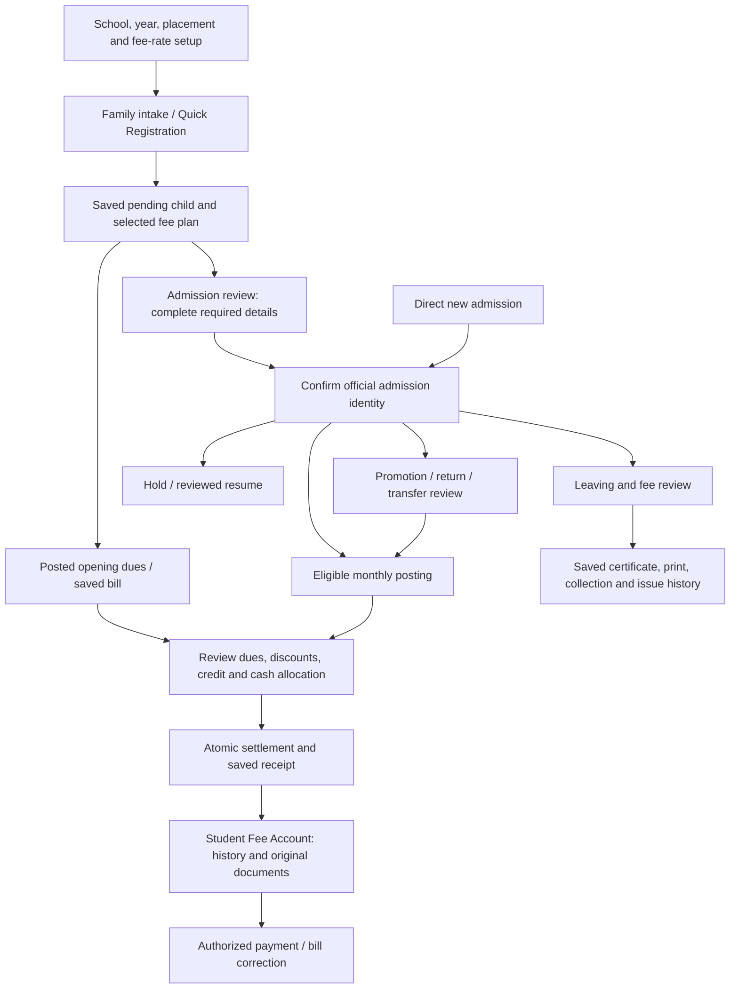

# Admission and fee-flow audit — 28 October 2026

Reviewed source commit: `04ced75`. Live database: `FMSC_DB`, schema **59**.

Follow-up: the owner requested fixes for all six findings. The corresponding C# changes and migration 60 are implemented and validated. Live deployment was rejected by automatic approval review pending explicit approval for migration 60; live schema remains 59. See [fix decisions, regression evidence and deployment status](Decisions/ADMISSION_FEE_FLOW_FIXES.md). Findings below preserve the original audited behavior, rather than describing the corrected build.

## Conclusion

The admission/finance lifecycle has useful separation and transaction/recovery safeguards, but six concrete inconsistencies need attention. Fix the cancellation authorization gap first. No live records or application logic were changed for this audit.

Findings distinguish source-confirmed behavior from actual data incidents. The two UI eligibility discrepancies were reproduced with fictional WinForms controls, without submitting operations. The cancellation-length defect was verified against live column metadata and a read-only SQL calculation. Credit attribution and rejected-admission handling are demonstrated by their call paths; no historical incident or lost money is claimed.

## Scope and evidence

- Retrieved the live inventory and definitions of all 279 procedures; reviewed the relevant procedures and billing/balance functions against their C# callers. Inventorying all definitions is not a claim that every procedure branch was executed.
- Traced family intake, quick registration, direct admission, completion, historical setup, placement/return, fee assignment/concessions, transport, monthly posting, collection, credit, receipts/reprints, adjustments, hold/resume, leaving/certificates, account/report entry points and recovery behavior.
- Surveyed related navigation, school setup, role permissions, help and backup/restore boundaries. Staff operations, communication delivery, fresh installation and actual printer output were not exhaustively executed in this admission/finance review.
- Live access was read-only. No payment, reversal, admission, credit transfer or certificate was created for evidence.
- Existing native checks passed: 30 admission/sibling checks, 5 fee-selection checks, 36 collection/return checks, 30 family-counter checks, 65 account/recovery checks and 55 statement checks: **221 assertions**.
- Two additional fictional-control checks reproduced the main-button cancellation permission discrepancy and pending-registration transport eligibility discrepancy. Their local harness and logs are under ignored `Tests/FlowAuditEvidence` and `artifacts/flow-audit-evidence.log`.
- Application/native-test build passed. The native project emitted NU1900 because NuGet vulnerability information was unavailable. Passing these checks does not invalidate the findings: the existing suite does not cover these exact discrepancies.

## Current lifecycle

Important distinctions to preserve:

- A pending registration can have legitimate posted dues and payments before final admission. Completing it reuses the existing identity/placement; it must not create a second student or opening bill.
- Historical admission and placement dates are different from approved billing commencement. Current admission explicitly documents using today's monthly cutoff; past academic years are history-only. That behavior is intentional, not a backdating defect.
- A family preparation batch saves children individually. Earlier successful children remain saved when a later child fails; the UI explicitly explains this. A family payment, in contrast, uses an enclosing transaction.
- Fees, payments and credit remain attributable to each child. Selecting siblings does not pool ownership of their credit automatically. Overpayment is refused in collection; intentional deposits use Advance Balance.
- A hold stops new posting while retained dues remain payable. A Left student is not silently converted into a hold. The family counter deliberately excludes Left students; ordinary collection/history remains the place for retained liabilities.
- Receipt printing/reprinting follows saved financial documents. Printing failure does not authorize another collection. Certificate cancellation stays retired; Issue Again preserves issue history.
- Automatic monthly posting can apply existing credit. OPERATOR_CONTROL.md explicitly distinguishes that behavior from opting into credit during a particular fee change; this is not a policy contradiction.

## Findings

### F01 — P1: main cancellation button bypasses adjustment permission

**Trigger:** a user has fee viewing/collection access but lacks `Fees.Adjust`, then selects an unpaid posted charge in ordinary Fee Collection.

The context menu checks `Fees.Adjust`, but the prominent Cancel Unpaid Charge button checks only transaction/grid/selection state. ReverseChargeAsync does not recheck adjustment permission, ReverseChargeDialog submits without that check, and the live ReverseBillingCharge procedure requires only `Fees.Collect`. This is a reachable UI path, not just a hypothetical direct SQL call.

Fictional-control reproduction, after raising the normal selection-change event: main cancellation button enabled **True**, context-menu cancellation available **False** for the same cashier. No cancellation was submitted.

**Impact:** a collection-only operator can cancel an uncollected financial obligation despite the adjustment restriction represented elsewhere in the same screen.

**Evidence:** `Pages/Finance/Collection/FeeCollectionPage.cs:560`, `:1261`, `:3955`; `Pages/Finance/Billing/ReverseChargeDialog.cs:116`; live `dbo.ReverseBillingCharge`, also saved in `Migrations/59.sql:1412`.

**Recommendation:** use one cancellation eligibility rule for both UI entry points and the handler. Enforce the approved permission at the SQL write as well; the current UI policy points to requiring adjustment permission in addition to collection access. Review the leaving/reconciliation callers before changing the SQL contract. Add role-matrix tests for collector-only, adjuster-only, full finance access and read-only users. Deliver SQL changes in the next numbered migration.

### F02 — P2: an accepted cancellation reason can fail because the saved note is too narrow

ReverseChargeDialog accepts a 500-character reason. ReverseBillingCharge appends `Charge reversed: ` and existing remarks, then clips to **1,000 characters**. The live BillingCharges.Remarks column is `nvarchar(500)`—its `sys.columns.max_length` is 1,000 **bytes**, not characters.

A read-only calculation confirmed that a 500-character reason with no existing note produces **517 characters**, exceeding the 500-character column. A shorter reason can also fail when the bill already has a long note. No live cancellation was attempted.

**Impact:** otherwise valid cancellation input fails at save time. Current live Open bills had no remarks over 450 characters; that does not remove the accepted-input defect.

**Evidence:** `Pages/Finance/Billing/ReverseChargeDialog.cs:7`; `Migrations/59.sql:1448`; live BillingCharges.Remarks metadata.

**Recommendation:** retain the complete cancellation reason in an appropriate business record or explicitly size the field and combined-note policy to accommodate it. Avoid silently clipping away the newly entered reason. Test an empty existing note plus 500-character reason, and a long existing note plus a short reason.

### F03 — P2: pending-registration transport is offered by C# but refused by SQL

FeeCollectionPage treats Active and Pending placements as eligible transport contexts. Its transport button can be enabled for a pending registration, and the help text says an active or pending placement is supported. Live ManageStudentTransport allows those enrollment statuses but additionally requires `Students.Status = Active`; an ordinary pending registration has Pending in both places.

The fictional-control check reproduced the enabled action for a pending placement. The SQL predicate demonstrates why its preview will refuse that identity. This live dataset currently has no pending students, so no existing affected registration was asserted.

**Impact:** operators are led into a transport dialog that cannot load its review for the advertised pending registration.

**Evidence:** `Pages/Finance/Collection/FeeCollectionPage.FeeActions.cs:77–83`, `:104`; `Migrations/58.sql:70`, verified against live `dbo.ManageStudentTransport`.

**Recommendation:** make an explicit choice about pending transport management. Either support Pending students in SQL with the existing pending-registration safeguards, or disable this action for them and clearly direct operators to the registration fee-plan editor. Keep permission, status, hold and billing-readiness rules shared between presentation and write eligibility.

### F04 — P2: some credit settlements can record the previous operator as the creator

ApplyStudentCredit_Internal accepts an optional actor. When omitted, it chooses CreatedByUserId from the latest credit entry, then uses that value for the new payment and credit movement. PostEnrollmentOpeningCharges omits the actor, including when invoked by ConfirmPromotedAdmission or ReAdmitStudent. ActivateStudentBilling also omits it. Other paths correctly pass the current operator.

**Reproduction by call path:** operator A records a credit deposit; operator B confirms a return that posts eligible dues and consumes the credit. The new credit application can be stored as created by A, even though B initiated the return. Amounts and balances are not changed by this attribution defect.

**Evidence:** live `dbo.ApplyStudentCredit_Internal:11`, `:26–32`; live `dbo.PostEnrollmentOpeningCharges:98`; live `dbo.ConfirmPromotedAdmission:128`; `Migrations/29.sql:103` for activation. These definitions were read into ignored local audit evidence under `artifacts/flow-audit-sql`.

**Recommendation:** pass the authenticated actor explicitly through every posting/activation caller. If an event is intentionally system-generated, record that system identity explicitly instead of borrowing the previous human actor. Test two different operators and retained original deposit ownership.

### F05 — P2: Open Statement unnecessarily requires annual-receipts access

OutstandingAgingReportPage gates its Open Statement action, student lookup and rechecks with `Fees.Statement.View`. PermissionCatalog now defines that code as annual fee receipt access. The destination is Student Fee Account, whose access rule is `Reports.View || Fees.Collect`; its receipt readers additionally require `Fees.View`.

**Impact:** a legitimate fee-report/account operator can view the aging result and open the same student account from Daily Work, but cannot use this contextual shortcut without unrelated annual-receipts permission.

**Evidence:** `Pages/Reports/Finance/OutstandingAgingReportPage.cs:27`, `:80–99`; `Pages/Reports/Finance/StudentAccountStatementPage.Account.cs:30`; `Core/PermissionCatalog.json:58–60`.

**Recommendation:** gate and recheck against the destination's actual access rule, including necessary data-reader permission. Keep annual receipts gated separately. Prefer the caption Open Student Account, matching the actual destination.

### F06 — P2: definite admission refusals can become permanently “unknown” within the editor

AdmissionSaveConfirmation catches every write exception and always reconciles by reading the proposed admission number. If no record exists, ApplyAdmissionConfirmationAsync leaves unconfirmedAdmission set and disables Save. It does not distinguish an explicit pre-transaction validation refusal from a lost commit response.

For example, live AdmitStudent can throw 51019 for a selected fee whose configuration disappeared after the form was loaded; that validation precedes BEGIN TRANSACTION. No admission was written, but the editor can show “outcome unknown,” and Check Saved Admission cannot find a record to confirm. Discarding/restarting the draft is then needed instead of fixing the known problem in place.

**Evidence:** `Core/AdmissionSaveConfirmation.cs:56–67`; `Pages/Students/Admissions/StudentAdmissionPage.cs:2122`, `:4530`; live `dbo.AdmitStudent`, selected-fee validation before BEGIN TRANSACTION.

**Recommendation:** retain a distinct, verified-rejection outcome and re-enable editing when non-commit is established. Keep unknown outcomes blocked and never retry automatically. Do not implement a blanket rule that all SQL application errors mean rollback; use a bounded known-refusal contract or verified transaction/request result. Add tests for a pre-write refusal, a lost reply after commit, and a failed reconciliation read.

## Live data checks

Aggregate checks exposed no student identities. At inspection there were 5,345 Active and 1,248 Left students, zero Pending students and zero open posting holds. Only two Active students had positive posted dues. No account simultaneously had positive credit and unpaid dues. This dataset therefore does not exercise all pending/hold/credit transitions in current records.

| Check | Result |
|---|---:|
| Assignment student differs from enrollment student | 0 |
| Charge student differs from enrollment student | 0 |
| Charge ownership differs from its assignment | 0 |
| Payment allocation/student ownership mismatch | 0 |
| Multiple Active enrollments per student | 0 |
| Inverted fee-plan effective dates | 0 |
| Overlapping noncancelled monthly fee-plan periods | 0 |
| Completed signed allocations exceed a noncancelled bill's net amount | 0 |
| Duplicate noncancelled monthly/annual fee-month groups | 0 |
| Repeated manual fee-month group | 1; separate purchases are permitted, not classified as corruption |
| Charges without an assignment | 0 |

These are selected integrity checks, not a complete reconciliation or accounting certification. No observed corrupted balance is inferred from the source findings above.

## Recommendations beyond bug fixes

1. **Centralize operation eligibility.** Reuse named predicates for admission review, transport, cancellation, return and account access. A top button, context menu, shortcut and SQL procedure should agree. Test each route with deliberately limited permissions; full Administrator tests conceal F01/F05.
2. **Unify recovery presentation.** Quick Registration has a durable request marker; direct admission mainly retains editor state and reconciles by official number. Collection persists an intent but asks an operator to acknowledge manual history review. Extend exact saved-request lookup where practical, while retaining human recovery for genuinely ambiguous historical operations. Never turn an interrupted receipt print into a repeated payment.
3. **Prefer one contextual account workspace.** Collection History and the aging result can open existing financial views while retaining the selected student and a return path. Consolidation should preserve permissions and busy/unsaved guards, not simply delete useful shortcuts.
4. **Explain disabled family actions.** The family counter intentionally blocks a selected Left/unready/dirty child, potentially disabling the whole selected batch. Name the blocking child and next valid action, and let an operator explicitly unselect that child. Do not silently convert Left into Active or Hold.
5. **Distinguish projected plans from actual posting eligibility.** Future Fees is a read-only plan estimate; GetStudentFeeProjection can include a future month with a previously cancelled charge while automatic posting deliberately skips cancelled fees. Add a previously-cancelled/needs-reviewed-reposting indication rather than presenting every estimate as an inevitable bill.
6. **Keep fee history honest after audit retirement.** Existing audit records remain readable, but new generic audit writes have stopped. If a complete future fee-change timeline is required, add a purpose-specific business event record linked to bill/plan/request IDs. Do not restore the broad retired audit system merely to make an old history screen appear complete.
7. **Keep release evidence dated.** Some readiness documents describe schema 21 and a historical release. They should remain historical evidence rather than being presented as acceptance proof for schema 59. Run installation, restore and physical-output acceptance independently when packaging the next release, following the owner-supplied snapshot policy.

## Recommended fix sequence

First fix F01 at both UI and SQL boundaries. Then fix F02 and F03, followed by F04, F05 and F06. Add narrowly targeted regressions for those cases, then rerun the existing admission/collection/account checks. Any SQL change belongs in a numbered migration after 59 and should preserve operational history and request markers. This audit authorizes no live repair, retrospective reattribution or data deletion.
